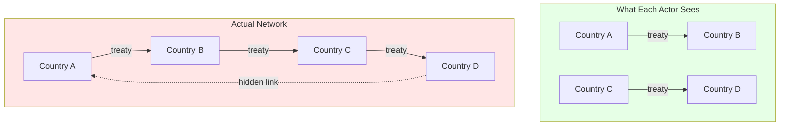
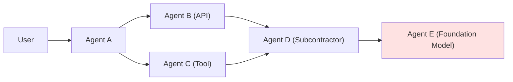

When actors form bilateral commitments without mapping the whole network, local commitments can add up to a global catastrophe. The July Crisis of 1914 is the standard example: each government reasoned about its own treaties, and a regional assassination became a continental war within five weeks.

## The Pattern

**Alliance cascade failure** occurs when:
1. Multiple actors form bilateral relationships (treaties, contracts, dependencies).
2. Each actor reasons about its own relationships, not the network.
3. A trigger activates one relationship, which activates others through hidden connections.
4. The cascade propagates faster than decision-making can respond.

The danger here is not that couplings appear under stress (as in the [2008 correlation spike](/entanglements/research/research-connections/#correlation-under-stress)) but that they were *always present and invisible* to the actors.

---

## World War I, Condensed

By 1914 Europe's powers had a dense web of alliances and understandings: the Franco-Russian alliance and Britain's ententes with France and Russia on one side, and on the other the Triple Alliance of Germany, Austria-Hungary and Italy (which stayed neutral in 1914), all tangled around Serbia and the Balkans. Each foreign ministry reasoned mainly about its own bilateral edges: "We have a treaty with X; X backs us if Y attacks; this deters Y." No one modeled what happened system-wide if one edge activated.

Three kinds of **hidden coupling** bound the network far tighter than the formal treaties implied:

- **Mobilization schedules.** The Schlieffen Plan required Germany to attack France *before* Russia could fully mobilize. So: Russia mobilizes → Germany must mobilize → Germany attacks through Belgium (the only plan it had) → Britain enters (Belgian neutrality). The *speed* of the cascade was hardcoded into war plans.
- **Secret clauses and implicit commitments.** Unpublished treaty provisions, British–French staff talks, and naval agreements meant no power fully knew what the others had promised.
- **Irreversibility.** Once mobilization began, the general staffs treated it as impossible to halt, so there was no decision point left to pull.

The cascade ran in **five weeks**: assassination (June 28) → Austrian ultimatum → Austria declares war on Serbia (July 28) → Russia mobilizes → Germany declares war on Russia (Aug 1) and France (Aug 3) → invades Belgium → Britain declares war (Aug 4).

How inevitable the cascade was is disputed. Fritz Fischer's school stressed German war aims; Clark's *The Sleepwalkers* (2012) stresses contingency and shared misjudgment. On either reading, the governments' bilateral view understated how tightly the mobilization schedules coupled their choices. An earlier version of this page quantified the understatement as "roughly 20×"; that figure was invented and has been removed.

---

## Lessons for AI Delegation

An alliance is a form of delegation: "when X happens, I commit to Y," which entangles your response with your ally's. The same failure appears when an agent delegates to another agent that delegates onward—your delegation risk depends on couplings several hops out that you never mapped.

Modern analogues include 2008 financial contagion, supply chains coupled through shared lower-tier suppliers, and AI agent networks in which each agent knows only its immediate dependencies while a fault in a shared model or tool propagates through the whole graph in minutes.

Design implications:
- **Map the network, not your edges.** Ask what happens two or three hops out; build the full dependency graph and test failure correlation ("if Provider A fails, who else fails?").
- **Watch the mobilization schedule.** The most dangerous cascades have automatic triggers, speed asymmetry (cascade faster than deliberation), and irreversibility.
- **Build circuit breakers.** Never deploy a system whose cascade speed exceeds human decision-making without explicit interrupts: fallback models, conditional rather than automatic commitments, and mandatory deliberation points.
- **Reserve larger margins for unmapped dependencies.** Standard [risk budgeting](/research/risk-methods/financial-risk-budgeting/) assumes you know the covariance structure; alliance cascades violate exactly that assumption.

---

## See Also

- [Research Connections](/entanglements/research/research-connections/) — Common-cause failure and the 2008 parallel
- [Channel Integrity Patterns](/design-patterns/channel-integrity/) — Preventing unauthorized coordination
- [Detecting Influence](/entanglements/detection/detecting-influence/#hidden-coordination) — Hidden coordination between components
- [Exposure Cascade](/delegation-risk/exposure-cascade/) — How risk flows through hierarchies

## Further Reading

- Clark, Christopher. *The Sleepwalkers: How Europe Went to War in 1914* (2012)
- Fischer, Fritz. *Germany's Aims in the First World War* (1961)
- Tuchman, Barbara. *The Guns of August* (1962)
- Haldane, Andrew. "Rethinking the Financial Network" (2009) — 2008 as network failure
- Taleb, Nassim. *The Black Swan* (2007) — Hidden dependencies and fat tails
