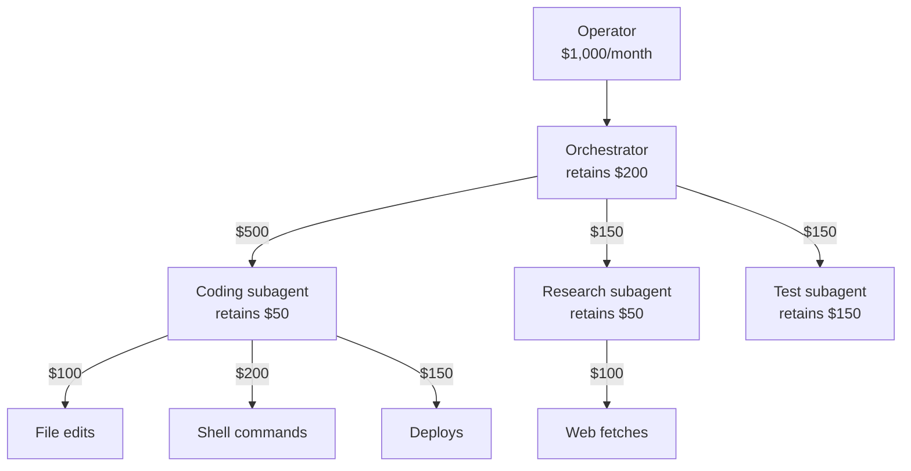

:::note[Vocabulary]
The budgets on this page are **risk budgets**: caps on delegation risk, the expected loss Σ P(harm) × Damage. They are not caps on exposure, the worst case. See the [Glossary](/getting-started/glossary/#delegation-risk).
:::

An operator who sets a risk budget for an agent deployment has to decide where in the deployment that budget may be spent. Agent systems are trees: an orchestrator delegates to subagents, and each subagent acts through tool calls. This page is about dividing the budget down such a tree.

## The rule is additive

At each node:

$$\text{budget received} = \text{budget retained} + \sum \text{budgets delegated}$$

The *retained* part covers actions the node takes itself. The rest goes to its children. Nothing multiplies, and nothing is lost on the way down.

Addition is the right rule because expected losses add, whatever the correlation between them, by linearity of expectation. If every node keeps its actual delegation risk within its allocation, the whole tree stays within the root budget. Where two nodes' harm modes hit the same asset, the sum overstates the true expected loss, so the check is conservative. Correlation does not change the expected-loss total. It changes the *tail*, such as the chance that several nodes have a bad month together, and it matters for stacked checks where every layer must miss. Those are handled by [Risk Propagation](/delegation-risk/risk-propagation/) and by consolidation in [Runtime Accounting](/delegation-risk/runtime-accounting/#3-the-exposure-ledger), not by the budget split.

## An example tree

:::caution[Illustrative numbers]
The allocations are invented to show the bookkeeping.
:::

An operator gives a coding-agent deployment a risk budget of \$1,000 per month.

| Node | Receives | Retains | Delegates |
|---|---|---|---|
| Orchestrator | \$1,000 | \$200 (decomposing tasks, granting permissions) | \$800 to three subagents |
| Coding subagent | \$500 | \$50 (planning) | \$450 to file edits, shell commands and deploys |
| Research subagent | \$150 | \$50 | \$100 to web fetches |
| Test subagent | \$150 | \$150 (runs the suite itself) | nothing |

The retained amounts and leaf allocations sum to \$1,000. Each allocation should come from the node's harm table. The research subagent's web fetches, for instance, are its [hijack](/delegation-risk/risk-decomposition/) surface, because fetched pages can carry injected instructions.

## Allocating is a judgment; attributing is not

Two questions are easy to confuse.

**Attribution** asks how much of the system's measured expected loss each node is responsible for. For expected loss the answer is unambiguous: each node's own expected loss. The Euler allocation principle used in finance ([Tasche 2008](https://arxiv.org/abs/0708.2542)) and the Shapley value both reduce to this when the risk measure is additive. They give different, non-trivial answers only for non-additive measures, such as tail measures, where correlation creates interaction between nodes.

**Allocation** asks how much each node is *allowed* to spend. No formula settles it. It is a decision about where you want expected loss to be incurred: which node should hold permission to deploy, how much autonomy the research subagent's web access deserves. The split above is judgmental, and should be labeled as such.

## Tightening moves budget; it does not remove risk

Suppose the operator moves deploys out of the coding subagent and makes them an orchestrator action gated by human approval. The \$150 deploy allocation moves up the tree. The root budget is still \$1,000, so on paper nothing has changed.

The realized risk changes only if the new decider is better at the decision. If the human reviewer catches bad deploys the subagent would have shipped, the deploy row's expected loss falls, and the operator can then *lower* the root budget. If the reviewer rubber-stamps, the risk has only been relabeled. Tightening oversight is worth what the new decider's measured catch rate is worth, minus the throughput it costs.

## Keeping the tree honest

Allocations are plans. The [exposure ledger](/delegation-risk/runtime-accounting/#3-the-exposure-ledger) records what each node actually spends, measured by the harness rather than reported by the agent. When a node runs over its allocation mid-task, a margin call pauses it, escalates or unwinds. Periodic reconciliation against incidents corrects the harm tables the allocations came from.

The same arithmetic applies to human organizations. A board's tolerance divides among executives, managers and staff, and how much each level retains is equally a judgment about where decisions should sit.

## See also

- [Runtime Accounting](/delegation-risk/runtime-accounting/): preflight, envelope and ledger
- [Delegation Accounting](/delegation-risk/delegation-accounting/): the balance-sheet view of one delegation
- [Risk Propagation](/delegation-risk/risk-propagation/): composition through chains and stacks of checks
