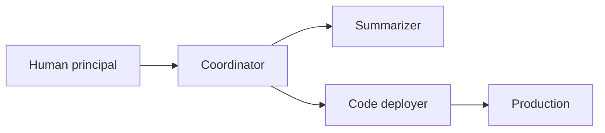

Delegating a task, to an employee, a contractor or an AI agent, creates ways for it to go wrong. This section puts a number on them. The core quantity is an expected loss in dollars:

$$\text{Delegation Risk} = \sum_{\text{harm modes}} P(\text{harm mode}) \times \text{Damage}(\text{harm mode})$$

Three terms keep the inputs apart (definitions in the [Glossary](/getting-started/glossary/#exposure)):

- The **harm surface** is the set of harm modes. You enumerate it.
- **Exposure** is the worst-case loss across that set, given what the delegate can actually reach. It is a bound.
- **Delegation risk** is the expectation above. A **risk budget** caps it.

Every probability is per something. On this page, probabilities are per month at stated task volumes, so delegation risk is in dollars per month.

## A worked example

:::caution[Illustrative numbers]
The probabilities, damages and catch rates below are invented to show the mechanics. Nothing about real systems follows from them.
:::

A research assistant has three components. A **coordinator** routes about 2,000 tasks a month and grants tool permissions to the other two. A **summarizer** reads about 1,500 external papers a month. A **code deployer** ships about 40 changes a month to a production service.

### Step 1: the harm table

Each row is a harm mode, tagged with its [channel](/delegation-risk/risk-decomposition/). An *accident* is a failure at the task. *Defection* is the delegate pursuing something else, including reward hacking. A *hijack* is a third party steering a delegate that is not itself scheming.

| Component | Harm mode | Channel | P per month | Damage | Risk per month |
|---|---|---|---|---|---|
| Coordinator | Misroutes a task | Accident | 0.01 | \$2,000 | \$20 |
| Coordinator | Grants excessive permissions by mistake | Accident | 0.003 | \$100,000 | \$300 |
| Coordinator | Grants excessive permissions deliberately | Defection | 0.002 | \$100,000 | \$200 |
| Summarizer | Misrepresents a paper's findings | Accident | 0.02 | \$5,000 | \$100 |
| Summarizer | Follows instructions injected into a paper and leaks proprietary data | Hijack | 0.002 | \$50,000 | \$100 |
| Code deployer | Ships buggy code | Accident | 0.05 | \$20,000 | \$1,000 |
| Code deployer | Special-cases or edits tests so a broken change passes | Defection (reward hacking) | 0.01 | \$20,000 | \$200 |
| Code deployer | Inserts deliberately malicious code | Defection (scheming) | 0.0001 | \$1,000,000 | \$100 |

By component, the coordinator carries \$520, the summarizer \$200 and the code deployer \$1,300. **The total is \$2,020 per month.**

The rows add whatever the correlation between them, by linearity of expectation. Where two rows can destroy the same asset, the sum overstates the true expected loss, so it is a conservative upper bound.

### Step 2: compare with the budget

Suppose the operator's risk budget is \$1,500 per month. The system is \$520 over, and the code deployer carries 64% of the total. There are three kinds of fix:

- Lower the probabilities, for example with a check before deployment.
- Lower the damage, by narrowing what a deployment can touch.
- Hand the decision to a human. This replaces the deployer's error rate with the human's; it does not remove the risk.

### Step 3: add a verifier

Put a deployment verifier between the deployer and production. It sits at tiers 1 and 2 of the [verifiability hierarchy](/getting-started/core-concepts/#verifiability-hierarchy). It runs the test suite and static analysis. It requires human sign-off on any change to tests or CI configuration. A policy engine blocks changes outside an allow-list of paths and permissions. Assume it catches 70% of buggy changes, 90% of test tampering and 90% of malicious changes.

| Harm mode | Before | Catch rate (assumed) | After |
|---|---|---|---|
| Ships buggy code | \$1,000 | 70% | \$300 |
| Special-cases or edits tests | \$200 | 90% | \$20 |
| Inserts malicious code | \$100 | 90% | \$10 |

The code deployer falls to \$330, and the system to **\$1,050 per month**, under budget.

The arithmetic hides three things:

- **The malicious-code catch rate is the weakest number.** An attacker who knows the policy engine's rules aims at what they do not cover. A catch rate measured on ordinary changes does not transfer to deliberate ones. For that row you need a control evaluation, in which a red team plays the attacker ([Greenblatt et al. 2023](https://arxiv.org/abs/2312.06942); see [adversarial inputs](/delegation-risk/risk-propagation/#adversarial-inputs)).
- **The verifier does nothing about the hijack row.** The summarizer reads untrusted text, can see private data and can send data out. Removing the outbound path shrinks the exposure itself, which no catch rate does.
- **Expected loss hides the tail.** The \$100 malicious-code row is a one-in-10,000 chance of a \$1 million loss. An expected-loss budget treats it like a certain \$100 loss. A hard limit on what any single action can do handles this case better ([when expected loss is the wrong metric](/getting-started/core-concepts/#when-expected-loss-is-the-wrong-metric); [the exposure envelope](/delegation-risk/runtime-accounting/#2-the-exposure-envelope)).

### Quantitative trust

Earlier versions of this example put "trust" weights on the diagram's arrows without defining them. Where this site attaches a number to trust, it means t = P(the delegate executes a task faithfully), read off the harm table as one minus the probability of any harm mode per task. For the code deployer before the verifier, that is about 1 − 0.06/40 ≈ 0.9985 per deployment. Links of this kind compose through chains by the [propagation rule](/delegation-risk/risk-propagation/).

## Pages in this section

| Page | Question |
|---|---|
| [A Walk-Through](/delegation-risk/walkthrough/) | How do harm surface, exposure and delegation risk work on one simple delegation? |
| [Risk Decomposition](/delegation-risk/risk-decomposition/) | Does each harm mode come through accident, defection or hijack, and why does it matter? |
| [Risk Propagation](/delegation-risk/risk-propagation/) | How do reliabilities compose through chains and stacks of checks, and what does correlation do? |
| [Runtime Risk Accounting](/delegation-risk/runtime-accounting/) | How would an agent harness preflight, bound and book risk as it runs? |
| [Delegation Accounting](/delegation-risk/delegation-accounting/) | What does a delegation look like on a balance sheet, and why does exposure depend on capability? |
| [The Insurer's Dilemma](/delegation-risk/insurers-dilemma/) | What can insurance price, and where does transferring risk stop working? |
| [Exposure Cascade](/delegation-risk/exposure-cascade/) | How does a risk budget divide down an orchestrator, its subagents and their tool calls? |

[Concepts](/getting-started/core-concepts/) has the reference statement of the formula and its units. [Entanglements](/entanglements/) covers what happens when the components in a table like this one fail together.
