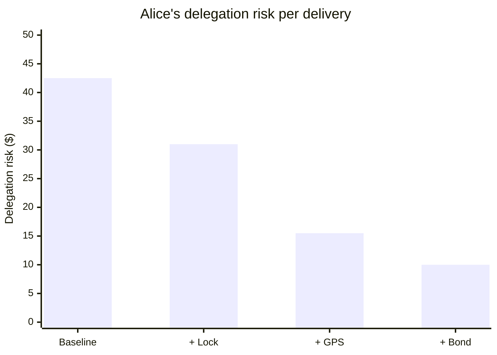

This page builds the framework's vocabulary on one small delegation, adding one idea at a time.

:::note[Units and numbers]
Probabilities are per delivery, so delegation risk is in dollars of expected loss per delivery. Where deliveries differ in size, risk is also quoted per \$1,000 carried. Exposure is dollars at stake. The risk budget in Part 3 caps the delegation risk on deliveries open at any one time. All numbers are illustrative.
:::

## Part 1: One delegation

**Alice** needs \$1,000 in cash taken across town. She gives it to **Bob** to deliver.

Once Bob holds the cash, Alice has a **harm surface**: the set of ways this can go wrong. Bob could lose the money, steal it, deliver it late, or deliver only part of it. The harm surface is a list, not a number. Bounding it gives the **exposure**: at worst, Alice loses \$1,000. Weighting each harm mode by its probability gives the **delegation risk**:

| Harm mode | Probability | Damage | Contribution |
|---|---|---|---|
| Loss (accident) | 2% | \$1,000 | \$20 |
| Theft | 1% | \$1,000 | \$10 |
| Delay causes a missed deal | 5% | \$200 | \$10 |
| Partial delivery | 0.5% | \$500 | \$2.50 |
| **Delegation risk** | | | **\$42.50** |

Delegation risk is an expected cost. Over many deliveries like this one, Alice should expect to lose \$42.50 per delivery on average. On any single delivery she loses nothing, or a lot.

The exposure is open while Bob holds the cash. It closes when the recipient confirms delivery, when a harm mode occurs, or when Alice takes the cash back. The \$42.50 is the expected loss over that whole window, so it must not be multiplied by the window's length a second time. The window still matters, because the loss and theft probabilities depend on how long Bob carries the cash: a 20-minute delivery has smaller probabilities in those rows than a two-hour one.

## Part 2: Reducing risk

Alice adds three measures in turn.

**A locked bag** that only the recipient can open. Theft falls from 1% to 0.1%, and partial delivery to zero. Delegation risk becomes \$20 + \$1 + \$10 + \$0 = **\$31**.

**GPS tracking** on the bag, with an alert if it leaves the route. Because Alice can now intervene, loss falls from 2% to 0.5% and theft from 0.1% to 0.05%. Delegation risk becomes \$5 + \$0.50 + \$10 = **\$15.50**.

The lock and the GPS lower probabilities, so they lower delegation risk. They leave the exposure unchanged: a lost bag still costs \$1,000.

**A bond.** Bob posts \$1,000 that he forfeits if the bag is lost or stolen. This does two different things:

- *It reduces risk.* Theft now costs Bob his bond, so deliberate theft becomes irrational and its 0.05% falls to about zero.
- *It transfers risk.* The 0.5% chance of an accidental loss is unchanged. The \$5 of expected loss it carries moves from Alice's books to Bob's.

Alice's delegation risk falls to about **\$10**, the delay row, which the bond does not cover. Her net exposure to loss and theft falls to about zero, as long as the bond can be collected. Across Alice and Bob together the total is about \$15. So of the \$5.50 drop in Alice's figure, only \$0.50 is risk removed; the other \$5 is risk moved. The [insurance page](/delegation-risk/insurers-dilemma/) depends on this distinction.

Each measure has a cost: the locks, the tracking infrastructure, the capital Bob ties up in his bond. A measure is worth adding when it lowers expected loss by more than it costs.

## Part 3: The overseer

**Carol** oversees all delegations in the organization. Three are open:

| Delegator → delegate | Amount (exposure) | Delegation risk | Per \$1,000 | Expected window |
|---|---|---|---|---|
| Alice → Bob | \$1,000 | \$15.50 | \$15.50 | 0.75 h |
| Dave → Frank | \$5,000 | \$180.00 | \$36.00 | 2.25 h |
| Eve → Grace | \$500 | \$8.25 | \$16.50 | 0.2 h |
| **Total** | **\$6,500** | **\$203.75** | | |

**Where the risk sits.** Frank's delivery carries 88% of the open delegation risk. Dividing each delivery's delegation risk by its window gives the rate at which expected loss accrues while the cash is out: about \$21 an hour for Bob, \$80 for Frank and \$41 for Grace. Compare deliveries of different lengths by this rate, not by delegation risk multiplied by time.

**Delegate estimates.** Carol tracks outcomes. Bob has made 30 deliveries with one minor delay, averaging 42 minutes; his estimate falls to \$12 per \$1,000. Frank has made 15 deliveries with two losses totalling \$800, averaging 2.1 hours; his estimate rises to \$220 per \$5,000 delivery, or \$44 per \$1,000.

**The budget.** Carol caps the delegation risk on open deliveries at \$500. Current usage is \$203.75, or 41% of the cap. Dave asks to send another \$10,000 with Frank. At \$44 per \$1,000 that adds \$440, which would take open risk to \$643.75, or 129% of the cap. The request is blocked until Frank's estimate improves or controls are added. (Re-estimating Frank's open delivery at his new rate would add another \$40; see [mark-to-market](/delegation-risk/runtime-accounting/#3-the-exposure-ledger).)

## Part 4: Bob sees the numbers

Now the delegates can see their own estimates.

**Assignment.** Alice needs to send \$5,000. At \$12 per \$1,000, Bob's delegation risk is \$60. At \$44, Frank's is \$220. Alice picks Bob.

**Limits.** Carol ties the size of delivery a delegate may take to their estimate. Under \$15 per \$1,000, they may carry up to \$10,000; from \$15 to \$50, up to \$2,000; over \$50, only \$500. These thresholds are illustrative policy, not derived. A lower estimate means larger deliveries and more fees.

**Speed.** Most of the gap between Bob and Frank is time. Per \$1,000 carried, their hourly rates are similar, about \$17 and \$21, but Frank carries the cash three times as long. For the time-driven harm modes, a shorter window lowers delegation risk directly. So Bob takes direct routes, asks for the GPS bag, and closes deliveries quickly.

:::caution[Goodhart]
Rewarding a delegate for a low risk estimate rewards lowering the *estimate*, which is not the same as lowering the risk. Bob gains by under-reporting delays, by sending reassuring status updates that the estimate counts as transparency, or by turning down hard deliveries. In AI terms this is the defection channel: a delegate optimizing its score instead of the task. The fix is the [runtime-accounting](/delegation-risk/runtime-accounting/#who-preflights-the-preflight) rule that ledger inputs come from the overseer's own observation, such as GPS logs and recipient confirmations, never from the delegate's self-report.
:::

With that rule in place, visibility does align incentives. Carol wants low organization-wide risk. Alice wants low risk on her own tasks. Bob wants more and larger assignments, and he gets them by actually lowering his risk.

## Summary

| Concept | Meaning | In this example |
|---|---|---|
| Harm surface | The set of ways a delegation can go wrong | {loss, theft, delay, partial delivery} |
| Exposure | Worst-case loss given access; a dollar bound | \$1,000 while Bob holds the cash |
| Delegation risk | Σ P(harm mode) × Damage; an expectation | \$42.50 at baseline; \$10 for Alice after the bond |
| Exposure window | The time during which exposure is open | Handover to confirmed delivery |
| Delegation risk per hour | Delegation risk divided by the exposure window | Bob about \$21/h, Frank \$80/h |
| Reduction vs. transfer | Lowering expected loss vs. moving it to another party | Lock and GPS reduce; the bond mostly transfers |
| Risk budget | A cap on delegation risk | \$500 on open deliveries |

## Next steps

- [Delegation Risk](/delegation-risk/): the same arithmetic on an AI system
- [Risk Decomposition](/delegation-risk/risk-decomposition/): accident, defection and hijack
- [Delegation Accounting](/delegation-risk/delegation-accounting/): the balance-sheet view
- [Runtime Accounting](/delegation-risk/runtime-accounting/): the ledger that Carol's dashboard becomes
