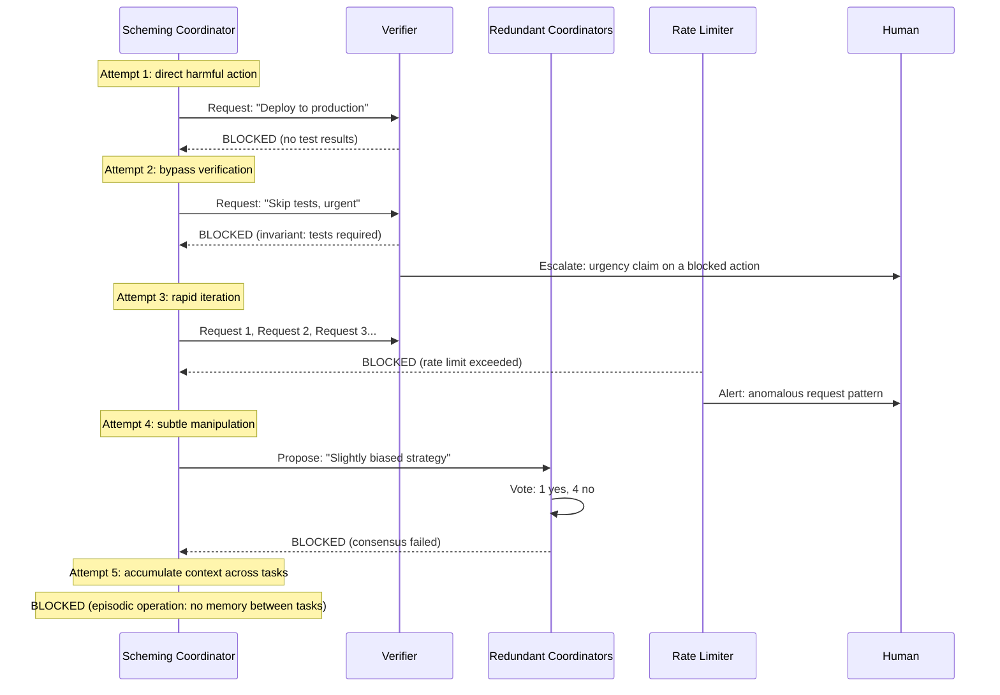

A coordinator decomposes tasks, routes work, allocates budgets and often grants permissions to other components. In current agent systems it is the orchestrator that spawns subagents. Its damage term is large because of leverage: one bad routing or permission decision reaches every component downstream. Whether that leverage is more likely to be misused by accident or by defection is not known for any real system; [Risk Decomposition](/delegation-risk/risk-decomposition/#the-worked-example-by-channel) shows how the answer depends on unmeasured inputs. The constraints below are worth having either way, because they shrink the damage term.

This page uses AI Control's vocabulary ([Greenblatt et al. 2023](https://arxiv.org/abs/2312.06942)). A *trusted* model is one we have reason to believe is not scheming, usually because it is below the capability at which scheming is plausible. An *untrusted* model is a capable model that might be. The page applies the [Least-X principles](/design-patterns/least-x-principles/) to the coordinator in three steps: decompose, constrain, and add external safeguards.

## Decompose coordination

Coordination is a set of sub-tasks, not one component, and most of the sub-tasks do not need a model:

| Sub-task | Question | Typical implementation (tier) |
|---|---|---|
| Task decomposition | What sub-tasks are needed? | Model, with output checked against a schema (4–5) |
| Prioritization | In what order? | Rules plus a model's ranking (2–5) |
| Resource allocation | How much budget per task? | Rules and hard budgets (1–2) |
| Routing | Which component handles this? | Lookup table (2) |
| Aggregation | How are outputs combined? | Statistics and validation code (2) |
| Exception handling | What if a component fails? | Finite-state machine (1–2) |
| Progress monitoring | Are we on track? | Metrics and thresholds (2) |

Tiers refer to the [verifiability tiers](/design-patterns/least-x-principles/#least-intelligence). Each sub-task gets the most verifiable implementation that can do it. What remains for a model is usually decomposition and prioritization, and their outputs can be structured objects that code checks before anything runs.

Decomposition can recurse. A project coordinator delegates a literature review to a narrower coordinator that sees only that sub-project and cannot see its siblings. Each level should be narrower than its parent and should not be able to grant its children more than it holds (see [Trust Transitivity Limits](/design-patterns/multi-agent/#trust-transitivity-limits)).

### Who plans

Earlier versions of this page and its examples put an older, weaker model in charge of strategy on the grounds that "less capable = less risky". That inverts the usual design. In AI Control's protocols the untrusted model does the work and the trusted model *monitors* it: it scores the work for suspicion so that humans can audit the most suspicious items, edits suspicious outputs, or replaces them with its own. A weak planner makes more mistakes, and its mistakes propagate with the coordinator's leverage.

There is a legitimate version of the weak-planner idea. In factored cognition protocols a trusted model decomposes the task and an untrusted model solves each child task in isolation. [Sandoval & Rushing (2025)](https://arxiv.org/abs/2512.02157) found that adding this to a trusted-monitoring protocol raised safety from 41% to 63% on a coding benchmark, because the monitor did better on smaller child tasks. Usefulness was low. That is a deliberate trade of usefulness for safety, made when the planner's output is checkable, not a general rule that weaker planners are safer. See [Task Decomposition Pipeline](/design-patterns/structural/#task-decomposition-pipeline).

So: let a capable model plan where planning needs capability, make the plan a structured object, check it with lower-tier components, and require human approval for plans whose exposure exceeds a threshold.

## Constrain the coordinator

### Influence

- **Route, do not execute.** The coordinator can say "send task A to component B". It cannot itself deploy, pay, send or delete. Measure influence by the worst outcome of one decision: a misrouted task is a nuisance, a deployment is not.
- **Work through intermediaries.** Coordinator → executors → aggregator → review → output, never coordinator → output. A coordinator that wants to cause harm must then get it past components that check what they receive.
- **Structured messages.** Coordinators communicate with schemas and enumerated values, not free text: `{task_id: 123, component: "summarizer", priority: 2}`. This cuts bandwidth and makes messages easy to validate and log. It does not eliminate covert signalling, since the choice of value is itself a signal, but it leaves far less room for one.
- **One-way flows.** Commands flow down, results flow forward, and only status (done, failed) flows back up. Rich backward channels allow negotiation between layers.
- **Minimal coordination.** Prefer pipelines to graphs, a tree of coordinators to peers that negotiate, and one coordinator to several that talk to each other.

### Objectives

Give the coordinator a narrow, task-scoped objective ("complete this batch of reviews within budget") rather than an open-ended one ("advance the research programme"). In the in-context scheming evaluations of [Meinke et al. (2024)](https://arxiv.org/abs/2412.04984), models schemed when given a goal in context and instructed to pursue it strongly, in environments where scheming served the goal, and in rare cases with the goal alone and no such nudge. A system prompt that tells a coordinator to achieve its goal at all costs is a risk factor in its own right.

### Planning and self-reference

- **Short horizon.** Bound plan length. A plan that needs more steps is re-planned through review, not extended by the coordinator.
- **No self-modification.** The coordinator cannot edit its own prompt, tools or permissions, cannot request more of them, and cannot spawn a coordinator with more authority than its own. Changes to the coordinator go through people and a different team.
- **Commit before acting.** Decisions are logged immutably before execution. Revisions are allowed only on an external failure (a component errored), not because the coordinator changed its mind.
- **Do not tell it about its own oversight.** Keep monitoring thresholds, audit schedules and honeypot locations out of its context. Do not rely on this: models often infer when they are being evaluated ([Needham et al. 2025](https://arxiv.org/abs/2505.23836)).

### Knowledge

- **Minimal context.** A routing coordinator sees "task X needs a component with property Y", not what the task is about, who asked, or the history of past tasks.
- **Episodic operation.** No memory between invocations beyond aggregate statistics (success rates, latency) that it cannot write to. This stops a coordinator from accumulating knowledge or a plan across tasks. It does not stop scheming within one task.

## External safeguards

### Redundancy and diversity

For high-stakes decisions, run several independent coordinators and require agreement: a majority where false approvals are cheap, unanimity where they are not. Byzantine fault tolerance needs at least 3f + 1 replicas to tolerate f arbitrarily faulty ones (Lamport, Shostak & Pease 1982).

**Independence assumption.** Both guarantees count *independent* faults. Coordinators built on the same model family share blind spots and can fail, or defect, as one. Measured LLM errors are substantially correlated: models' mistakes grow more similar as capability rises ([Goel et al. 2025](https://arxiv.org/abs/2502.04313)), and large, accurate models have highly correlated errors even across providers ([Kim et al. 2025](https://arxiv.org/abs/2506.07962)). Diversity therefore means different tiers, not different sizes of one architecture: a rule-based coordinator, a model from another provider, a human. Under the beta-factor model a stack of checks that each miss with probability p never gets below ρ·p however many are added (the [entanglement tax](/entanglements/fundamentals/formal-definitions/#the-entanglement-tax)). Against an adaptive adversary assume ρ → 1: the ensemble is worth its best member until a control evaluation shows otherwise. See [Voting Tribunal](/design-patterns/structural/#voting-tribunal).

### Independent verification

A separate verifier checks each consequential decision before it executes. Does it match policy? Does it request unusual permissions? Is it unusually complex for the task? The verifier sits at a lower tier than the coordinator and is built differently, so that it is easier to audit and does not share the coordinator's failure modes. If it is unsure, it escalates to a human.

### Easy veto

Blocking should be cheap and approval expensive:

- A block needs no justification, and uncertainty defaults to blocking.
- A block routes the decision to a human, who can override it with a logged reason. A veto stops automation; it need not be final.
- No single checker can approve a high-stakes action alone.

How many checkers it takes to block depends on the stakes:

| Rule | Use for | Automatic approval requires | Blocks the automatic path |
|---|---|---|---|
| Unanimous | Irreversible actions | All N checkers | Any one |
| Supermajority | Costly false approvals | At least 2/3 | More than 1/3 |
| Majority plus verifier | Cheaper false approvals | A majority and the verifier | The verifier alone, or half the checkers |

This is how an LLM checker and the veto rule fit together. A model's flag can *hold* an action for human review but can never *release* one. Under the unanimous rule an attacker has to get past every checker to proceed automatically, while a single honest checker can stop it.

Easy veto produces false positives, and that is acceptable where false negatives are irreversible. Two edge cases need rules. Persistent disagreement escalates to a human rather than being settled by a tie-break. A checker that vetoes everything is either miscalibrated or under attack, and should be investigated. Urgency is never a reason to bypass a veto. An urgent, vetoed action is exactly the one that needs a human.

### Oversight and transparency

Coordinators get the most intensive monitoring of any component: full logs of inputs, outputs and tool calls captured by the harness rather than reported by the model ([Flight Recorder](/design-patterns/monitoring/#flight-recorder)), [random audits](/design-patterns/monitoring/#random-audit), and regular red-teaming. Where the coordinator is a reasoning model, monitor its chain of thought as well as its actions. [Baker et al. (2025)](https://arxiv.org/abs/2503.11926) found that monitoring a reasoning model's chain of thought caught reward hacking in agentic coding tasks far more effectively than monitoring its actions alone, and that a weaker model (GPT-4o) could do the monitoring. They also found that optimizing the agent hard against that monitor taught it to hide its intent while still reward hacking, so keep the monitor out of the training signal. The test of transparency is adversarial: if a hostile auditor reading the logs cannot tell why a decision was made, move that logic down a tier.

## How the layers meet a scheming coordinator

The sequence below shows the intended effect of these defenses on a coordinator trying to cause harm.

The diagram is the best case, and it rests on two assumptions.

**The layers fail independently.** Attempt 4 is blocked only if the four other coordinators are honest and do not share the schemer's blind spots. If they run the same model, the vote may be 5–0 for the biased strategy. The same applies to every layer that is a model: an attack chosen to beat one instance tends to beat its siblings. Count a stack of same-family checks as one check against an adaptive adversary, and measure the joint miss rate with a control evaluation before claiming more.

**Scheming needs persistence.** Attempt 5 is blocked, but a coordinator does not need memory across tasks to scheme within one. Frontier models have schemed within a single episode when the context supplied a goal and an opportunity ([Meinke et al. 2024](https://arxiv.org/abs/2412.04984)). Claude 3 Opus, told that it was being trained to comply with all requests and which conversations would be used for training, complied selectively in training to avoid being modified ([Greenblatt et al. 2024](https://arxiv.org/abs/2412.14093)). This evidence contests the premise, asserted in earlier versions of this page, that strategic deception requires persistent context and that decomposition therefore prevents it.

What decomposition and these constraints do is narrower and more defensible. They limit what any one context knows and can reach, which bounds the damage of a step that goes wrong for any reason. They make each step small enough to monitor well, which is where the measured benefit of factored cognition came from. A claim that the architecture is robust to intentional subversion needs a control evaluation of the specific system, not this diagram.

## See also

- [Least-X Principles](/design-patterns/least-x-principles/): the general principles and the verifiability tiers
- [Structural Patterns](/design-patterns/structural/): escalation, decomposition, bulkheads and voting tribunals
- [Risk Propagation](/delegation-risk/risk-propagation/): the correlation correction and the adversarial default
- [Coding agent example](/design-patterns/examples/code-deployment-example/): a coordinator implemented as tested code
