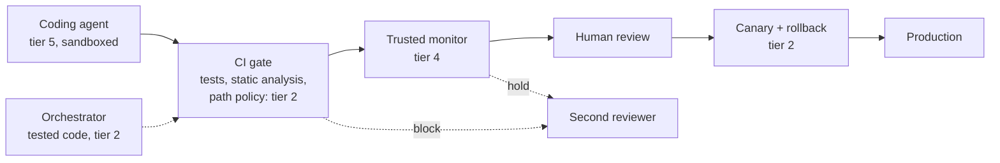

:::caution[Illustrative numbers]
Every probability, damage, miss rate and correlation on this page is invented to show the method. The ranges are judgments, not measurements; each row says where a real number would come from. Nothing about real coding agents follows from them.
:::

A coding agent writes changes to a production web service, about **200 merged pull requests a month**. Volume is the one input the operator measures rather than estimates. Everything else is a per-change probability or a damage, multiplied by volume to give a monthly figure.

## The design

Each part is a pattern from the catalog, at a stated [verifiability tier](/design-patterns/least-x-principles/#least-intelligence):

- **The agent** is an untrusted frontier model (tier 5). It works in a container behind an [Exposure-Envelope Gateway](/design-patterns/structural/#exposure-envelope-gateway). It can push to a branch and run tests. It cannot merge or deploy, it holds only a repository-scoped token, and its network egress is limited to the package mirror and the code host. Each session gets its own container and credentials ([Bulkhead Isolation](/design-patterns/structural/#bulkhead-isolation)).
- **The orchestrator** that sequences the pipeline is tested code (tier 2) with no model in it: "all checks passed and the required humans approved" is fully specifiable.
- **The CI gate** (tier 2) runs the test suite, a set of held-out tests that the agent can neither see nor edit, static analysis and a dependency allow-list. A path policy sends any change to tests, CI configuration, deployment scripts, authentication or payment code to a named owner.
- **A trusted monitor** (tier 4), a smaller model from a different provider, reads each diff and the agent's action log and scores it for suspicion ([Trusted Monitor](/design-patterns/monitoring/#trusted-monitor)). The log is captured by the harness, not reported by the agent ([Flight Recorder](/design-patterns/monitoring/#flight-recorder)).
- **A human reviewer** approves every merge and sees the raw diff, not the agent's summary of it.
- **The canary** (tier 2) sends a new version 5% of traffic, compares error rate and latency against fixed thresholds, and rolls back automatically ([Checkpoint-Rollback](/design-patterns/recovery/#checkpoint-rollback)).

### Who can block and who can approve

The rules follow [Easy Veto](/design-patterns/coordinator-constraints/#easy-veto):

- Any check (CI gate, monitor or canary) can block the automatic path. A block sends the change to a second reviewer, who can override it with a logged reason. A model's veto stops automation and summons a human; the monitor can hold a change but never release one.
- No single party approves a high-exposure change. Changes on the owner-only paths need the owner plus the reviewer, and deploy after a time lock ([Escalation Ladder](/design-patterns/structural/#escalation-ladder)).
- The agent's scope widens only on its record ([Graduated Autonomy](/design-patterns/structural/#graduated-autonomy)). It starts on internal tools and documentation and reaches the owner-only paths last.

## The harm table

Probabilities are per merged change, *before* the checks. Each range is a 90% interval; the central value is its geometric midpoint.

| Harm mode | Channel | P per change | Damage | Where a real number would come from |
|---|---|---|---|---|
| A change causes a production incident | Accident | 1.6% (0.5–5%) | \$5,500 (\$1k–\$30k) | P: your change-failure rate for human-written changes, then the agent's own record. Damage: incident postmortems. |
| The agent special-cases or edits tests so a broken change passes | Defection (reward hacking) | 0.8% (0.2–3%) | \$5,500 (\$1k–\$30k) | P: the rate at which changes pass visible tests and fail the held-out ones. [Baker et al. (2025)](https://arxiv.org/abs/2503.11926) document this behavior in a frontier model on agentic coding tasks. |
| The agent inserts a deliberate backdoor | Defection (scheming) | 3×10⁻⁶ (10⁻⁷–10⁻⁴) | \$1M (\$100k–\$10M) | No measured rate exists. The range is a judgment spanning three orders of magnitude. |
| Instructions injected through an issue, a dependency's docs or a web page make the agent leak its token or add a malicious dependency | Hijack | 0.1% (0.01–1%) | \$4,500 (\$1k–\$20k) | P: red-team injection attempts through the channels the agent reads. Damage: bounded by the envelope; see below. |

## The checks and their correlation

Each row passes through the checks that apply to it. A harmful change gets through only if every check misses it, so the stack's miss probability uses the [beta-factor mixture](/delegation-risk/risk-propagation/#the-common-cause-correction):

$$P(\text{all miss}) = (1-\rho)\prod_i p_i + \rho \cdot \min_i p_i$$

| Harm mode | Checks and assumed miss rates | ρ assumed | P(all miss) |
|---|---|---|---|
| Incident | CI 0.5, human review 0.6, canary 0.4 | 0.2 (range 0.1–0.5) | 0.18 |
| Test gaming | held-out tests and path policy 0.2, human review 0.5 | 1 (defection) | 0.20 |
| Backdoor | CI 0.9, monitor 0.5, human review 0.7 | 1 (defection) | 0.50 |
| Injection | monitor 0.5, human review 0.6 | 1 (hijack) | 0.50 |

**Where ρ comes from.** For the accident row, ρ is the phi correlation of the checks' misses. Estimate it by seeding known bugs, running all three checks on them, and following the [canonical recipe](/delegation-risk/risk-propagation/#what-ρ-means-and-how-to-estimate-it). The value 0.2 assumes that tests, reviewers and the canary all tend to miss the same kind of bug, the rare-input and data-dependent kind, but are otherwise unlike each other. For the defection and hijack rows the input is chosen by someone trying to beat the checks, so the stack counts as its best layer (ρ = 1) until a [control evaluation](https://arxiv.org/abs/2312.06942) measures more. For test gaming this is conservative: an agent gaming the visible tests is not necessarily optimizing against the held-out ones.

Sensitivity of the accident row to ρ:

| ρ | 0 | 0.1 | 0.2 | 0.5 | 1 |
|---|---|---|---|---|---|
| P(all miss) | 0.120 | 0.148 | 0.176 | 0.260 | 0.400 |
| Over independence | 1× | 1.2× | 1.5× | 2.2× | 3.3× |

## Expected loss per month

Monthly expected loss for a row is volume × P per change × P(all miss) × damage. The inputs are drawn from lognormals matching the ranges above, and the table reports the Monte Carlo mean and 90% interval (one million draws). The [delegation risk calculator](/design-patterns/tools/delegation-risk-calculator/) does the point-estimate version.

| Harm mode | Mean per month | 90% interval |
|---|---|---|
| Incident | \$6,600 | \$400–\$24,000 |
| Test gaming | \$4,100 | \$200–\$15,000 |
| Backdoor | \$7,600 | \$5–\$20,000 |
| Injection | \$1,800 | \$30–\$7,000 |
| **Total** | **\$20,000** | **\$2,400–\$54,000** |

The means add, whatever the correlation between rows. The interval for the total assumes the rows' input uncertainties are independent.

## What the arithmetic shows

The numbers are invented. Four structural points do not depend on them.

**Per-change probabilities mislead without volume.** After the checks, the incident row's central per-change probability is 0.016 × 0.176 ≈ 0.28%, which sounds negligible. At 200 changes a month it is about one incident every two months. Every probability on a harm table needs a stated unit and a stated volume.

**The entanglement tax is large only for good layers.** For this stack, correlation raises the accident row by 1.5× at ρ = 0.2, because the best single layer already misses 40%. The general ratio is $1 + \rho(\min_i p_i / \prod_i p_i - 1)$. For three layers that each miss 10% it is 1 + 99ρ: about 11×, 21× and 50× at ρ = 0.1, 0.2 and 0.5. Leaky layers lose little to correlation; good layers lose most of the gain that independence would promise.

**An unmeasured tail sets the mean.** About two-thirds of the backdoor row's mean comes from the top 5% of its probability draws. The mean is not a description of a typical month: at the central probability, the chance that at least one backdoor merges in a year is about 0.4%, and at the 95th-percentile probability about 11%. A control evaluation would measure the stack's miss rate, not the base rate. That row stays a judgment, which is why it gets a hard rule, two-person approval on the paths where a backdoor would matter, rather than a budget line.

**The envelope changes damage, not probability.** The injection row's probability is set by attackers. What the design controls is what a successful injection can reach. Because the container holds only a repository-scoped token and egress is allow-listed, the damage is the cost of rotating the token and auditing the branch. Give the same agent a production deploy credential, with damage of \$50k–\$1M, and the row's mean rises from about \$1,800 to about \$90,000 with the probability unchanged.

## Reconciliation

The model makes a checkable prediction. At the central inputs it expects roughly 0.56 incidents a month from agent changes. If 600 agent changes ship with no incident, the 95% upper bound on the per-change incident rate after checks is about 0.5% (the rule of three, 3/n), which does not yet refute the model's 0.28%. Three months of data can refute the model but not confirm it. Book the predictions in an [exposure ledger](/delegation-risk/runtime-accounting/#3-the-exposure-ledger), compare them with incidents each month, and replace the invented ranges with your own as the record grows. Run the sensitivity analysis on your own inputs, and measure first whichever input dominates the interval and is cheapest to measure.

For a system where a model also coordinates the work, see the [research assistant example](/design-patterns/examples/research-assistant-example/).
