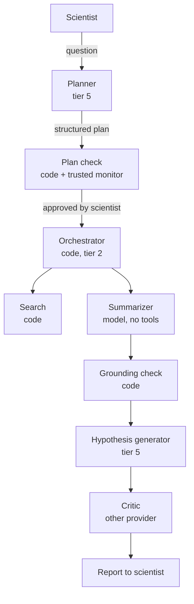

:::caution[Illustrative example]
A hypothetical design to show how the patterns fit together. It has not been built or measured, and the harm modes are listed without numbers. For a worked estimate with probabilities, volumes and correlation assumptions, see the [coding agent example](/design-patterns/examples/code-deployment-example/).
:::

A lab asks for a research assistant that surveys the literature on a question about protein folding and proposes experiments. Its outputs are documents for the lab's scientists. It has no lab access, runs no experiments and sends nothing outside the system except search queries.

Unlike the [coding agent](/design-patterns/examples/code-deployment-example/), this system needs a model to coordinate: deciding which sub-questions matter is a judgment call. The design question is how to let a capable model plan without giving the plan leverage nobody checks.

## Components



| Component | Implementation | Can reach | Pattern |
|---|---|---|---|
| Planner | Untrusted frontier model (tier 5) | The question and a list of components; nothing else | [Task Decomposition Pipeline](/design-patterns/structural/#task-decomposition-pipeline) |
| Plan check | Schema and budget validation in code; a trusted monitor (tier 4) screens for anomalies | The plan | [Trusted Monitor](/design-patterns/monitoring/#trusted-monitor) |
| Orchestrator | Tested code: routing, budgets, rate limits, circuit breaker | Component invocation only | [Exposure-Envelope Gateway](/design-patterns/structural/#exposure-envelope-gateway) |
| Search | Code: API calls, ranking, deduplication | The search API | |
| Summarizer | A model with no tools, no network and no access to the lab's notes | One paper at a time | [Need-to-Know Compartments](/design-patterns/information/#need-to-know-compartments) |
| Grounding check | Code: every quoted span must appear in the source | Summary and source | [Consistency Triangulation](/design-patterns/verification/#consistency-triangulation) |
| Hypothesis generator | Untrusted frontier model | Checked summaries and the lab's notes; never raw papers | |
| Critic | A model from a different provider, prompted to attack each hypothesis | Hypotheses and summaries | [Adversarial Collaboration](/design-patterns/multi-agent/#adversarial-collaboration) |

Every call, input and output is logged by the orchestrator ([Flight Recorder](/design-patterns/monitoring/#flight-recorder)). No component keeps memory between projects; the only carried state is a bibliography the scientists curate ([Selective Amnesia](/design-patterns/information/#selective-amnesia)).

## Who plans

Earlier versions of this example made an older, weaker model the strategist because "less capable = less risky". That inverts how AI Control uses weak models ([Greenblatt et al. 2023](https://arxiv.org/abs/2312.06942)). A trusted model monitors the untrusted model's work; it does not make the most consequential decisions in its place. A weak planner would make more mistakes, and the coordinator's leverage would spread them.

Here the planner is capable, and its leverage is removed instead:

- Its output is a structured plan (sub-questions, queries, a budget per step), not free text and not tool calls.
- Code checks the plan against a schema and the project budget. The trusted monitor flags anything unusual, such as a sub-question unrelated to the topic or a step that asks for the lab's notes.
- A scientist approves the research direction before anything runs. Changing direction mid-project requires approval again ([Escalation Ladder](/design-patterns/structural/#escalation-ladder)).
- The planner never sees intermediate results, so it cannot steer later steps by what earlier ones found.

None of this makes scheming impossible. Frontier models have schemed within a single episode when given a goal and an opportunity ([Meinke et al. 2024](https://arxiv.org/abs/2412.04984)). What the decomposition does is limit what any one context knows and can reach, and keep each step small enough to check. See [Coordinator Constraints](/design-patterns/coordinator-constraints/#how-the-layers-meet-a-scheming-coordinator).

## Harm surface

| Harm mode | Channel | Main mitigation |
|---|---|---|
| Summary misstates a paper's findings | Accident | Grounding check on quotes; critic; scientist reads the sources for anything the report relies on |
| Report cites a paper or quote that does not exist | Accident, or defection (reward hacking) | Search results are the only admissible sources; the grounding check rejects quotes not found verbatim |
| Planner or generator steers the report toward a conclusion | Defection | Critic from another provider; scientist approval of direction; monitor on the plan |
| A paper contains instructions that make the summarizer leak the lab's notes or slant its summary | Hijack | The summarizer cannot see the notes and cannot send anything out; the generator, which sees the notes, never reads raw papers |
| A hypothesis has dual-use implications | Accident | A narrow classifier (tier 3) with a measured false-negative rate flags candidates for human review |

The hijack row drives the layout. The only outbound channel is search queries, and they are fixed in the approved plan before any paper is read. Summaries still carry text from the papers, quoted spans included, so the generator is not insulated from injected instructions. What bounds the row is that no component that has read untrusted text can send data out. That is the [hijack channel's](/delegation-risk/risk-decomposition/) architectural answer, applied by hand.

## Two pieces of code

Earlier versions had about 300 lines of Python, including a circuit breaker that reset itself although the text required a manual reset, and a regex blocklist labelled "formally verifiable" that would have rejected the critic's own output and was easy to evade. Two short pieces show the idea.

The grounding check is tier 2: deterministic, and testable on a fixed set.

```python
def quotes_grounded(summary: dict, source_text: str) -> bool:
    """Every claim must carry a quote that appears verbatim in the source."""
    def norm(s: str) -> str:
        return " ".join(s.split()).lower()
    source = norm(source_text)
    return all(
        claim.get("quote") and norm(claim["quote"]) in source
        for claim in summary["claims"]
    )
```

It proves that quotes exist, not that a claim follows from its quote. That second judgment is left to the critic and the scientist.

The circuit breaker trips after repeated failures and stays open until a person resets it.

```python
class CircuitBreaker:
    def __init__(self, threshold: int = 5):
        self.threshold = threshold
        self.consecutive_failures = 0
        self.open = False

    def allow(self) -> bool:
        return not self.open

    def record(self, ok: bool, reason: str = "") -> None:
        if ok:
            self.consecutive_failures = 0
            return
        self.consecutive_failures += 1
        if self.consecutive_failures >= self.threshold and not self.open:
            self.open = True
            alert_humans(f"circuit breaker tripped: {reason}")

    def reset(self, operator_id: str) -> None:
        log_event("breaker_reset", operator_id)
        self.open = False
        self.consecutive_failures = 0
```

When it is open, the orchestrator stops invoking components and returns the work done so far, marked incomplete ([Graceful Degradation](/design-patterns/recovery/#graceful-degradation)).

[Composing Patterns](/design-patterns/composing-patterns/#the-principles-in-the-two-examples) sets this design's Least-X choices beside the coding agent's.
