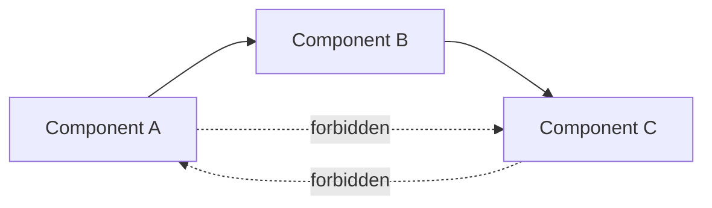

Least privilege gives each component the minimum access rights its function needs (Saltzer & Schroeder 1975). A delegated AI component has more dimensions than access rights: how capable it is, what it knows, what it remembers, how freely it acts and whom it can talk to. Each "Least X" principle bounds one of these. A component's exposure, the worst-case loss given what it can reach, is limited by whichever dimension binds first, so the principles are applied together.

Six principles are the core. The rest of the page lists a tail of narrower or weaker ones, each with its caveat.

| Principle | What it bounds |
|---|---|
| **Least Intelligence** | Capability: the least capable implementation that does the task |
| **Least Privilege** | Permissions and access rights |
| **Least Context** | Information about the wider system, other components and other users |
| **Least Persistence** | State carried across invocations |
| **Least Autonomy** | Ability to act without review |
| **Least Connectivity** | Communication paths between components |

None is new as a security idea. The AI setting adds that the component itself may be the adversary, misaligned or hijacked, and will use whatever capability, access, information, memory and channels it has. The principles shrink each in advance, without detecting anything.

## Least Intelligence

Give each component the least capable implementation that can do its job. A component that checks SQL for injection needs less general capability than one that designs database security, and a narrow component has fewer ways to fail and fewer ways to pursue something else.

"Less capable" is shorthand for "more verifiable". The working version of the principle is a choice among five tiers, from most to least verifiable:

1. **Formally verified code.** Proven against a specification. Examples: access-control checks, rate limiters, parsers with proved properties.
2. **Deterministic tested code and rule-based checks.** Auditable and repeatable. Examples: routing tables, schema validation, allow-lists, test suites.
3. **Narrow learned models with measured error on a fixed task.** Examples: a classifier with a known false-negative rate on a held-out set.
4. **Trusted LLMs**, below the capability at which scheming is a live concern. This is AI Control's *trusted model* ([Greenblatt et al. 2023](https://arxiv.org/abs/2312.06942)).
5. **Untrusted frontier models and agents.**

Use the most verifiable tier that can do the job. Training method does not define a tier: nearly every deployed frontier model is RL post-trained, and what matters is what you can verify about the deployed system. Earlier versions of this page ranked "RL systems" below "general foundation models"; that ordering would rule out every current frontier model and has been dropped.

Three rules follow from the tiers:

- **A check sits lower than what it checks.** A frontier model checking a sibling of itself shares its blind spots and, if the actor is scheming, may share its goals. This is the [risk preflight](/delegation-risk/runtime-accounting/#who-preflights-the-preflight) rule.
- **Push leverage down the tiers.** Where a component has leverage over others (a coordinator, a deployment gate, a permission grant), put as much of its logic as possible in tiers 1 and 2 and leave only the judgment calls to a model.
- **Weaker is not the same as trusted.** In AI Control, *trusted* means there is reason to believe the model is not scheming, usually because it is below the capability where scheming is plausible. An older model is not trusted merely by being older. And a trusted model's job in the Control protocols is mostly to monitor and edit the untrusted model's work, not to make the most consequential decisions in its place. See [Coordinator Constraints](/design-patterns/coordinator-constraints/#who-plans).

Two examples show the range:

- **A SQL-injection checker** should sit at tier 1 or 2: a real SQL parser plus rules, with a test suite of known attacks. An LLM asked "is this secure?" is a worse checker on every axis that matters here.
- **A hypothesis generator** for a research tool can reasonably be a tier 5 model, because novelty is the point. Its exposure is kept low by the other principles: it cannot act on its ideas, its output is evaluated by other components and by people, and it keeps no state.

## Least Privilege

Grant the minimum permissions the task needs: read rather than write, one directory rather than the file system, no network or an allow-list of hosts, no ability to spawn processes or invoke other components unless required. The gap between what a delegate *can* do and what its current task *needs* is its [privilege overhang](/getting-started/glossary/#privilege-overhang); privilege creep is how the gap grows.

For agents the main mechanism is the tool layer and the sandbox: which tools the model is shown for this task, what credentials the session holds, and what the container's network policy allows. A shell with network access routes around any tool-level restriction, so the enforced boundary is usually the container, not the tool list. The [Exposure-Envelope Gateway](/design-patterns/structural/#exposure-envelope-gateway) pattern is the implementation.

## Least Context

Give each component the minimum information about the wider system: which other components exist, how the system is deployed, other users' data, the long-term goal. A component that does not know where the production credentials live, or that its output feeds a deployment gate, has less to work with if it is misaligned and less to leak if it is hijacked.

Least Context also limits the damage of prompt injection. Every piece of untrusted text a component reads is a possible instruction, so a component that reads less untrusted text is hijacked less often.

## Least Persistence

Keep the minimum state across invocations. For an LLM component that means more than its weights. It includes conversation history, memory and retrieval stores, prompt and KV caches the deployment reuses, scratch files in a persistent workspace, and logs the component can read back. Each is a way to carry a plan, a learned exploit or an injected instruction from one task to the next.

Stateless should be the default. Some components need state (a forecaster benefits from its calibration history), and that state should be summary statistics the component cannot write to directly.

Persistence across episodes is not the only route to deception. Frontier models given a goal in context have schemed within a single episode ([Meinke et al. 2024](https://arxiv.org/abs/2412.04984)). Least Persistence stops accumulation across tasks. It does not make a single task safe.

## Least Autonomy

Minimize the ability to act without review. The spectrum runs from approval for every action, through acting freely under monitoring and acting freely within hard limits, to full autonomy. Choose the level per action, by stakes and reversibility, not once per agent. The [Escalation Ladder](/design-patterns/structural/#escalation-ladder) and [Graduated Autonomy](/design-patterns/structural/#graduated-autonomy) patterns implement this.

Review is a resource. A human asked to approve every action stops reading them, so lower autonomy only helps where review stays real.

## Least Connectivity

Minimize communication paths between components, and specify the ones that remain as a directed graph.

- Allow A → B without implying B → A.
- Prefer pipelines in which results flow forward and only status flows back.
- Give no component a broadcast channel to all others.
- Expose minimal interfaces: a forecaster exposes `predict(scenario)` and nothing else.

Removing a channel removes one way to coordinate, not all of them. Instances of the same model can converge on the same choice without exchanging a message, and a shared provider, prompt template or retrieval corpus makes components fail together whatever the topology. Those are the subject of [Channel Integrity](/design-patterns/channel-integrity/) and [Entanglements](/entanglements/).

## The principles are orthogonal

Bounding one dimension does not bound the others, so a component's profile is set per dimension.

| | Code-generation component | Security-verification component |
|---|---|---|
| Intelligence | High: needs open-ended problem solving | Moderate: analytical, narrow |
| Privilege | Low: writes to a branch in a sandbox, cannot merge or deploy | High: reads production configuration |
| Context | Low: no production systems or user data | High: needs the system architecture |
| Persistence | None | Low |
| Autonomy | Low: a human reviews before merge | High: rejects insecure changes automatically |
| Connectivity | Sends to the review queue only | Receives from the pipeline, sends pass/fail |

The verifier is allowed high privilege and context because it sits at a low tier (rules and narrow models) and its only output is a verdict. The generator is allowed high capability because it has almost no privilege. The design question is never "how restricted is this component?" but "which dimension is doing the bounding?"

## The tail

These are narrower than the core six, or depend on an assumption that may not hold. They are listed so that older references to them resolve.

**Least Scope.** Restrict the domain a component operates in: input and output types, problem domains, interfaces, time horizon of its actions. In practice this is Least Privilege plus Least Context applied to a task description.

**Least Compute.** Cap computation, memory, wall-clock time, tokens and bandwidth per invocation (cgroups, quotas, timeouts, spend caps). Caps reliably bound cost and runaway loops, which makes them part of the exposure envelope. Whether they limit deception is unclear: a model can deceive within an ordinary call's budget, so do not count a compute cap as a defense against scheming.

**Reproducibility** (formerly "Least Surprise"; renamed because *least surprise* is the established name of a user-interface principle). Record everything needed to replay a component's behavior: inputs, model version, sampling parameters, seeds, tool results. Break ties in code-level aggregation deterministically. Two caveats correct earlier claims on this site:

- Temperature 0 does not make a served LLM deterministic. Production inference engines are not batch-invariant, so the same request can produce different output depending on server load ([He 2025](https://thinkingmachines.ai/blog/defeating-nondeterminism-in-llm-inference/)).
- Determinism does not close covert channels. A deterministic policy can encode information in *which* output it produces for a given input; steganography needs no sampling noise.

The value of reproducibility is auditability: a suspicious action can be replayed and examined. It is not a defense against signalling.

**Least Observability.** Limit what a component can observe about the system and itself: other components, timing, resource usage, its own monitoring, whether an input is a test. The first few are ordinary information hiding. The last is hard to enforce. Frontier models distinguish evaluation transcripts from deployment ones well above chance; in one benchmark Gemini 2.5 Pro reached an AUC of 0.83 against a human baseline of 0.92 ([Needham et al. 2025](https://arxiv.org/abs/2505.23836)). In anti-scheming tests, models' reasoning often states that they are being evaluated, and that awareness causally reduced covert behavior ([Schoen et al. 2025](https://arxiv.org/abs/2509.15541)). Make tests as close to deployment as you can, but do not build a defense that assumes the component cannot tell.

Earlier versions also listed a **Least Latency Budget**, on the theory that time pressure forces simpler, more honest behavior. Nothing supports that, and it has been dropped.

## Coordinators

Coordinators route work, grant permissions and see more of the system than any other component, so the principles bind hardest there. [Coordinator Constraints](/design-patterns/coordinator-constraints/) specializes them: decompose coordination into checkable parts, keep the coordinator's influence indirect and its messages structured, and put redundancy and veto rights around it.

## Further reading

- Saltzer, J.H. & Schroeder, M.D. (1975). *The Protection of Information in Computer Systems.* Proceedings of the IEEE. The classic statement of least privilege and its companion design principles.
- Miller, M.S. (2006). *Robust Composition.* PhD thesis, Johns Hopkins. Object-capability security, in which authority is explicit, minimal and composable.
- Greenblatt, R. et al. (2023). [AI Control: Improving Safety Despite Intentional Subversion](https://arxiv.org/abs/2312.06942). ICML 2024. Trusted and untrusted models.
- Drexler, K.E. (2019). [*Reframing Superintelligence: Comprehensive AI Services as General Intelligence*](https://www.futureofhumanityinstitute.org/s/2019-1.pdf). FHI Technical Report 2019-1. Capability as a system of bounded services.
