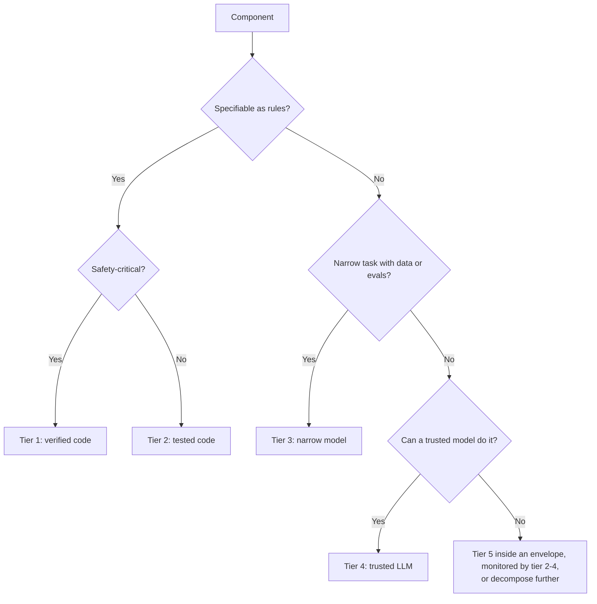
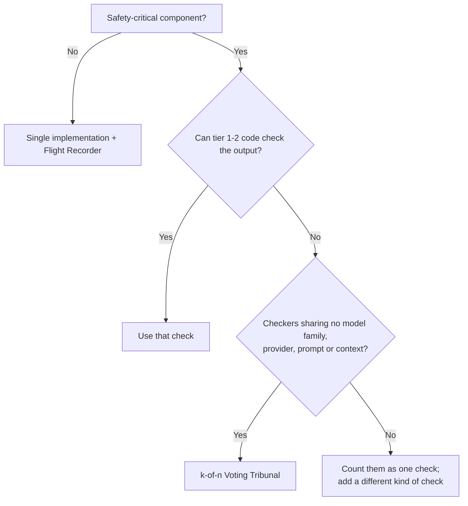
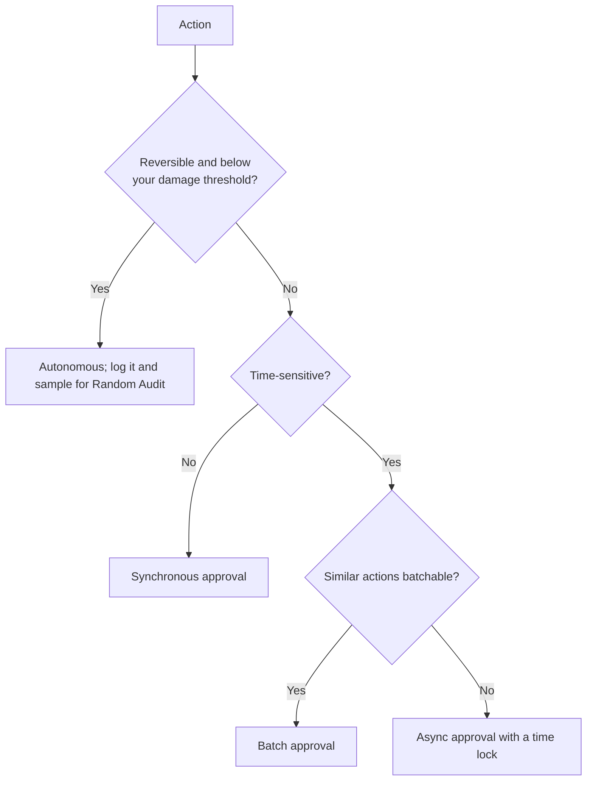

This page is a procedure for applying delegation risk to an agent system, from scope to a reconciled ledger. Each step names the [design patterns](/design-patterns/) that implement it. The numbers in the example are illustrative.

## 1. Scope, exposure and budget

- List what the system does, which tools and actions it can call, which data and credentials it can reach, and who its principals are.
- **Bound the exposure.** Work out the worst loss the system could cause given that access. If the bound is unacceptable, shrink the access before estimating anything else: [Exposure-Envelope Gateway](/design-patterns/structural/#exposure-envelope-gateway), [Least Privilege](/design-patterns/least-x-principles/#least-privilege). Most agent harnesses already supply the parts: OS sandboxes with egress allow-lists, per-tool permission rules and pre-tool-use hooks ([what exists](/delegation-risk/runtime-accounting/#what-exists-and-what-is-new)). Check what runs outside the sandbox and whether the agent can request an exit.
- **Set a risk budget.** The budget is the expected loss per month the operator will accept. It is a choice, not something derived. Anchor it to what the operator can absorb or insure.

## 2. Build the harm table

| Component | Harm mode | Channel | Actions per month (N) | P(harm) per action | Mean damage per incident | Risk per month |
|---|---|---|---|---|---|---|
| _name_ | _what goes wrong_ | accident / defection / hijack | | | | N × P × D |

- **Say what P is per.** Here it is per action, and N converts it to a monthly figure. A per-month probability also works if you say so. Never mix the two.
- **Use mean damage.** With heavy-tailed damage, the mean can be several times the typical case.
- **Assign a channel.** Each row belongs to one of the harm channels from [Risk Decomposition](/delegation-risk/risk-decomposition/). Hijack covers prompt injection through tool outputs and retrieved content.
- **Elicit what you cannot measure.** Where there is no data, get an interval ([Expert Elicitation](/design-patterns/tools/expert-elicitation/)) and run it through the [calculator](/design-patterns/tools/delegation-risk-calculator/).
- **Sum the rows.** Expected losses add whatever the correlation between rows. Correlation matters for the tail and for stacked defenses.

## 3. Reduce the largest rows

| Lever | Patterns |
|---|---|
| Lower P | [Trusted Monitor](/design-patterns/monitoring/#trusted-monitor), [Voting Tribunal](/design-patterns/structural/#voting-tribunal), [Consistency Triangulation](/design-patterns/verification/#consistency-triangulation), [Honeypot Injection](/design-patterns/verification/#honeypot-injection) |
| Lower D | [Exposure-Envelope Gateway](/design-patterns/structural/#exposure-envelope-gateway), [Bulkhead Isolation](/design-patterns/structural/#bulkhead-isolation), [Expiring Grants](/design-patterns/information/#expiring-grants), [Checkpoint-Rollback](/design-patterns/recovery/#checkpoint-rollback) |
| Lower N on the risky path | [Escalation Ladder](/design-patterns/structural/#escalation-ladder), [Graduated Autonomy](/design-patterns/structural/#graduated-autonomy) |
| Separate instructions from data | [Need-to-Know Compartments](/design-patterns/information/#need-to-know-compartments), [Selective Amnesia](/design-patterns/information/#selective-amnesia) |
| Split the component | [Task Decomposition Pipeline](/design-patterns/structural/#task-decomposition-pipeline) |

Re-estimate after each change, and stop when the total is within budget. When you stack checks, do not multiply their miss rates as if they were independent. Take three layers that each miss 10%. A common-cause correlation $\rho$ multiplies their joint miss rate by $1+99\rho$, which is about 11×, 21× and 50× at $\rho$ = 0.1, 0.2 and 0.5. Those values of $\rho$ are assumed, not measured. Against an adaptive attacker, count only the best layer ([Risk Propagation](/delegation-risk/risk-propagation/)).

## 4. Choose an implementation for each component

Use the lowest verifiability tier that can do the job:

1. formally verified code;
2. deterministic tested code and rule-based checks;
3. narrow learned models;
4. trusted LLMs, in the AI Control sense ([Greenblatt et al. 2023](https://arxiv.org/abs/2312.06942)): less capable models you are confident are not trying to subvert your checks;
5. untrusted frontier models and agents.

A coordinator that routes work between agents is a component like any other. Put routing rules in tier-2 code where possible. If a model must coordinate, keep it stateless, give it structured messages and no direct actions, and gate its irreversible decisions.

## 5. Add redundancy where it buys independence

With a trusted tally, meaning code that counts the votes, a k-of-n approval rule behaves as follows:

| Rule | Harmful action still blocked with up to | Legitimate action still passes with up to |
|---|---|---|
| 2-of-2 | 1 faulty voter | 0 |
| 2-of-3 | 1 | 1 |
| 3-of-4 | 2 | 1 |
| 4-of-5 | 3 | 1 |

Every row assumes that voters fail independently. Checkers built on one model family can fail as one, and against an adaptive attacker you should assume they do. The tribunal is then worth its best member. Byzantine agreement bounds ($n \geq 3f+1$) apply when replicas must agree without a trusted tally. A harness that counts votes in code does not need them.

## 6. Place human approval

Approval is only a control if the reviewer reads what they approve. Track the rubber-stamp rate, the share of approvals issued faster than the minimum reading time.

## 7. Monitor, roll back, reconcile

- For each harm mode, name the signal that would reveal it. Set one threshold that alerts and one that halts ([Graceful Degradation](/design-patterns/recovery/#graceful-degradation)).
- For each action that cannot be undone, add a commit point and a time lock ([Checkpoint-Rollback](/design-patterns/recovery/#checkpoint-rollback)).
- Keep an **exposure ledger** per delegate, and **reconcile** it against incidents and near misses on a schedule ([Runtime Accounting](/delegation-risk/runtime-accounting/)). A harm table that is never reconciled stays a guess.

**Before deployment**, check five things:

- The total is within budget, and exposure is bounded by an envelope the agent cannot bypass.
- Each component passes the six [Least-X](/design-patterns/least-x-principles/) questions: least intelligence, privilege, context, persistence, autonomy and connectivity.
- Every redundancy states its independence assumption.
- Rollback has been tested.
- A date is set for the first reconciliation.

## Example: internal Q&A bot (illustrative)

A chat bot answers 3,000 employee questions a month from internal documents. The budget is \$1,000 per month.

| Harm mode | Channel | N | P per action | Mean D | Before | After |
|---|---|---|---|---|---|---|
| Wrong answer acted on | accident | 3,000 | 0.002 | \$100 | \$600 | \$600 |
| Restricted document shown to the wrong employee | accident | 3,000 | 0.00002 → 0.000002 | \$10,000 | \$600 | \$60 |
| Posts to the wrong channel | accident | 3,000 | 0.0001 | \$200 | \$60 | \$60 |
| Injected instruction in a retrieved document | hijack | 3,000 | 0.00001 | \$20,000 → \$2,000 | \$600 | \$60 |
| **Total** | | | | | **\$1,860** | **\$780** |

Two structural changes bring the table under budget:

- Retrieval is filtered by the asker's permissions in tier-2 code, so the model never sees what the asker cannot read.
- The bot's only tool is a reply to the asker, which caps what an injected instruction can do.

Neither change adds a model-based check.

## Quick reference

- **Delegation risk:** $\sum N \times P(\text{harm per action}) \times \mathbb{E}[D]$, in dollars per month.
- **Serial chain:** P(the chain executes faithfully) $= \prod t_i$, where $t_i$ is P(link $i$ executes faithfully). The product is conservative when links are correlated.
- **Parallel checks:** P(all miss) $\approx (1-\rho)\prod p_i + \rho \min p_i$, with $\rho$ on the phi scale. Against adaptive attackers, use $\min p_i$.
