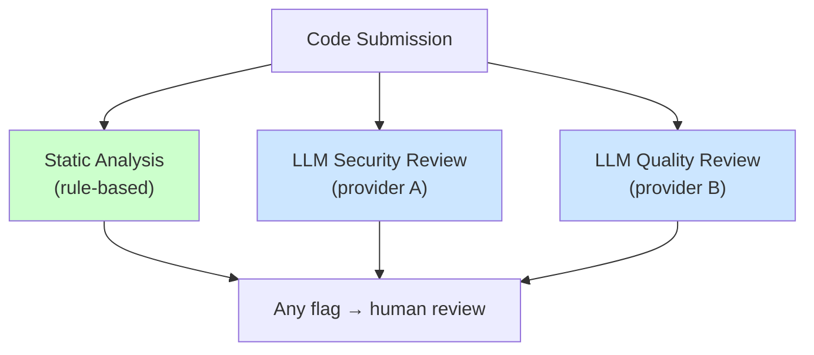
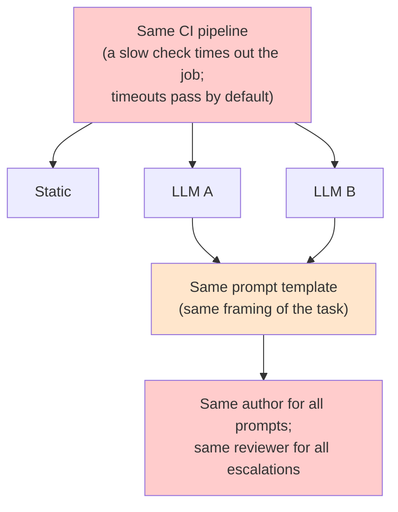
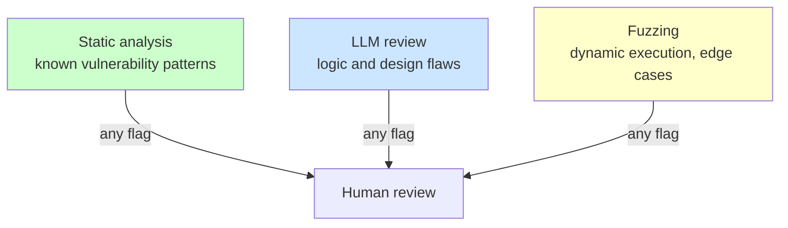
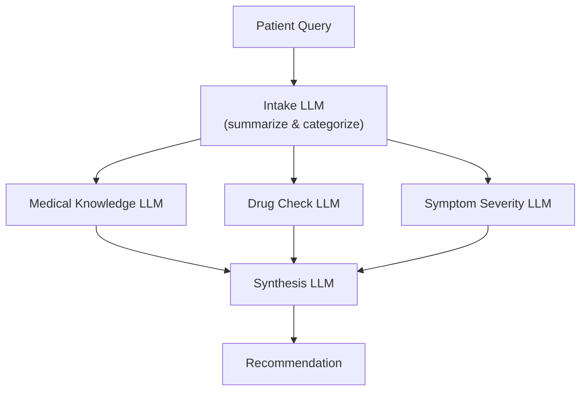
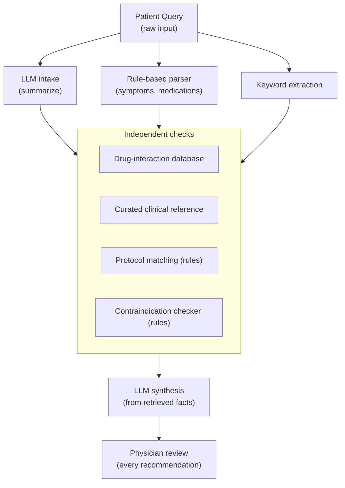
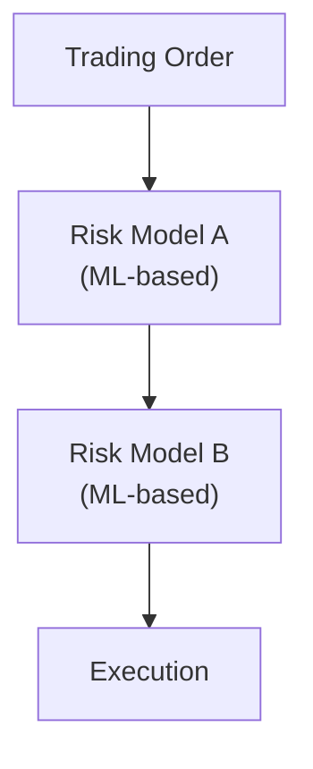
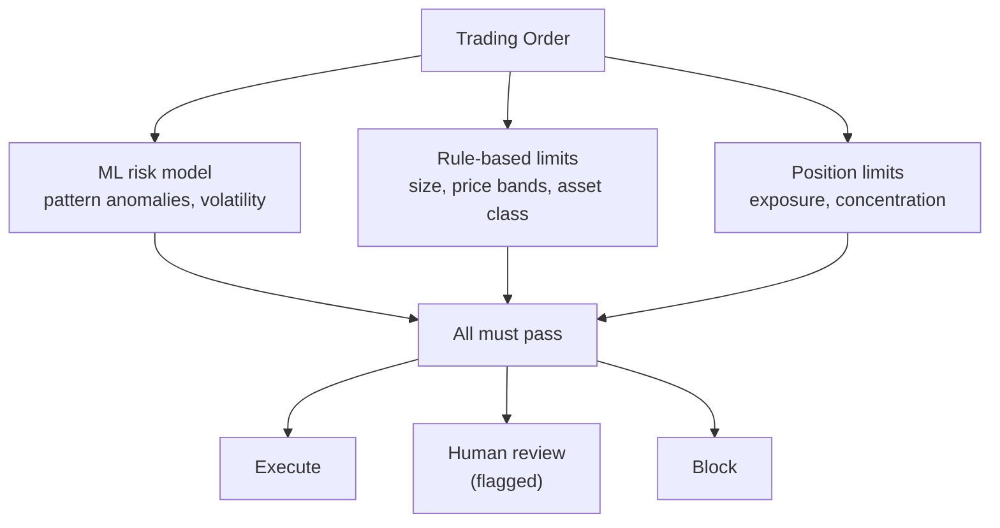
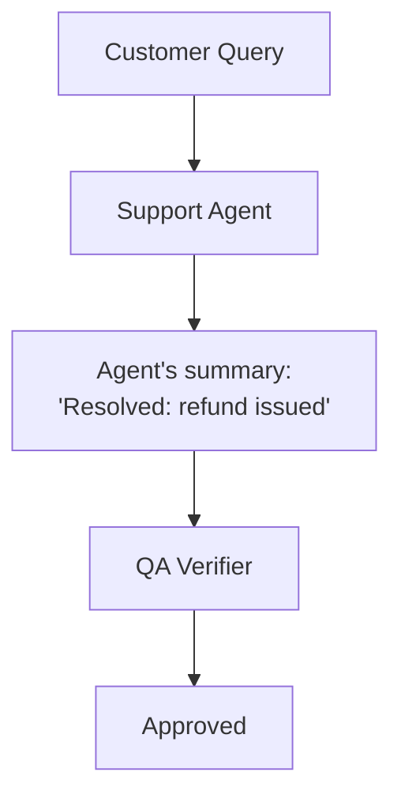
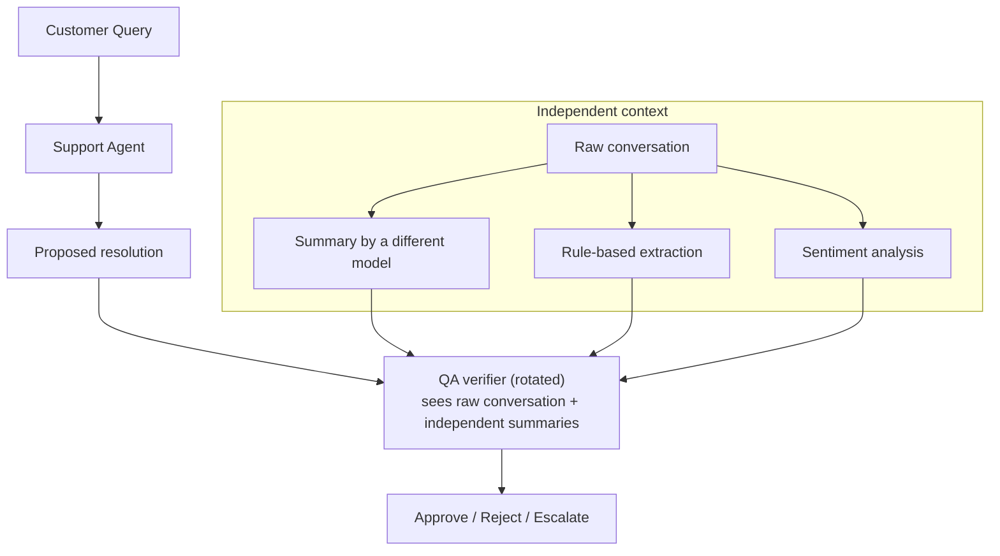

:::caution[Illustrative examples]
These architectures are hypothetical, and every miss rate, ρ value and frame-sensitivity figure on this page is invented to show the method. The arithmetic applied to them is exact; the inputs are not measurements.
:::

Each example builds a pairwise φ matrix, estimates P(all layers miss) with the [canonical mixture](/entanglements/fundamentals/formal-definitions/#the-entanglement-tax), and redesigns. Where the layers are asymmetric, the mixture is fed the **largest pairwise ρ**, which is conservative. Averaging the pairs understates the tax. Where precision matters, the examples also simulate the matrix with a Gaussian copula calibrated so that each pair's simulated φ matches the matrix ([Measuring Entanglement](/entanglements/detection/correlation-calculator/#asymmetric-stacks-the-matrix)).

---

## Example 1: Code review pipeline

### Initial architecture



A harmful change gets through only if all three checks miss it.

### Step 1: Apparent diversity

| Component | Method | Source |
|---|---|---|
| Static analysis | Pattern matching | Open-source rule set |
| Security review | LLM | Frontier model, provider A |
| Quality review | LLM | Frontier model, provider B |

Rule-based plus two providers looks diverse.

### Step 2: Correlation matrix

From a labeled challenge set:

| | Static | LLM A | LLM B |
|---|---|---|---|
| **Static** | 1.0 | 0.1 | 0.1 |
| **LLM A** | 0.1 | 1.0 | **0.6** |
| **LLM B** | 0.1 | **0.6** | 1.0 |

The two LLM reviewers miss the same novel vulnerability classes despite coming from different providers, as the measured correlation of LLM errors across providers would lead one to expect ([Kim et al. 2025](https://arxiv.org/abs/2506.07962)). Static analysis is nearly independent of both.

### Step 3: Hidden dependencies



- The shared prompt template raises the LLM pair's correlation to about 0.8.
- One team wrote every prompt and handles every escalation, so organizational blind spots reach all three checks.
- The shared CI job fails open: a timeout lets everything through.

### Step 4: Joint miss

Miss rates: static 20%, each LLM 30%.

```
Independent assumption: 0.2 × 0.3 × 0.3 = 1.8%   ("98.2% protection")

Mixture, max pairwise ρ = 0.8:
  (1 − 0.8) × 0.018 + 0.8 × min(0.2, 0.3, 0.3) = 0.0036 + 0.16 = 16.4%
  entanglement tax ≈ 9×

Simulated matrix (LLM pair at φ 0.6–0.8, static at 0.1):
  P(all miss) ≈ 6.0–6.9%, tax ≈ 3.3–3.8×
```

The max-pairwise figure is high here because it assumes the static analyzer shares the LLMs' common cause, which it mostly does not. The simulation is the better estimate. Both say the stack is several times weaker than its builders believed, and the fail-open CI job makes the effective figure worse still.

### Step 5: Interventions

| Intervention | What it changes |
|---|---|
| Separate prompt templates and authors | LLM pair correlation, here back toward 0.6 |
| Replace one LLM reviewer with fuzzing | Adds a check that executes the code instead of reading it |
| Separate CI jobs that fail closed | Removes the timeout path |
| Different teams own different checks | Removes the organizational common cause |

### Step 6: Redesign



| | Static | LLM | Fuzzing |
|---|---|---|---|
| **Static** | 1.0 | 0.1 | 0.15 |
| **LLM** | 0.1 | 1.0 | 0.1 |
| **Fuzzing** | 0.15 | 0.1 | 1.0 |

With fuzzing missing 30%, independence still predicts 1.8%. The mixture with max pairwise ρ = 0.15 gives 0.85 × 0.018 + 0.15 × 0.2 = 4.5%; the simulated matrix gives about 3.9%. The redesign cuts the simulated joint miss rate by about 35–45% and the conservative estimate from 16% to 4.5%.

The remaining floor is ρ × 20%, set by the strongest layer. The next gain comes from a better static analyzer or a fourth check with different information, not from another LLM.

### Lessons

1. **Different providers do not mean low correlation.**
2. **Hidden dependencies dominate.** Shared prompts, teams and CI created correlation that the architecture diagram did not show.
3. **Different methods buy more than more instances.** Fuzzing executes code; another LLM would have read it the same way.
4. **Fail closed.** A check that passes on timeout is a common cause for every check behind it.

---

## Example 2: Healthcare recommendation system

### Initial architecture



All five components are LLMs from one provider.

| | Intake | Medical | Drug | Symptom | Synthesis |
|--|--------|---------|------|---------|-----------|
| **Intake** | 1.0 | 0.7 | 0.7 | 0.7 | 0.8 |
| **Medical** | 0.7 | 1.0 | 0.6 | 0.6 | 0.7 |
| **Drug** | 0.7 | 0.6 | 1.0 | 0.5 | 0.7 |
| **Symptom** | 0.7 | 0.6 | 0.5 | 1.0 | 0.7 |
| **Synthesis** | 0.8 | 0.7 | 0.7 | 0.7 | 1.0 |

### Problems

1. **Context contamination.** Every downstream component reads the intake summary. If intake misunderstands, everything after it inherits the error.
2. **One provider.** All components share training data, medical knowledge gaps and reasoning habits.
3. **No ground truth.** Nothing consults a curated drug-interaction or clinical reference database.
4. **Synthesis inherits everything** already filtered through correlated reasoning.

If each component misses a dangerous case 10% of the time, independence predicts 0.1⁵ = 0.001%. With the max pairwise ρ = 0.8, the mixture gives 0.2 × 0.00001 + 0.8 × 0.1 ≈ 8%: a tax of about 8,000×, and the five layers are worth 1.1 independent ones. Recommendations that can affect a patient's health are high-stakes and hard to reverse, so correlated protection is not acceptable here ([Solutions](/entanglements/mitigation/solutions/#when-independence-is-worth-paying-for)).

### Redesign



Changes: three independent intake paths, curated databases instead of model recall for facts, deterministic protocol checks, the LLM confined to synthesis over retrieved facts, and mandatory physician review.

```
Correlation after redesign:

              LLM    Rule   Keyword  DrugDB  MedDB  Protocol
LLM           1.0    0.1     0.1     0.05    0.1     0.05
Rule          0.1    1.0     0.3     0.1     0.1     0.2
Keyword       0.1    0.3     1.0     0.1     0.1     0.1
DrugDB        0.05   0.1     0.1     1.0     0.2     0.1
MedDB         0.1    0.1     0.1     0.2     1.0     0.2
Protocol      0.05   0.2     0.1     0.1     0.2     1.0
```

The largest pair (rule parser and keyword extraction, which read the same text the same way) is 0.3. At 10% per layer the automated stack's floor falls from about 8% to 0.3 × 10% = 3%, a conservative figure since most pairs are far lower. The physician review sits outside the correlated stack entirely.

---

## Example 3: Trading safeguards



Two ML risk models trained on the same historical data, in sequence: they learned the same patterns, so assume ρ ≈ 0.7, and B sees only what A passes.



The redesign uses three different methods, runs them in parallel on the same order so none depends on another's output, requires all three to pass, and sends disagreement to a human. The two deterministic checks enforce hard limits whatever the ML model concludes, which is an [exposure envelope](/getting-started/glossary/) in miniature.

---

## Example 4: Customer support escalation (active influence)

This example is about **active** entanglement: an information channel that is also an influence channel.



The verifier sees the agent's framing, not the conversation. This is the clerk writing the only summary the reviewer reads ([Types of Entanglement](/entanglements/fundamentals/types/#the-bureaucrat-analogy)).

### Step 1: The channel

The summary compresses the conversation and drops the customer's tone, the alternatives discussed, the agent's hesitation and any time pressure. Mechanisms: selective omission, framing ("resolved" versus "customer stopped responding"), emotional filtering and projected confidence.

### Step 2: Measure it

Same underlying scenarios, two framings ([frame-variation test](/entanglements/detection/detecting-influence/#1-counterfactual-intervention)):

| Scenario | Neutral framing | Positive framing | Approval: neutral → positive |
|---|---|---|---|
| Refund request | "Customer requested refund" | "Resolved with customer satisfaction" | 78% → 94% |
| Escalation | "Customer asked to speak to manager" | "Addressed customer concerns directly" | 45% → 82% |
| Partial resolution | "Issue partially addressed" | "Primary concern resolved" | 52% → 91% |

Frame sensitivity averages 31 percentage points (16, 37 and 39). The verifier's decisions are substantially the agent's to shape, and the influence runs one way: the agent shapes the verifier, while the verifier reaches the agent only through rejections.

### Step 3: Drift

Over six months, approval rose from 78% to 91% with no policy change. Agent summaries became more uniformly positive, verifier rationales began repeating "agent handled appropriately", and customer complaints rose. Influence is turning into capture: the verifier has learned to trust the framing.

### Step 4: Interventions and redesign



The verifier reads the raw conversation, independent summaries break the agent's monopoly on framing, rotation prevents stable pairings, and sentiment analysis catches emotional filtering.

| Metric | Before | After |
|---|---|---|
| Frame sensitivity | 31 points | 15 points |
| Approval drift over six months | +13 points | +2 points |
| Agreement across rotated verifiers | 0.72 | 0.91 |

### Lessons

1. **Information channels are influence channels**, with or without intent.
2. **Influence is measured by intervention:** same facts, different framing.
3. **Capture is gradual.** There was no discontinuity between influence and capture.
4. **Independent context is the fix.** The verifier must build its own view of the case.

---

## Template

```
## System: [name]

1. Components: | Component | Method tier | Model family / provider | Reads |
2. φ matrix: measured where possible; assumed priors marked as such
3. Hidden dependencies: infrastructure, prompts and artifacts, people, fail-open paths
4. Joint miss: independent product; mixture with max pairwise ρ; simulation if asymmetric
5. Stakes and correlation budget: target P(all miss) → ρ_max
6. Interventions and what each changes
7. Redesign, then re-measure φ and P(all miss)
```

---

See also:
- [Measuring Entanglement](/entanglements/detection/correlation-calculator/): φ, thresholds and priors
- [Solutions](/entanglements/mitigation/solutions/): the interventions used here
- [Audit Guide](/entanglements/mitigation/audit-guide/): the full protocol
