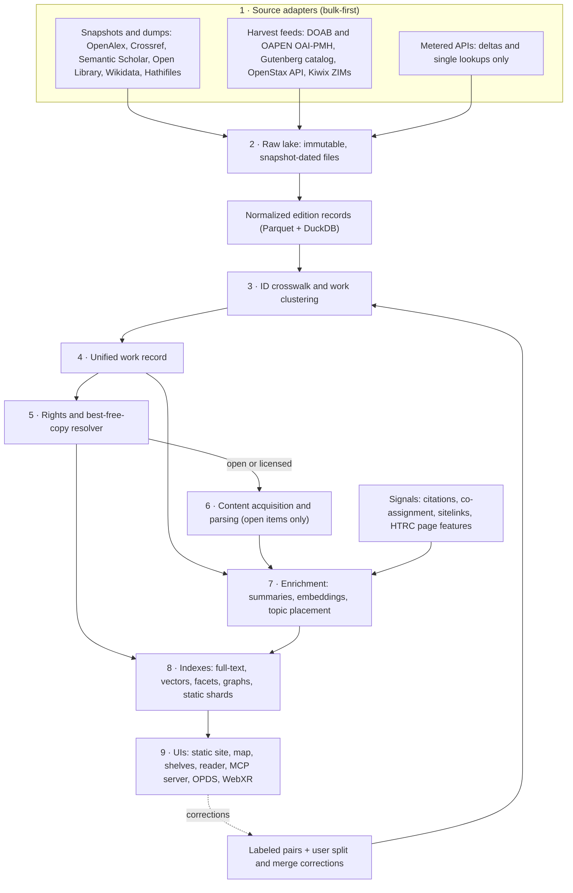

*Status: draft, October 2026. Dataset sizes, API prices, benchmark scores and product statuses are as of October 2026 (most were measured against primary endpoints on 2026-10-15) and go stale fastest. The most load-bearing figures (OpenAlex, Claude and Voyage prices and limits, Open Library terms, OmniDocBench, HTRC, Hathifile fields, dataset cards, the OCLC opinion) were re-checked on their primary pages on 2026-10-15. The pipeline, the record schema, the resolver ranking and the static semantic index are design proposals. None has been tested at the 10M-work scale. Inline tags: [I] marks inference or arithmetic, [S] a secondary source, [P] background knowledge not re-verified in October 2026. Sources: the [R10 dossier](https://github.com/quantified-uncertainty/cairn/blob/main/apps/open-stacks/research/R10-catalog-architecture-and-costs.md), the [R05 dossier](https://github.com/quantified-uncertainty/cairn/blob/main/apps/open-stacks/research/R05-book-discovery-and-catalogs.md), and primary sources linked inline.*

## The design in brief

Open Stacks rests on one idea: keep the catalog separate from the content. This chapter turns that idea into a pipeline. The catalog layer holds identity, titles, tables of contents, summaries, topic placement and a pointer to every legal copy. It is small: for 10M works, roughly 5–20 GB of Parquet plus about 320 MB of binary vectors [I, rough]. The content layer is terabyte-scale, scattered across hosts, and mostly not yours to copy. So the system:

1. downloads open metadata in bulk;
2. resolves it into one record per work;
3. decides, for each work and each reader, where it can actually be read and at which page;
4. parses only the open subset.

Two judgments from R10 drive the design.

- **The work record and the crosswalk are the product** [I, ~75%]. Search, embeddings and LLM summaries are commodities in 2026. R10 found no existing tool that does clean work clustering plus a "best legal free copy" resolver across books, papers and lectures together. That is a negative finding from one research pass, not a survey.
- **Correctness is the bottleneck, not cost** [I, ~85%]. Summarizing 100,000 books from metadata and TOC costs about \$15 on Claude Haiku 5.5 batch as of October 2026 (see [Costs and Effort](/building/costs-and-effort/)). Builds fail on harder questions: are these two records the same book, and is this scan legally readable where the reader lives?

**Decisions at a glance** (each is argued below):

- Start with born-digital open sources (Gutenberg, OpenStax, DOAB) and no OCR. A weekend gets about 10k works with summaries and a map.
- Load snapshots and dumps. Spend metered API budget only on deltas and single lookups.
- Put the first serious engineering effort into clustering and a 300–500-pair gold set, before enrichment.
- Store every legal copy with its rights basis, and rank copies per reader at query time.
- Stay on static hosting until you need chunk-level semantic search over millions of chunks, or multi-user writes.
- Do not ingest shadow-library metadata or scraped WorldCat records.

## The pipeline



Each stage should be a pure function of the previous stage's files plus a version string. With that property you can re-run one stage, for example after a new summary prompt or a new clustering scorer, without touching the others.

| # | Stage | Writes | Re-run when |
|---|---|---|---|
| 1 | Source adapters | `lake/raw/<source>/<snapshot>/` | an upstream release lands |
| 2 | Normalize | `lake/norm/editions/*.parquet` | adapter code changes |
| 3 | Crosswalk and clustering | `catalog/members.parquet` | new editions arrive, the scorer version changes, or users correct a cluster |
| 4 | Work record assembly | `catalog/works.parquet` | any upstream change |
| 5 | Rights resolver | `catalog/access.parquet` | every 1 January, on daily Hathifile updates, or when a rule changes |
| 6 | Content and parsing | `text/`, `catalog/toc.parquet`, `catalog/chunks.parquet` | new open items arrive or the parser is upgraded |
| 7 | Enrichment | `catalog/enrich/`, `catalog/vectors/`, `catalog/ledger.parquet` | the prompt or model version changes, or new works arrive |
| 8 | Indexes | full-text index, vector shards, facet Parquet | anything above changes |
| 9 | UIs | static site, MCP server, OPDS feed | the indexes are rebuilt |

## 1. Source adapters: bulk first, APIs for deltas

**Rule:** download snapshots and dumps, and call APIs only for deltas, single-record lookups and actions the user triggers. Three forces push this way:

- **Metering.** OpenAlex now charges per call (below).
- **Explicit terms.** Open Library's API page says "Please do not use our APIs to bulk download metadata" ([OL API](https://openlibrary.org/developers/api), edited 2026-10-09).
- **Bot walls.** On 2026-10-15 alone, R05's scripted checks hit Cloudflare challenges on HathiTrust's full-text search (`babel`), The StoryGraph and Literal; a "Human Verification" page on Open Library `/explore`; a sign-in wall on LibraryThing; and an F5 challenge on Stanford SearchWorks.

### What to ingest

| Source | Bulk route | Size or count (date) | Cadence | Metadata terms | What it contributes |
|---|---|---|---|---|---|
| [OpenAlex](https://help.openalex.org/access/snapshot/) | Snapshot at `s3://openalex`, no AWS account needed | ~745 GB JSONL gz or ~770 GB Parquet; ~626M records (Sept 2026 release) | Quarterly | CC0 | Papers, authors, topics, OA locations, a deletion log |
| [Crossref](https://crossref.org/services/metadata-retrieval/public-data-file/) | Public data file | 208 GB; ~180M records (registrations through part of March 2026) | Annual | Not stated on the data-file page; generally treated as free to reuse, abstracts aside [P] | DOIs, including per-chapter DOIs for books |
| [Semantic Scholar](https://api.semanticscholar.org/datasets/v1/release/latest) | Datasets API (free key) | 200M papers; 100M abstracts; 58M TLDRs; 120M SPECTER2 vectors (~840 GB); 2.4B citations (release 2026-10-06) | Roughly weekly | Per dataset: abstracts ODC-BY, SPECTER embeddings Apache-2.0 | Precomputed summaries and vectors for papers |
| [arXiv](https://info.arxiv.org/help/bulk_data_s3.html) | OAI-PMH or Kaggle metadata; full text on requester-pays S3 (~9.2 TB, April 2025) | 3,213,484 submissions (2026-10-15) | Continuous | Default paper license bars redistribution; tools must link back | Preprints, LaTeX source |
| [Open Library](https://openlibrary.org/developers/dumps) | Monthly dumps | 18.18 GB gz for all types (editions 12.62, works 4.07, authors 0.78), 2026-09-30 | Monthly | IA "does not assert any new copyright" ([licensing](https://openlibrary.org/developers/licensing)); not a formal CC0 | The book spine: works, editions, LCC/DDC, ISBN/OCLC/LCCN |
| [Wikidata](https://dumps.wikimedia.org/wikidatawiki/entities/) | JSON dump | 156.5 GB gz (2026-10-13) | Weekly | CC0 | ID hub for canonical works and authors |
| [HathiTrust Hathifiles](https://www.hathitrust.org/hathifiles) | Full file plus daily updates | 1.23 GB gz; 19,701,406 items under 9,745,536 bibliographic records (2026-10-01) | Monthly, plus daily | Freely downloadable | Rights code and access per scanned volume |
| [HTRC Extracted Features 2.5](https://htrc.atlassian.net/wiki/spaces/COM/pages/975306753/Extracted+Features+v.2.5) | rsync, per volume | 18.7M volumes; 6.87B pages; 4.4 TB bz2 (April 2025 snapshot) | Incremental | CC BY 4.0 | Per-page token counts, including 9.97M in-copyright volumes |
| [LoC id.loc.gov](https://id.loc.gov/download/) | Bulk RDF/JSON-LD; experimental embeddings | LCSH 141 MB; LCNAF 5 GB; embeddings in 22 files, ≈190 GB gz | Weekly increments | "public domain data set" ([about](https://id.loc.gov/about/)); probably covers the embeddings too [~75%] | Subject graph, name authorities, 1024-d record vectors |
| [LoC MDSConnect](https://www.loc.gov/cds/products/marcDist.php), [Harvard MARC](https://library.harvard.edu/services-tools/harvard-library-apis-datasets) | MARC downloads | ~25M records (frozen at 2016); 12.7M records (CC0) | Static | Free; CC0 | LCC, LCSH, MARC 505 contents notes |
| [Project Gutenberg](https://www.gutenberg.org/ebooks/offline_catalogs.html) | `pg_catalog.csv` (weekly), RDF (daily) | 78,325 texts, 61,817 of them English (2026-10-15) | Daily or weekly | Texts public domain in the US; Gutenberg trademark terms apply [P] | Clean EPUB and HTML |
| DOAB, OAPEN | OAI-PMH | 128,285 and 59,193 records (2026-10-15); DOAB records may include chapters | Continuous | DOAB metadata CC0 [S] | Open-access monographs |
| OpenStax | CMS API | 129 book pages; the live books are 70 CC BY-NC-SA, 4 CC BY and 10 with no license field (2026-10-15) | As published | Per book | Textbooks as HTML |
| LibreTexts, Wikibooks | [Kiwix ZIMs](https://opds.library.kiwix.org/catalog/v2/entries?q=libretexts) | e.g. LibreTexts Humanities 4.43 GB (2026-07) | Per release | Mixed CC, per page [P] | Textbooks, offline |
| Internet Archive | `advancedsearch` and scrape API | 52.7M `texts` items, 46.8M not access-restricted (2026-10-15) | — | Item-specific; PD flags unreliable | Scans, lending, search-inside |
| YouTube | [Data API](https://developers.google.com/youtube/v3/getting-started) (own or listed channels) | 10,000 units/day, plus 100 `search.list` calls/day (page updated 2026-09-14) | — | API terms | Lecture metadata only. `captions.download` requires edit rights on the video |

All figures are from R10 and R05, which measured most of them against primary endpoints on 2026-10-15.

### OpenAlex is metered: worked numbers

As of October 2026, a free OpenAlex key buys \$1/day of usage, and keyless use gets \$0.10/day ([pricing](https://help.openalex.org/access/pricing), [example costs](https://help.openalex.org/access/example-costs/), both checked 2026-10-15). Per 1,000 calls:

| Call | Price |
|---|---|
| Single-entity lookup (by ID or DOI) | Free |
| List plus filter | \$0.10 |
| Full-text search | \$1 |
| Search with rerank | \$2 |
| Semantic search | \$1, and limited to 1 req/s |
| Cached PDF download | \$10 |

The [authentication page](https://help.openalex.org/api-reference/authentication) (updated 2026-10-14) caps `per_page` at 100, caps basic paging at 10,000 results, and requires a key for cursor paging past the first page. Harvesting the default API corpus of ~327M works through list calls therefore takes 3.27M calls: about \$327, or 327 days of the free allowance [I, arithmetic on the listed prices]. The quarterly snapshot holds the same data for free, and AWS Open Data pays the roughly \$70 transfer cost of each download ([snapshot](https://help.openalex.org/access/snapshot/), updated 2026-09-24).

**What to do:**

- Load each quarterly snapshot.
- Apply `deleted_ids.csv.gz`, which has been in the public bucket since the 2026-09-23 release.
- Use free single-entity lookups for resolver queries ("is this DOI open?").
- Pull between-snapshot deltas with filtered list calls. OpenAlex's own example puts the \$1/day budget at about 10,000 list calls, or about 1M results a day.

Decide explicitly whether to include XPAC works. The API default is ~327M works, ~476M with `corpus=all`. The snapshot holds all of them, and an `is_xpac` field lets you reproduce the API's default view locally. A daily snapshot comes only with the Member+ plan at \$10,000/yr. The ~250 TB archive of 50M+ cached OA PDFs is not personal-scale: 10,000 PDFs through the API cost \$100.

### Other limits that shape adapters

- **Open Library.** 1 req/s anonymous, 3 req/s with a `User-Agent` naming the app and a contact. Cover lookups by ISBN, OCLC or LCCN are capped at 100 per IP per 5 minutes ([Covers API](https://openlibrary.org/dev/docs/api/covers)). The search backend now rejects broad queries: `q=lcc:*` returns HTTP 500, so take counts from the dumps.
- **Crossref.** Public pool: rate limit 5, concurrency 1. Polite pool (add `mailto=`): 10 and 3. Metadata Plus: 150, no concurrency cap ([Crossref](https://www.crossref.org/documentation/retrieve-metadata/rest-api/access-and-authentication/)).
- **Semantic Scholar.** API keys start at 1 req/s.
- **Google Books.** At most 40 results per call. Anonymous calls hit an exhausted shared quota (HTTP 429, 2026-10-15), so bring a key ([docs](https://developers.google.com/books/docs/v1/using)).
- **Closed to tools:**
  - **WorldCat.** APIs are for member institutions. In *OCLC v. Anna's Archive* (S.D. Ohio, No. 2:24-cv-144, [opinion](https://librarytechnology.org/docs/32142.pdf) filed 2026-01-15), the court granted OCLC default judgment on browsewrap-contract and trespass-to-chattels claims and a permanent injunction barring Anna's Archive from scraping, storing or distributing WorldCat data.
  - **Goodreads.** Stopped issuing API keys on 2020-12-08; `/api` now redirects to the homepage.
  - **Anna's Archive.** Its metadata includes WorldCat records under a court deletion order. Do not ingest it. See [The Legal Map](/building/legal-map/).

### The adapter contract

```python
class Adapter(Protocol):
    source: str                                        # "ol", "hathi", "openalex", "gutenberg", ...
    def latest(self) -> Snapshot: ...                  # upstream release id + date, no download
    def fetch(self, snap: Snapshot, dest: Path) -> None: ...
        # idempotent; writes lake/raw/<source>/<snap.date>/ and never edits it afterwards
    def normalize(self, raw: Path) -> Iterator[EditionRecord]: ...
        # pure function of the raw files; one record per edition, manifestation or item
    def deltas(self, since: date) -> Iterator[EditionRecord]: ...
        # optional; the only method allowed to spend metered API budget
```

`EditionRecord` carries `source`, `source_id`, `snapshot_date`, `ids{}`, `title`, `subtitle`, `creators[]`, `pub_year`, `publisher`, `language`, `n_pages`, `lcc[]`, `ddc[]`, `subjects{}`, `access_urls[]`, `rights{}`, `raw_ref` and `metadata_license`.

Give each adapter a contract test against a pinned fixture of about 100 raw records (so it fails loudly when the upstream schema changes), an identifying `User-Agent`, exponential backoff and a response cache.

## 2. The raw lake and data sizes

| Layer | Item | Size (October 2026) |
|---|---|---|
| Raw lake, 10M tier | OpenAlex 0.75 TB + Crossref 0.21 + Wikidata 0.16 + Semantic Scholar papers, abstracts and TLDRs ~0.1 + Open Library 0.02 + Hathifile 0.001 | **≈1.24 TB** |
| | Add S2 citations (0.26 TB) | ≈1.5 TB |
| | Add SPECTER2 vectors (0.84 TB) | ≈2.3 TB |
| Optional raw | HTRC EF 2.5, full | 4.4 TB (download by volume instead) |
| | LoC experimental embeddings | ≈190 GB |
| | Kiwix English Wikipedia maxi; Gutenberg ZIM | 127.4 GB; 221.3 GB |
| | arXiv PDFs and sources | ~9.2 TB (April 2025) |
| | OpenAlex cached OA PDFs | ~250 TB: not personal-scale |
| Raw lake, 100k tier | OL works and editions dumps, Hathifile, Gutenberg CSV, DOAB/OAPEN harvests | under 20 GB [I] |
| Derived | 10M works × one vector | fp32 1024-d 41 GB; int8 256-d 2.6 GB; binary 256-d 320 MB |
| | 10k books × ~300 chunks (3M chunks) | fp32 1024-d 12.3 GB; binary 0.4 GB |
| | Full text of 10k books (~150k tokens each) | ~6 GB UTF-8, ~2 GB compressed |
| | Catalog Parquet for 10M works | ~5–20 GB [I, rough] |

Raw sizes are verified in R10. The lake totals are R10's sums as corrected in its verification pass.

**Setup.** Store Parquet partitioned by `source` and `snapshot_date`, with ZSTD compression, and query it with DuckDB. A 4 TB local drive holds the whole 10M-tier lake plus the derived artifacts [I]. R10 puts disk for the 1.2–2.4 TB lake at roughly \$100–300 [I; prices not verified]. The 100k tier fits on a laptop.

## 3. ID crosswalk and work clustering

R10 judges this the hardest engineering problem in the system [I, high confidence] and suggests budgeting about a third of build effort for it [I]. Each source counts something different:

- **HathiTrust counts items (scanned volumes).** It lists 19.7M items under 9.75M bibliographic records, about two per record, and a record is still not a work.
- **Open Library separates works from editions.** R05's full-file count of the 2026-09-30 dump found 56.8M editions and 41.7M works. The verification pass could not reproduce that count, so treat it as unverified. OL also contains duplicate works.
- **Crossref mints a DOI per chapter**, so chapter DOIs swamp book DOIs.
- **OpenAlex hides part of its corpus by default.** It leaves XPAC records out of the default API corpus: 327M works versus 476M with `corpus=all`.
- **Translations, multi-volume sets, reprints and anthologies** break every naive key.

### Identifiers and how far to trust them

| Identifier | Identifies | Coverage (where measured) | Trust as a merge key [I] |
|---|---|---|---|
| ISBN-10/13 | One edition in one format | 52.4% of OL editions carry `isbn_13` | Strong for editions, weak for works |
| OCLC number | A bibliographic record | 35.2% of OL editions; in Hathifiles | Strong for editions |
| LCCN | A bibliographic record | 22.3% of OL editions; in Hathifiles and the LoC embeddings | Strong for editions |
| OL work / edition ID | Work / edition | 96.6% of OL editions link to a work | Strong, but OL has duplicate works |
| Wikidata QID (P629 "edition of") | Work or edition | ~335k items with ISBN-13; ~240k items with an OL work or edition ID; ~241k items with P629 | Strong, but covers only notable books |
| HathiTrust `htid` / `ht_bib_key` | Volume / record | Every Hathifile row | Many volumes per record; a record is not a work |
| IA `ocaid` | One scan | 11.3% of OL editions | Strong for that scan |
| DOI | A paper or a chapter | Crossref, OpenAlex | Strong for papers. Never merge a book with its chapter DOIs |
| OpenAlex W-id, S2 corpusId, arXiv ID | A paper | OpenAlex, S2 | Strong. Start from their clustering for papers |
| Gutenberg number, DOAB/OAPEN handle | One open text | Their catalogs | Strong for that copy |

The OL coverage percentages are R05's dump counts. They are upper bounds (an empty array still counts as present) and were not independently reproduced. The Wikidata counts are as corrected in R05's verification pass: 257,125 of the 496,710 items with an OL ID are people. The Hathifiles' 26 fields include `oclc_num`, `isbn`, `lccn` and `ht_bib_key` but no LCC or call-number field ([field list](https://www.hathitrust.org/files/hathifiles/hathi_field_list.txt), checked 2026-10-15). Class numbers have to come from a join to OL, LoC or Harvard MARC.

### The clustering pipeline

1. **Hard links.** Run union-find over shared edition-level IDs (ISBN, OCLC, LCCN), OL edition→work links and Wikidata P629. Cap component size and send oversized components to review. One bad ID shared by a series or a set can chain hundreds of unrelated records together [I].
2. **Blocking.** Group candidates by normalized title (lowercased, articles and subtitle stripped, transliterated), first-author surname and language. Without blocking, pairwise scoring is quadratic.
3. **Pairwise scoring.** Features: title similarity; author identity through Wikidata, VIAF, LCNAF or OL author IDs; a publication-year window; page-count ratio; LCC and subject overlap; cosine similarity of title-plus-TOC embeddings.
4. **Three bands.** Auto-merge above a high threshold and keep apart below a low one. Send the middle band to an LLM with both records, asking for "same work / same edition / translation / volume of / contained in / different". At about 1,500 input and 100 output tokens per pair this costs ~\$0.0002 per pair on Claude Haiku 5.5 at standard prices, ~\$0.0001 in batch, before tokenizer inflation [I, arithmetic]. A million adjudicated pairs is therefore about \$100–270. Tune both thresholds on the gold set.
5. **Typed relations.** Translations, volumes, reprints and anthology contents become cluster members with a `relation` flag. They are never silently merged.
6. **Evaluation.** Keep 300–500 labeled pairs, stratified by score band and by source pair. Track precision and recall per release. Favor precision. An over-merge hides a distinct book: many different books are titled *Introduction to Probability*. An under-merge only shows a duplicate card [our judgment, ~75%].
7. **Feedback.** An "edition collapser" UI shows one card per work, expandable to its members, with the reason for each link (shared ID, score, LLM verdict). Users split and merge, and each correction becomes a labeled pair.

**Seed data.** [Institutional Books](https://huggingface.co/datasets/institutional/institutional-books-1.0) (983,004 public-domain volumes) has a `likely_duplicates_barcodes_gen` field listing other volumes whose OCR text is highly similar. These are mostly scan-level duplicates, so they seed "same edition" pairs better than "same work" pairs [I]. Its early-access terms are gated, noncommercial and bar redistribution; noncommercial derivatives are allowed (card checked 2026-10-15).

**Papers.** For papers, adopt OpenAlex work IDs as the primary clusters and attach arXiv and S2 IDs by DOI and arXiv ID. Spend your clustering effort on books [I].

## 4. The unified work record

The record below keeps R10's sketch and adds what the resolver and UIs need: a typed rights basis, page addressing, multiple shelf placements and grounding labels. It is written as TypeScript so Claude Code can generate validators from it.

```ts
type ISODate = string;                       // "2026-10-15"

interface WorkRecord {
  work_id: string;                           // "osw_" + ULID. Ours and stable; never a source ID
  kind: "book" | "textbook" | "paper" | "chapter" | "lecture" | "course" | "episode" | "video";
  title: string;
  subtitle?: string;
  orig_language: string;                     // BCP 47
  first_pub_year?: number;
  first_pub_year_basis?: "wikidata" | "marc008" | "min_edition_date" | "source";
  creators: { name: string; role: "author" | "editor" | "translator" | "lecturer";
              ids: { wikidata?: string; viaf?: string; lcnaf?: string; ol?: string; orcid?: string } }[];
  ids: {                                     // every known external ID, for crosswalks and links
    doi?: string[]; isbn13?: string[]; oclc?: string[]; lccn?: string[];
    ol_work?: string; ol_editions?: string[]; wikidata?: string;
    openalex?: string; s2?: number; arxiv?: string;
    hathitrust?: string[]; ht_bib_key?: string[]; ia?: string[];
    gutenberg?: number; doab?: string; oapen?: string; openstax?: string;
  };
  cluster: {
    members: { source: string; id: string;
               relation: "edition" | "translation" | "volume" | "reprint" | "contained_in" | "scan";
               link: "hard_id" | "scorer" | "llm" | "human"; score?: number }[];
    method: string;                          // e.g. "hardlink+scorer-v3+llm-v2"
    confidence: number;                      // weakest link in the cluster, 0..1
  };
  subjects: {
    lcc: string[];                           // every class any member carries: one shelf per class
    ddc: string[]; lcsh: string[];           // LCSH as id.loc.gov URIs, not strings
    openalex_topics: string[]; arxiv: string[]; llm_tags: string[];
  };
  access: Access[];                          // one row per copy; ranked per reader at query time
  content?: {
    toc: { level: number; title: string; printed_page?: number;
           source: "epub_nav" | "pdf_outline" | "marc505" | "ol" | "vlm" | "headings" }[];
    abstract?: string;
    fulltext_ref?: string;                   // parsed text, open items only
    pages?: number; tokens_est?: number;
  };
  enrichment?: {
    blurb: string; chapter_summaries_ref?: string;
    level?: "intro" | "intermediate" | "advanced"; prerequisites?: string[];
    model: string; prompt_version: string; generated_at: ISODate;
    grounding: "meta" | "meta+toc" | "page_features" | "fulltext";
    evidence?: string[];                     // TOC lines or page locators behind the claims
  };
  placement?: { map_xy: [number, number]; cluster_path: string[]; map_version: string };
  vectors?: { level: "work" | "chapter" | "chunk"; model: string; dims: number;
              quant: "fp32" | "fp16" | "int8" | "binary"; ref: string }[];
  signals?: { cited_by?: number; syllabus_count?: number; wikipedia_sitelinks?: number };
  provenance: Record<string, string>;        // field -> "source@snapshot", e.g. title: "ol@2026-09-30"
}

interface Access {
  source: string; url: string;
  format: "epub" | "html" | "pdf" | "scan" | "txt" | "audio" | "video";
  tier: "open_text" | "open_pdf" | "full_view_scan" | "borrow" | "locate_only" | "buy";
  rights: string;                            // "pd" | "pdus" | "cc-by-nc-sa-4.0" | "oa" | "ic" | ...
  rights_basis: string;                      // "hathitrust:pdus" | "license_url:..." | "pd_by_date:US"
  jurisdiction: "world" | "US" | "unknown";
  page_scheme?: "ht_seq" | "ia_leaf" | "epub_cfi" | "pdf_page";
  printed_page_offset?: number;              // scan sequence minus printed page number, if known
  ocr_quality?: number;
  checked_at: ISODate;
}
```

**Physical layout.** Keep nested data in `works.parquet` for display, and normalize the tables that change on their own schedules:

```
lake/raw/<source>/<snapshot_date>/            immutable downloads
lake/norm/editions/source=<s>/snap=<d>/       normalized EditionRecords
catalog/works.parquet                         one row per work
catalog/members.parquet                       work_id, source, id, relation, link, score
catalog/access.parquet                        work_id, url, tier, rights, rights_basis, jurisdiction, checked_at
catalog/toc.parquet                           work_id, idx, level, title, printed_page, source
catalog/chunks.parquet                        work_id, chapter_idx, section_path, char_start, char_end, page
catalog/enrich/<prompt_version>/              LLM fields, one directory per prompt version
catalog/vectors/<model>-<dims>-<quant>/       one directory per embedding configuration
catalog/ledger.parquet                        item, stage, model, prompt_version, tokens_in, tokens_out, usd
eval/pairs.csv  eval/ocr_gold/  eval/summary_gold/
```

**Design rules:**

1. **Mint your own IDs.** A source ID never becomes a primary key. Sources merge, split and renumber.
2. **Record provenance per field.** It answers "why does this say 1987?", and it lets you drop a source cleanly if its terms change.
3. **Label every LLM field.** Each one carries its model, prompt version, grounding level and date, so it can be regenerated cheaply when prices drop. The UI should show grounding: a summary from metadata and TOC is not a summary of the book.
4. **Keep rights separate from metadata, and re-runnable.** Rights change on a calendar: every 1 January under US public-domain-by-date rules.

## 5. Rights and the best-free-copy resolver

The resolver is a function of two arguments: the work and the reader's access profile. The profile covers jurisdiction, an Internet Archive account, public library cards, an institutional proxy and subscriptions. A reader with a university proxy has a different best copy from one without. So store every access row, and rank them at query time. The [Access Ladder](/access/access-ladder/) describes the profiles.

| Rank | Tier | Typical sources | Stored evidence |
|---|---|---|---|
| 1 | Open born-digital text (EPUB, HTML) | Gutenberg, OpenStax, LibreTexts, DOAB/OAPEN EPUBs, arXiv | License URL or PD basis |
| 2 | Open PDF | DOAB/OAPEN, OpenAlex `best_oa_location` | OA license |
| 3 | Full-view scan | HathiTrust `pd`, `pdus` (US only), CC; IA public items | Rights code, OCR quality |
| 4 | Borrow | Open Library / IA lending (4.4M `inlibrary` items), public libraries | Loan terms |
| 5 | Locate only | HathiTrust search-only page hits; OL search-inside `page_num`; HTRC EF page counts | None: a pointer only |
| 6 | Buy or subscribe | Retailers, subscriptions | — |

The ranking is our proposal [I]. Rank 1 beats rank 3 because clean text reflows on e-ink and supports chunk-level search.

**HathiTrust rights, from a full count of the 2026-10-01 [Hathifile](https://www.hathitrust.org/hathifiles)** (reproduced exactly in both dossiers' verification passes):

| Status | Items |
|---|---|
| Full view (`allow`), total | 8,293,334 (42.1%) |
| ↳ `pd` | 5,870,879 |
| ↳ `pdus` (public domain in the US only) | 2,297,084 |
| ↳ CC | 96,499 |
| ↳ `ic-world` and `und-world` | ~29k |
| In copyright (`ic`) | 10,366,655 |
| Undetermined (`und`) | 964,698 |

Outside the US the `pdus` volumes are not open. A non-US reader therefore sees about 6.0M full-view volumes (pd + CC + the world codes) rather than 8.3M [I, arithmetic on verified counts].

**Rights traps to encode as rules,** each verified in R10 as of October 2026:

- **Internet Archive PD flags.** The [US-PD-Books card](https://huggingface.co/datasets/storytracer/US-PD-Books) says "The Internet Archive has requested that this dataset be deleted", because IA considers its metadata "too unreliable to determine whether a book is in the public domain". The 653,983 OCR texts were removed; the metadata remains. Never infer public domain from IA flags alone.
- **NC-SA licenses.** OpenStax's live books are mostly CC BY-NC-SA; its CC BY editions are mostly retired. MIT OCW is CC BY-NC-SA 4.0. A noncommercial license is fine for a personal tool and a blocker for a paid one.
- **arXiv.** The default license does not permit redistribution, and tools built on the full text must link back to arXiv.
- **Dataset terms.** Institutional Books is gated, noncommercial and bans redistribution. Semantic Scholar abstracts are ODC-BY, which requires attribution.

**Operations.** Re-run the resolver every 1 January, subscribe to the daily Hathifile updates and re-check a work when its rights code flips, and store `checked_at` on every row.

**Routing to the right page.** Store a page-addressing scheme for each access row, for example a HathiTrust `seq` or an EPUB CFI. Also store the offset between printed page numbers and scan sequence. TOCs cite printed pages, and readers address scans by sequence number. Without the offset, "chapter 4, p. 112" lands on the wrong leaf [I].

## 6. Content acquisition and parsing

Fetch and parse only items the resolver marks open or licensed, and route by document type. Do not parse what you can download clean: born-digital EPUB and HTML need no OCR and carry their own TOC.

| Input | Route | Notes |
|---|---|---|
| Born-digital EPUB/HTML (Gutenberg, OpenStax, LibreTexts ZIMs, DOAB EPUBs) | No parsing. Read `nav.xhtml`/NCX for the TOC | The cheapest, cleanest text available |
| arXiv | LaTeX source (requester-pays S3), or s2orc_v2 full text (16M papers), or OpenAlex GROBID TEI (~43M works, ~20 TB) | Check each dataset's license before storing text |
| Scholarly PDFs | [GROBID](https://github.com/kermitt2/grobid): headers, references, TEI | Apache-2.0. No OCR; not built for books. One user reports ~10.6 PDFs/s on 16 CPUs |
| Born-digital book PDFs | Marker, Docling or MinerU | Check the weights licenses (below) |
| Scanned public-domain books | Start from the IA or HathiTrust OCR. Re-OCR only low-quality volumes with a ~1B document VLM | Institutional Books' OCR-quality scores (`ocr_score_src`, `ocr_score_gen`, 0–100) can act as the router |

**Benchmarks.** On [OmniDocBench](https://github.com/opendatalab/OmniDocBench) v1.6 (end-to-end overall score; models added through 2026-09-11; re-checked 2026-10-15), small specialized vision-language models now beat frontier general models. The README says the benchmark moved to v1.7 on 2026-04-30, but the main table is still captioned "v1.6_full". The rows below are a selection; TeleOCR is the top score in the table.

| Model | Type | Overall |
|---|---|---|
| TeleOCR (1.2B) | Specialized VLM | 96.91 |
| OvisOCR2 (0.8B) | Specialized VLM | 96.47 |
| PaddleOCR-VL-1.6 (0.9B) | Specialized VLM | 96.34 |
| MinerU2.5-Pro (1.2B) | Specialized VLM | 95.75 |
| GLM-OCR (0.9B) | Specialized VLM | 95.22 |
| Gemini 3 Pro | General VLM | 92.91 |
| Gemini 3 Flash | General VLM | 92.62 |
| GPT-5.2 | General VLM | 86.59 |
| MinerU-Pipeline | Pipeline | 86.47 |
| olmOCR (7B) | Specialized VLM | 85.74 |
| Mistral OCR | Specialized VLM | 85.66 |
| Marker | Pipeline | 78.44 |

Rankings depend on who runs the benchmark:

- **AllenAI's own [olmOCR-Bench](https://github.com/allenai/olmocr):** Chandra OCR 0.1.0 83.1, olmOCR v0.4.0 82.4, PaddleOCR-VL 80.0, Marker 1.10.1 76.1, MinerU 2.5.4 75.2, Mistral OCR API 72.0.
- **[Marker's README](https://github.com/datalab-to/marker), vendor-run on 1,403 PDFs:** hosted Chandra 2 85.8, Gemini Flash 3.5 76.4, Marker balanced 76.0, MinerU pipeline 72.7, Docling 50.3.

Treat every vendor table as contested. Build a 50-page gold set per source type before you choose [I].

| Tool | Best for | License | Hardware and throughput | Status (Oct 2026) | Catch |
|---|---|---|---|---|---|
| [PaddleOCR-VL](https://huggingface.co/PaddlePaddle/PaddleOCR-VL) | Top-tier accuracy at 0.9B parameters | Apache-2.0 (model card tag, checked 2026-10-15) | Small GPU | Active; the card points to a newer PaddleOCR-VL-1.6 | Throughput not benchmarked in R10 |
| [MinerU](https://github.com/opendatalab/MinerU) 4.0 | Layout, tables, formulas; also EPUB, Office, HTML | "MinerU Open Source License": Apache 2.0 plus extra conditions | CPU tiers (2 GB RAM); GPU tier ≥8 GB VRAM; 0.54 pg/s in Marker's test | Active | Read the extra conditions; slowest in Marker's throughput table |
| [olmOCR](https://github.com/allenai/olmocr) v0.4 | Scanned books and long PDFs at scale | Apache-2.0 code | GPU with ≥12 GB; claims under \$200 per million pages | v0.4.0 (2025-10); PyPI 0.4.27 (2026-03) | Linear text output, little structure [P]; cost claim is self-reported |
| [Marker](https://github.com/datalab-to/marker) | Fast born-digital PDF to Markdown/JSON | Code Apache-2.0; weights modified OpenRAIL-M, free only under \$5M funding or revenue | One B200: 2.9 pg/s balanced, 7.4 fast; 23.7 pg/s on CPU without OCR | Active | The weights license matters for commercial tools |
| [Docling](https://github.com/docling-project/docling) | Structured output from many formats; MCP server | MIT (models under their own licenses) | CPU works; 2.1 pg/s in Marker's test | v2.139.0 on PyPI | Contested benchmark standing |
| GROBID | Scholarly headers, references, TEI | Apache-2.0 | CPU | Mature | No OCR |
| Nougat | arXiv-style PDFs | MIT code; CC-BY-NC weights | GPU | Low activity | `[MISSING_PAGE]` false positives. Superseded |
| [LlamaParse](https://www.llamaindex.ai/pricing) | Hosted parsing | Commercial | Hosted | Active | Basic parsing from about \$1.25 per 1,000 pages (1,000 credits = \$1.25; "as low as 1 credit" per page; checked 2026-10-15); agentic modes cost more; 10k free credits/month |
| Mistral OCR | Hosted OCR | Commercial | Hosted | OCR 4.1 current; three generations retired in 12 months | Per-page price not verified; churn risk |

**Which to use:**

- If your corpus is Gutenberg, OpenStax and DOAB, you need no OCR model at all.
- If you are re-OCRing scans, run a ~1B specialist (PaddleOCR-VL or MinerU2.5) on one GPU. Specialists beat Gemini 3 Pro on OmniDocBench and avoid per-page API fees. OmniDocBench is a mixed set of document pages, not a test on 19th-century library scans, so confirm on your own gold pages first [I].
- If the tool may ever be commercial, rule out Nougat's weights, and read Marker's and MinerU's terms first.

**TOC extraction, in priority order:**

1. EPUB `nav.xhtml` or NCX.
2. The PDF outline (via PyMuPDF).
3. MARC 505 contents notes (LoC, Harvard, HathiTrust MARC).
4. Open Library's `table_of_contents` field.
5. A VLM pass over the first ~15 page images of full-view scans.
6. Heading detection in the parsed text.

TOCs are the weakest layer of open metadata. Only about 2.5% of OL editions carry a `table_of_contents` field, and only 3.6% a description (R05's count, not reproduced in verification). Meanwhile about 34% carry an LCC number. The commons knows where a book sits far better than what it contains. An LLM pipeline that extracts TOCs from full-view scans would be novel and high-leverage [I].

**Chunking.** Chunk by structure: chapter, then section, then 500–1,000-token windows that carry a heading breadcrumb. Store a `(work_id, chapter_idx, section_path, char_start, char_end, page)` locator on every chunk, so every summary and answer can cite a page.

## 7. Enrichment

### LLM fields

Generate a blurb, chapter summaries, level and prerequisites, key questions and "why read this", and quality flags. Every field carries a grounding label. Prices are Anthropic's list prices ([pricing page](https://platform.claude.com/docs/en/about-claude/pricing), checked 2026-10-15). Full cost tables are in [Costs and Effort](/building/costs-and-effort/).

- **Base prices.** Claude Haiku 5.5 is \$0.10/\$0.50 per MTok, and batch halves that. A request whose prompt exceeds 100,000 tokens pays 5× (\$0.50/\$2.50).
  - 100k books from metadata plus TOC (~1,500 input and ~300 output tokens each): about \$15 on Haiku 5.5 batch, \$300 on Sonnet 5.5 batch.
  - 10k books from full text, chunked under 100K tokens: about \$90 on Haiku 5.5 batch [I, R10's arithmetic].
- **Map-reduce long books.** Summarize chunks under 100K Claude tokens into chapter summaries, then the chapter summaries into a book summary. This keeps Haiku on the cheap tier. A scanned library volume averages ~246k tokens (Institutional Books: 242B `o200k_base` tokens over 983k volumes). As a side effect you get chapter summaries, the most useful unit for "find the best chapter on X".
- **Pack items and control thinking.** Pack 10–50 short items per request to amortize the instructions [I]. Disable thinking, or use low effort, for bulk jobs. Claude models from 4.7 on, which includes all current ones, use a tokenizer that the pricing page says produces "approximately 30% more tokens" for the same text (the model reference gives 1.0–1.35×). Re-baseline with `count_tokens`; if your counts come from another tokenizer, cut chunks at about 70–75k to stay under the 100K tier [I].
- **Reuse before generating.** Semantic Scholar ships 58M TLDRs and 120M SPECTER2 vectors. OpenAlex ships topics and GROBID TEI. Check each license.
- **Put the expensive model where it pays.** Run a small model over the long tail and Sonnet 5.5 or Opus 5.5 over a curated 1k–10k core shelf. Before any batch over 10k items, check a stratified 200-item sample for faithfulness. [Generative Interfaces](/interfaces/generative-interfaces/) covers the faithfulness evidence.

### Embeddings

| Model | Price (Oct 2026) | Dims | Context | License | Use when |
|---|---|---|---|---|---|
| OpenAI text-embedding-3-small | \$0.02/MTok | 1536, shortenable [P] | 8k [P] | API | A cheap hosted default |
| Voyage voyage-4-lite / voyage-4 / voyage-4-large | \$0.02 / \$0.06 / \$0.12 per MTok; batch 33% off; 200M free tokens per model (not for batch) | 1024 default | 32k | API | The free tokens cover ~100k books of metadata plus TOC. All voyage-4 models share one embedding space |
| [voyage-4-nano](https://huggingface.co/voyageai/voyage-4-nano) | Free, open weights | 2048 / 1024 / 512 / 256 (MRL) | 32k | Apache-2.0 | ~340M parameters. Embeds queries locally into the same space as the hosted voyage-4 models |
| Gemini Embedding 2 | \$0.20/MTok (\$0.10 batch) | — | — | API | Multimodal needs |
| Qwen3-Embedding 0.6B / 4B / 8B | Free, self-hosted | up to 1024 / 2560 / 4096, MRL | 32k | Apache-2.0 | Offline or private; long chapters. The 8B ranked #1 on multilingual MTEB as of 2025-06-05, probably surpassed since |
| EmbeddingGemma-300M | Free | 768, MRL to 512/256/128 | 2,048 | Gemma terms | In-browser query embedding; MTEB English v2 69.67 (768-d), 66.66 (128-d) |
| nomic-embed-text-v2-moe | Free | 768, MRL to 256 | 512 | Apache-2.0 | Multilingual short texts |
| SPECTER2 | Free, precomputed for 120M papers | 768 [P] | Title plus abstract | Apache-2.0 | Papers: do not re-embed |
| LoC experimental embeddings | Free, precomputed | 1024 (Amazon Titan Text Embeddings V2) | — | Probably PD, like other id.loc.gov data [~75%] | Semantic neighbours of ~19–20M LoC records [I, estimate]; which fields were embedded is unknown |

Prices and model facts are from R10, which checked the vendor pricing pages and Hugging Face model cards ([OpenAI](https://developers.openai.com/api/docs/pricing), [Voyage](https://docs.voyageai.com/docs/pricing), [Gemini](https://ai.google.dev/gemini-api/docs/pricing), [Qwen3](https://huggingface.co/Qwen/Qwen3-Embedding-8B), [EmbeddingGemma](https://huggingface.co/google/embeddinggemma-300m), [nomic](https://huggingface.co/nomic-ai/nomic-embed-text-v2-moe)). The Voyage pricing, the voyage-4 shared space ([embeddings docs](https://docs.voyageai.com/docs/embeddings)) and the voyage-4-nano card were re-checked on 2026-10-15.

**The constraint that decides the model: query and document vectors must live in the same embedding space.** For fully static semantic search the query is embedded in the browser, so the browser model must produce vectors comparable with the document vectors. Three setups satisfy that:

- **One small open model for both.** EmbeddingGemma-300M embeds documents offline and queries in the browser through a community ONNX build ([onnx-community/embeddinggemma-300m-ONNX](https://huggingface.co/onnx-community/embeddinggemma-300m-ONNX), tagged for transformers.js).
- **A shared-space family.** Embed documents with voyage-4 or voyage-4-lite through the API, and queries in the browser with voyage-4-nano. A community ONNX export exists ([onnx-community/voyage-4-nano-ONNX](https://huggingface.co/onnx-community/voyage-4-nano-ONNX)), but Voyage does not document browser use, and whether a 4-bit export stays aligned with the hosted models is untested [I, ~60% that recall holds within a few points].
- **A hosted model plus a query endpoint.** Any API model, with a small server or serverless function that embeds queries. This is no longer fully static.

The browser model is a large first download. As of 2026-10-15 the EmbeddingGemma ONNX weights are 175–197 MB at 4-bit and 309 MB at 8-bit; voyage-4-nano's are 211–243 MB at 4-bit. Cache the model, and measure what a smaller model costs in recall [I].

Embed at three levels: the **work** (metadata, TOC and summary), the **chapter** (title plus summary, where "best chapter on Bayesian model comparison" queries live) and the **chunk** (open texts only).

Store vectors at 256–512 dimensions with int8 or binary quantization plus rescoring. Against 1024-d fp32 (4 KB per vector), 512-d int8 is 8× smaller and 256-d binary 128× smaller. R10 expects a modest recall loss with rescoring; measure it rather than assume it.

### Topic placement and shelves

- **Map.** Project the work vectors (UMAP or PCA), cluster hierarchically (HDBSCAN or k-means), and have an LLM label the clusters. Store the coordinates with a `map_version`. Re-running UMAP moves everything and destroys users' spatial memory. Fit once on a reference sample and transform new works into the fixed space [I]. See [Maps of Knowledge](/interfaces/maps-of-knowledge/).
- **Shelves.** LCC is the free, stable, expert-made linear order. Open Library alone has 14.7M works with an LCC number (live API, 2026-10-15). One work can carry several LCC numbers across its editions, and OL's `lcc_sort` sometimes picks a malformed value. Shelve the work in every class any member carries. R05 reads this as multi-reachability, a feature (see [Browsing the Stacks](/finding/browsing-the-stacks/)).
- **Signals:**
  - citations (OpenAlex, S2);
  - syllabus co-assignment (Open Syllabus; the free tier is capped at 2019 data and the full data needs a license);
  - Wikipedia sitelinks;
  - OL reading logs and lists (monthly dumps).

### Page-level signals without the text

[HTRC Extracted Features 2.5](https://htrc.atlassian.net/wiki/spaces/COM/pages/975306753/Extracted+Features+v.2.5) gives per-page part-of-speech token counts for 18.7M HathiTrust volumes, 9.97M of them in copyright, under CC BY 4.0 (April 2025 snapshot). Header, body and footer are counted separately. From these counts you can:

- rank pages for a set of terms with TF-IDF ("pp. 211–224 are where *calibration*, *scoring* and *forecast* co-occur");
- detect TOC and index pages, whose lines end in digits;
- recover rough chapter titles from running headers.

The counts are unigram bags, so phrase search is impossible. Confirm hits with [OL search-inside](https://openlibrary.org/dev/docs/api/search_inside), which returns page numbers and snippets. On 2026-10-15 a query for "base rate neglect" returned 472 volumes, 469 of them in the print-disabled collection. Then route the reader to a legitimate copy. [Searching Inside Books You Don't Have](/finding/searching-inside-books/) covers this tier in depth.

## 8. Indexes and hosting

| Option | Kind | Scale | Key facts (Oct 2026) | Cost |
|---|---|---|---|---|
| [Pagefind](https://pagefind.app/) 1.5 | Static full-text index built from HTML | Aimed at sites with "tens of thousands of pages" | A 10,000-page site searches with under 300 kB total payload, closer to 100 kB typically | Free |
| [sql.js-httpvfs](https://github.com/phiresky/sql.js-httpvfs) | SQLite (e.g. FTS5) over HTTP range requests | Large read-only DBs | Needs good indexes; no cache eviction, so RAM grows; "mainly written for small personal projects" | Free plus CDN egress |
| [DuckDB-Wasm](https://duckdb.org/docs/current/clients/wasm/overview.html) | Analytical SQL in the browser over Parquet | Wasm memory capped at 4 GB; browsers may impose less | Reads only the Parquet byte ranges a query needs | Free |
| [transformers.js](https://huggingface.co/docs/transformers.js/index) | ONNX models in the browser | Bound by model size | `feature-extraction` pipeline; WASM (q8 default) or WebGPU (experimental) | Free |
| [Orama](https://github.com/oramasearch/orama) | In-memory JS search | Bound by browser memory [I] | Full-text, vector, hybrid, BM25, facets; Apache-2.0 | Free |
| [sqlite-vec](https://github.com/asg017/sqlite-vec) | SQLite vector extension | "Fast enough" | float, int8 and binary vectors; runs in WASM; pre-v1, "expect breaking changes" | Free |
| [LanceDB](https://github.com/lancedb/lancedb) | Embedded columnar store on object storage | Claims billions of vectors | Vector, full-text and SQL; Apache-2.0 | Free; cloud tier |
| [pgvector](https://github.com/pgvector/pgvector) 0.8.7 | Postgres extension | Postgres limits | HNSW/IVFFlat; index limits of 2,000 dims (vector), 4,000 (halfvec), 64,000 (bit); iterative scans fix filtered-search recall | Free plus a VPS |
| [turbopuffer](https://turbopuffer.com/pricing) | Serverless on object storage | Large | Minimums \$16, \$256 or ≥\$4,096 a month; per-GB rates not captured | Paid |
| [Qdrant Cloud](https://qdrant.tech/pricing/) | Managed or OSS | Large | Free tier: 0.5 vCPU, 1 GB RAM, 4 GB disk | Usage-based above that |

### A fully static design for a large catalog

This design is R10's proposal. It has not been tested at 10M works [~65% that, once the model is cached, it gives interactive latency on a mid-range phone without changes].

1. **Lexical search.** Use Pagefind over per-work pages up to roughly 50k works [I]. Above that, serve an SQLite FTS5 database through sql.js-httpvfs, sharded by first letter or LCC class to cap RAM growth.
2. **Facets and analytics.** Store Parquet partitioned by topic cluster or decade, and query it with DuckDB-Wasm.
3. **Semantic search with an IVF index.** Load ~4,096 centroid vectors once (about 4 MB at 256-d fp32, or 1 MB at int8). Find the nearest 2–8 clusters, range-fetch their binary vector shards, then rescore the top candidates with int8 vectors. At 10M works that is ~2,400 vectors per cluster: about 78 KB per binary shard and about 625 KB per int8 shard. Probing four clusters fetches ~0.3 MB of binary vectors. Fetching the same clusters' int8 shards adds ~2.5 MB, or much less if you range-fetch only the top few hundred candidates. So a query moves roughly 0.5–3 MB after the one-time centroid and model downloads [I, arithmetic]. R10 lists this as an unbuilt idea ("Pagefind for vectors"). We have not checked whether a package now exists.
4. **Writes.** Annotations and reading queues go to IndexedDB, to a tiny server, or to Zotero or Readwise.

**Decision rules:**

| If you have | Do | Main obstacle |
|---|---|---|
| Up to ~50k works, work-level search only | Pagefind plus one vector file (≤50 MB at 256-d) searched in memory | Pagefind index size; the 175–310 MB first-query model download |
| 50k–10M works, read-only, work and chapter level | The static IVF design above, on object storage (R2 or S3) behind a CDN. At 10M works the shards and Parquet run to several GB; GitHub Pages caps a published site at 1 GB ([limits](https://docs.github.com/en/pages/getting-started-with-github-pages/github-pages-limits), checked 2026-10-15) | Building and validating the shard index yourself |
| Chunk-level semantic search over millions of full-text chunks, or multi-user writes | A server: pgvector or LanceDB on a VPS, \$40–150 a month (R10's estimate, unverified) | Ops burden; this is the point where hosting stops being free |
| Papers only | SPECTER2 vectors plus OpenAlex and S2 metadata; no embedding spend | License checks on the S2 datasets |

## 9. UIs

Every UI reads the same catalog and indexes. None needs its own data model.

| UI | What it shows | Built from | Effort with Claude Code [I] | See |
|---|---|---|---|---|
| Static site (Astro/Starlight) | A page per work: TOC, summary with grounding label, ranked copies, neighbours | `works`, `access`, `toc` | Days | [Prototype Gallery](/building/prototype-gallery/) |
| Map or galaxy | Works as points at fixed coordinates; zoom from field to chapter | `placement`, `vectors` | Days to a week | [Maps of Knowledge](/interfaces/maps-of-knowledge/) |
| Shelves | LCC spine walls with multi-placement, plus "wormholes" to embedding-near, shelf-far works | `subjects.lcc`, `vectors` | Days | [Browsing the Stacks](/finding/browsing-the-stacks/) |
| Reader | EPUB.js or PDF.js for open copies; otherwise a deep link to the page in the host's reader | `access.page_scheme`, `chunks` | A week | [Reading Interfaces](/interfaces/reading-interfaces/) |
| MCP server | Tools: `search_works`, `get_work`, `get_toc`, `find_free_copy(citation, profile)`, `similar_chapters`, `which_pages(work, terms)` | All indexes | Days | [AI Research Assistants](/finding/ai-research-assistants/) |
| OPDS feed | The reading queue as an OPDS catalog with acquisition links to open EPUBs, for OPDS clients such as KOReader ([OPDS spec](https://opds.io/)) | `access` tier 1–2 | A day | [Reading Modes and Devices](/environments/reading-modes-and-devices/) |
| WebXR stacks | Walkable shelves laid out by map coordinates or LCC; spine colour encodes access tier | `placement`, `subjects`, `access` | 2–5 days for a prototype | [Building a Virtual Reading Room](/environments/virtual-reading-room/) |

Notes on the less obvious rows:

- **MCP.** The cheapest reading assistant is Claude querying your own clean index rather than browsing the web [I, R10]. `which_pages` combines HTRC EF counts with search-inside, so Claude can say where in an in-copyright book a topic sits without holding the text.
- **Shelves.** McKay, Smith & Chang (JCDL 2014) found in OhioLINK circulation data (2007–08 loans) that a loan of a shelf neighbour raised a book's loan probability "at least 9-fold" ([paper](https://figshare.com/articles/conference_contribution/Lend_me_some_sugar_Borrowing_rates_of_neighbouring_books_as_evidence_for_browsing/26289658)). Instrument neighbour uptake in your shelf UI and compare against that bar.
- **WebXR.** Inside an immersive WebXR session the DOM is not rendered. Text must be drawn into WebGL, as SDF text or canvas textures, and WebXR Layers keep it sharp where supported (per the [R08 dossier](https://github.com/quantified-uncertainty/cairn/blob/main/apps/open-stacks/research/R08-spatial-computing-reading-environments.md)). WebXR runs in Quest Browser and Android XR Chrome, and in visionOS Safari for VR sessions [S].

## Build order for Claude Code

R10's effort tiers assume one strong developer driving Claude Code. Hours are focused work, and they are estimates, not measurements [I]. Money and hours are broken down in [Costs and Effort](/building/costs-and-effort/).

| Tier | Scope | Hours | Result |
|---|---|---|---|
| Weekend | Gutenberg CSV, OpenStax API, DOAB OAI (or the OL works dump filtered to public ebooks); DuckDB ETL to one Parquet file; Haiku 5.5 batch blurbs for ≤10k works (~\$1–5); EmbeddingGemma for documents and queries (or voyage-4-lite documents with voyage-4-nano queries, untested in the browser); Astro plus Pagefind; client-side vector search; a UMAP map | 12–20 | A searchable "free shelf" of ~10k works with summaries and a map |
| Month | 8–10 adapters (add OpenAlex, Wikidata, Hathifiles, OAPEN, arXiv, S2, IA); crosswalk and clustering v1 with a 300–500-pair gold set; rights resolver; full text for 1–10k open books; chapter summaries; hybrid search; OPDS; MCP server | 80–120 | A 100k-work catalog with best-free-copy links, chapter-level search and a topic map |
| Quarter | 10M works; incremental updates (OpenAlex quarterly plus `deleted_ids`, OL monthly, Hathifile daily, S2 weekly); blocking, learned scorer and LLM adjudication; a jurisdiction-aware rights engine; the static IVF index; several UIs; quality dashboards; a cost ledger | 300–450 | A personal "catalog of everything" with monthly refresh and measured quality |

**A first session.** A good first instruction for Claude Code:

> Implement the `Adapter` protocol for Gutenberg (`pg_catalog.csv`), OpenStax (CMS API) and DOAB (OAI-PMH). Write `lake/raw/<source>/<date>/` and normalized `EditionRecord` Parquet. Add a fixture-based contract test per adapter. Then build `works.parquet` with hard-link clustering only, and an Astro page per work with Pagefind.

Add clustering, rights and enrichment as separate stages after that, each with its own eval directory.

## Failure modes and how to avoid them

| Failure | What it looks like | Prevention | Early test |
|---|---|---|---|
| **Bad work clustering** (the #1 risk) | The same book 5–40 times across HathiTrust volumes, OL editions, reprints and translations; chapter DOIs swamping books; different books with one title merged | Hard links first; blocking; a scorer; LLM adjudication of the middle band; typed relations; precision over recall | A 300–500-pair gold set; inspect the 100 largest clusters every build |
| **Messy metadata** | Reprint dates shown as first publication; author name variants; noisy OCR'd titles; LCSH, OpenAlex and arXiv subjects that don't align; wrong language tags; malformed `lcc_sort` | `first_pub_year` from Wikidata or MARC, otherwise the minimum edition date, with a `basis` field; authority control via Wikidata, VIAF and LCNAF; per-field provenance | Distribution checks: future years, printed books dated before 1450, title-language mismatches |
| **Rate limits, terms, bot walls** | 429s and 403s; IP blocks; contract exposure | Bulk first; identify the client; backoff; caching. Never scrape WorldCat or HathiTrust `babel` | Per-adapter 429/403 counters |
| **Wrong rights** | `pdus` scans shown as free outside the US; PD inferred from IA flags; NC-SA content in a paid tool | Rights as data, with basis, jurisdiction and `checked_at`; a rerun every 1 January | Audit 100 random "free" links each quarter |
| **Contaminated provenance** | Shadow-library metadata or text in the lake | An allowlist of sources; provenance on every field. The *Bartz v. Anthropic* settlement (final approval 2026-07-20 per the [settlement site](https://www.anthropiccopyrightsettlement.com/); its court-ordered class notice gives a \$1.5B fund, about \$3,000 per work before fees and costs) shows what book-corpus provenance can cost | A provenance audit before any public release |
| **Cost blowups** | Unchunked prompts over 100K tokens on Haiku 5.5 (5×); tokenizer inflation (~30%); thinking tokens; full reruns after a prompt tweak; scheduled price rises (Gemini 3.8 Flash doubles on 2027-01-01) | A cost ledger; 200-item pilot batches; versioned prompts that regenerate only deltas | Projected vs actual cost for every batch |
| **Unfaithful summaries** | A metadata-only blurb read as a summary of the book; invented chapter content | A visible grounding label; evidence pointers; "AI-generated" labels | A stratified 200-item faithfulness check |
| **Parsing failures** | GROBID run on scans (it has no OCR); Nougat `[MISSING_PAGE]`; tables, math and footnotes breaking chunks; scrambled two-column scans; printed pages that don't match scan sequence | Route by document type; keep page anchors; store printed-page offsets | A 50-page gold set per source type |
| **Embedding lock-in** | Query and document models differ; a better model needs a full re-embed | Record model, dims and quantization per vector set; keep the input texts; if hosting is static, use one model for both or a shared-space family | Recall@10 on a fixed query set at every model change |
| **Static-hosting limits** | Tabs crashing at the 4 GB DuckDB-Wasm cap; httpvfs RAM growth; Pagefind past its design range | Shard by topic and decade; keep the hot set small | A load test on a mid-range phone |
| **Unstable maps** | Every rebuild reshuffles the map | A fixed projection fitted on a reference sample; LCC as the stable fallback | Displacement of 100 anchor works between builds |
| **Source drift** | OpenAlex moved its layout and retired n-grams; Mistral retired three OCR generations in 12 months; Harvard StackLife's domain no longer resolves; Goodreads' API is gone; BookLore entered maintenance mode | Pin snapshot dates; contract tests in CI; prefer institutionally backed bulk sources (LoC, HathiTrust, IA/OL, Harvard) | Contract tests on every scheduled run |

## Open questions

- Does the static IVF-plus-binary index reach acceptable recall@10 at 10M works with 1–3 MB per query? Benchmark it against a pgvector HNSW baseline on the same vectors and queries.
- What precision and recall does blocking plus a scorer plus LLM adjudication reach on book clusters spanning OL, HathiTrust and OpenAlex? What is the cost per correct merge?
- How many of OL's ~41.7M works are duplicates of one another? The dossier's dump counts were not reproduced in verification.
- Which text fields went into the LoC experimental embeddings? Does id.loc.gov's "public domain data set" statement cover them explicitly?
- How accurate are LLM-extracted TOCs from full-view scans, with page numbers, compared with MARC 505 notes and OL's `table_of_contents` on the same books?
- Does embedding adjacency beat LCC shelf adjacency on McKay et al.'s neighbour-uptake measure? Can a personal tool collect enough sessions to tell?
- Do Institutional Books' OCR-quality scores predict where re-OCR with a ~1B VLM changes downstream summaries or search results?
- What does it cost per quarter to track OpenAlex between snapshots through filtered list calls, for a corpus filtered to one field such as statistics or AI?
- Is there a browser-sized embedding model, under ~50 MB, whose recall on book and chapter queries is close enough to EmbeddingGemma-300M to make fully static semantic search practical on phones?
- Do queries embedded in the browser by a 4-bit ONNX export of voyage-4-nano retrieve as well against voyage-4 document vectors as queries embedded by the hosted voyage-4 API? Measure recall@10 on a fixed set of book and chapter queries.

## Related pages

- [Catalogs and Metadata](/finding/catalogs-and-metadata/)
- [Browsing the Stacks](/finding/browsing-the-stacks/)
- [Searching Inside Books You Don't Have](/finding/searching-inside-books/)
- [The Access Ladder](/access/access-ladder/)
- [The Public Domain and Open Corpora](/access/public-domain/)
- [The Legal Map](/building/legal-map/)
- [Costs and Effort](/building/costs-and-effort/)
- [The Design Space](/building/design-space/)
- [Prototype Gallery](/building/prototype-gallery/)
- [Maps of Knowledge](/interfaces/maps-of-knowledge/)
- [Building a Virtual Reading Room](/environments/virtual-reading-room/)
- [Directory of Sources and Tools](/reference/directory/)
