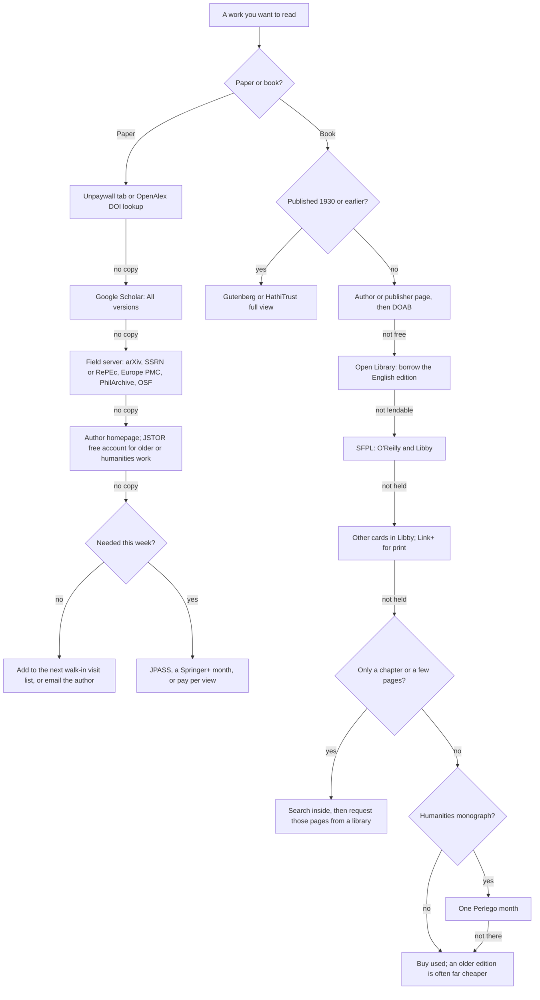
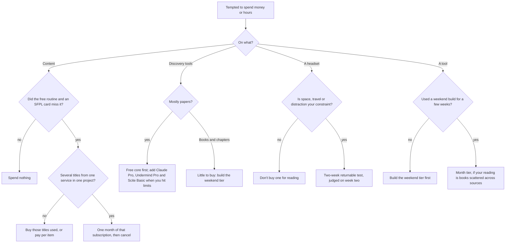

*Status: draft, October 2026. This chapter condenses the chapters it links. Every price, count and coverage figure is taken from them and carries their dates (most were checked on 2026-10-15). Figures that are my own arithmetic or inference are marked. The book-coverage figures come from small, hand-picked spot-checks: 55 canonical books, plus 33 technical and 20 humanities books. The paper figures come from one study of 875 cited works in seven fields, none of them ML, statistics or philosophy. Read all of them as rough, and as upper estimates for less famous lists. Four things are unverified and flagged where they come up: whether SFPL's JSTOR link works from home, whether O'Reilly's library edition carries its full catalog, whether a "Start Anytime" UC Berkeley Extension course qualifies for the \$25 library card, and every hour estimate for building. Sources: the linked chapters, which cite the primary sources and the [research dossiers](https://github.com/quantified-uncertainty/cairn/tree/main/apps/open-stacks/research).*

This page answers one question. Suppose you live in the Bay Area and want to browse and read across thousands of books, textbooks and papers, cheaply and legally. What should you do, and in what order? Each step gives the time it takes, its cash cost as of October 2026, what the evidence says it buys, and the chapter that holds that evidence. The order follows one rule from [The Access Ladder](/access/access-ladder/): use up the free routes before spending anything, then spend on what is still missing, not on the whole list.

## The short version

- **Free routes first, and stop when your list is covered.** In the spot-checks, nearly all coverage arrived before any money was spent, most of it with one free library card ([The Access Ladder](/access/access-ladder/)).
- **Tonight (\$0, about an hour):** install Unpaywall, open free Open Library and JSTOR accounts, learn the free-book routine, and apply online for a San Francisco Public Library (SFPL) card.
- **This week (\$0, one visit):** collect the SFPL card with photo ID. Its O'Reilly and Libby access plus legal free copies reached 28 of 33 well-known technical books (85%). O'Reilly alone costs \$499 a year ([O'Reilly](https://www.oreilly.com/pricing/), October 2026).
- **Papers:** the free legal tools found some version of 73% of 875 cited works (58% in the final version). One university library raised that to 88% (85%) ([Walters 2025](https://pmc.ncbi.nlm.nih.gov/articles/PMC12260569/), recomputed in [Open Papers and Preprints](/access/open-papers/)). Batch the rest into free walk-in visits.
- **Textbooks:** check the author's own book page first. Of 55 canonical books, 24 (44%) had a free legal text, including 8 of 10 in ML ([Open-Access Books and Textbooks](/access/open-books/)).
- **Subscriptions:** with an SFPL card, buy none by default, and buy the last few books used. The five technical titles that no free or Bay Area route reached cost \$159 together on 2026-10-15 ([Cheap Subscriptions](/access/subscriptions/)).
- **Pages inside books you can't read:** Internet Archive search-inside, HTRC Extracted Features and HathiTrust's page search, chained together, found printed page locations for a topic in 43 books in about 15 minutes, for \$0 ([Searching Inside Books](/finding/searching-inside-books/)).
- **AI tools:** start with the free core. The best paid bundle costs about \$45 a month at academic prices. AI search is precise, not exhaustive, and cited sources often don't support the claim, so check every reference ([AI Research Assistants](/finding/ai-research-assistants/)).
- **VR:** don't buy a headset to read better. If space, travel or distraction is your constraint, test a returnable \$349.99 Quest 3S for two weeks ([VR and Spatial Computing](/environments/vr-and-spatial-computing/)).
- **Building:** buy content and paper search; build routing for books and chapters, which nobody sells. Start with a weekend build (about \$22 and 12–20 hours). Keep shadow-library files and licensed full text out of it ([Costs and Effort](/building/costs-and-effort/), [The Legal Map](/building/legal-map/)).

## The plan at a glance

Steps are in priority order. Costs are as of October 2026; coverage figures come from the samples in each linked chapter.

| # | Step | When | Time | Cost (Oct 2026) | What it buys (evidence) | Main catch | Details |
|---|---|---|---|---|---|---|---|
| 1 | Unpaywall extension; Google Scholar "All versions" | Tonight | 10 min; under a minute per paper | \$0 | A free copy of 69% of cited works, 51% in the final version | Weak on pre-2001 work (36%) and cited books (3%) | [Open Papers](/access/open-papers/) |
| 2 | Open Library and JSTOR accounts; the free-book routine | Tonight | 30 min; about a minute per title [inference] | \$0 | 24 of 55 canonical books (44%) free; 30 (55%) with lending. 10 JSTOR articles every 30 days | Terms range from CC BY to "on-screen only"; check the borrowable edition's language | [Open Books](/access/open-books/) |
| 3 | SFPL card, then an evening to add it to Libby, activate O'Reilly, test JSTOR and place holds | This week | One branch visit, plus 45 min | \$0 for Californians | With free copies: 28 of 33 technical titles (85%) and 10 of 20 humanities titles | O'Reilly bans AI input; bestseller holds take weeks | [Public Libraries](/access/public-libraries/) |
| 4 | More cards: Peninsula–South Bay loop; East Bay; LAPL on a Los Angeles trip | Optional | An afternoon each | \$0 for Californians | Humanities ebooks in Libby: 10 → 16 of 20 (19 with LAPL). Technical: +1 title (CLRS, via LAPL) | Proof of address; not worth a dedicated LA trip | [Public Libraries](/access/public-libraries/) |
| 5 | Walk-in sessions for paywalled papers | When the backlog justifies it | Half a day per visit [inference] | \$0 | A university library raised coverage from 73% to 88% (final versions 58% to 85%) | On site only; no systematic downloading | [University and Employer Access](/access/academic-and-employer/) |
| 6 | Buy the residue used | Per project | Days | \$8–\$70 per title | The last 10–15% of a list | Shipping time | [The Access Ladder](/access/access-ladder/) |
| 7 | One month of one subscription | Only if a project needs it | Minutes | \$15–\$40 | Perlego: +2 humanities titles beyond six free cards | Personal use only; AI use banned or unverified | [Cheap Subscriptions](/access/subscriptions/) |
| 8 | Search inside books | Per topic | About 15 min | \$0 | Printed page locations for 43 of 52 HathiTrust-matched books in one test | 4 of 31 post-2010 books reachable | [Searching Inside Books](/finding/searching-inside-books/) |
| 9 | AI research stack | This month | An evening [inference] | Free; paid bundle \$45–\$89/month | Precise search, citation graphs, feeds | Recall roughly 30–85% [estimate]; unsupported citations | [AI Research Assistants](/finding/ai-research-assistants/) |
| 10 | Two-week VR test | Optional | Two daily sessions for 10 working days | Up to about \$375, mostly refundable | Your own answer | Buy inside a return window | [VR and Spatial Computing](/environments/vr-and-spatial-computing/) |
| 11 | Weekend build with Claude Code | When you want a tool | 12–20 h [estimate] | About \$22 | A searchable, mapped shelf of about 10,000 free works | Hours are most of the cost | [Costs and Effort](/building/costs-and-effort/) |

## Two decision charts

The first chart routes one work to its cheapest legal copy, compressing the paper workflow in [Open Papers and Preprints](/access/open-papers/) and the book routine in [Open-Access Books and Textbooks](/access/open-books/).

The second covers spending money or hours.

## Step 1. Tonight: the free routine

This costs \$0 and about an hour. Legal free copies alone covered a third of a famous technical list (11 of 33). With Open Library lending, free routes covered 18 of the 30 books (60%) in the mixed probability, ML, forecasting and philosophy list worked through in [The Access Ladder](/access/access-ladder/).

**Papers.** Install the [Unpaywall](https://unpaywall.org/) browser extension, which shows a tab on an article page when a legal free copy exists. When it finds nothing, search the title in Google Scholar and open "All versions", which groups preprints, accepted manuscripts and repository copies. Together these found some version of 69% of Walters' 875 cited works, and the final version of 51%.

**Books.** The routine from [Open-Access Books and Textbooks](/access/open-books/):

1. **Published in 1930 or earlier?** It is in the US public domain ([Duke CSPD](https://cspd.law.duke.edu/publicdomainday/2026/)). Go to [Project Gutenberg](https://www.gutenberg.org/) (79,598 ebooks on 2026-10-15) or HathiTrust full view. Check HathiTrust for US books from 1931–1963 too; one whose copyright was never renewed may already be public domain.
2. **Otherwise, find the book's own website.** Search the title plus "pdf" or "book", and look for the author's or publisher's domain. This found 8 of the 10 canonical ML books.
3. **Read the terms** before saving or sharing. They run from CC BY to "personal use only" and "view the book on-screen".
4. **For scholarly monographs, search [DOAB](https://directory.doabooks.org/)** (92,260 books on 2026-10-15, mostly humanities and social science). Filter by publisher: 69% of its STEM books come from IntechOpen, MDPI and Frontiers, mostly edited collections.
5. **For classics from 1930–1989, use [Open Library](https://openlibrary.org/).** Open the specific edition and confirm the borrowable copy is in English. Six of 12 books Open Library flagged as borrowable in the test were lendable only in translation or as a study guide.

**Accounts.** Open an Internet Archive / Open Library account: one-hour renewable loans in the browser, up to 10 books at a time ([Internet Archive](https://help.archive.org/help/borrowing-from-the-lending-library/)). Open a free [JSTOR account](https://about.jstor.org/oa-and-free/): 10 articles every 30 days, read online.

**Applications.** Submit SFPL's online form ([SFPL](https://sfpl.org/welcome-new-cardholders)). If you will drive the loop in Step 2, also apply online to San José and the Peninsula Library System.

**Start a list of the free copies you rely on,** with URL, edition, terms and last-checked date. Author-hosted books are the most valuable free layer for ML and statistics, the least indexed, and fragile. On 2026-10-15 the host of *The Elements of Statistical Learning* was unreachable, and Google's *Site Reliability Engineering* is free in its first edition but sold only in its second ([sre.google](https://sre.google/books/)).

## Step 2. This week: library cards

**The SFPL card is the largest single gain on the ladder.** It is free to every California resident: apply online, then show photo ID at any branch. No proof of address is asked ([SFPL](https://sfpl.org/welcome-new-cardholders), October 2026). It unlocks ([SFPL databases](https://sfpl.org/articles-databases)):

- **O'Reilly for Public Libraries,** the platform behind the \$499-a-year individual plan. I put [~70%] on nearly all its books being readable through the library; nobody in this research logged in to check.
- **Libby,** LinkedIn Learning, ProQuest eBook Central, and EBSCO and Gale article databases.
- **A JSTOR link,** although JSTOR says public-library access is walk-in only.
- **Link+,** for print books held by other libraries.

In the technical spot-check, SFPL's O'Reilly held 14 of 33 titles and its Libby 10. With legal free copies they reached 28 (85%). The five missing were CLRS, AIMA, CS:APP, *Gödel, Escher, Bach* and Jaynes beyond chapter 3. Of 20 humanities titles the card reached 10, all through Libby.

**Which extra cards are worth an afternoon** (increments over SFPL, from the 2026-10-15 spot-checks in [Public Libraries](/access/public-libraries/)):

| You are… | Get | What it adds |
|---|---|---|
| A technical reader on a laptop or Boox tablet | SFPL alone | All of the measured technical coverage |
| A technical reader on a Kindle or Kobo | SFPL plus San José | Libby editions of six titles that are otherwise only on O'Reilly or the free web. Neither device runs O'Reilly |
| A humanities or trade non-fiction reader | Santa Clara County first, then the Peninsula Library System and Berkeley | Humanities ebooks in Libby rise from 10 to 16 of 20 (Santa Clara County +4) |
| Not a California resident | Santa Clara County, in person | A free full card for anyone with a US mailing address ([SCCLD](https://sccld.org/card/)) |
| Passing through Los Angeles | LAPL | +1 technical title (CLRS) and +3 humanities titles. No O'Reilly |

**The afternoon.** The Peninsula–South Bay loop, by car: an SFPL branch (photo ID), a Peninsula Library System library (photo ID plus proof of address), a San José branch (photo ID plus proof of a California address), and a Santa Clara County branch (photo ID showing your current address). Every card is \$0. This loop supplied all eight extra technical Libby titles and five of the six extra humanities titles. The East Bay (Oakland, Berkeley) is a second afternoon, mainly for Berkeley's JSTOR link and in-library physics journals.

**The evening after (about 45 minutes).** Add every card to Libby, with hold notifications on. Activate O'Reilly from SFPL's database list. Then test SFPL's JSTOR link from home. JSTOR says remote public-library access "is not currently supported" ([JSTOR](https://about.jstor.org/products/fees/public-libraries/)), but SFPL lists a remote link; I put it at [~50%] that it works. The answer decides whether JPASS is ever worth buying. Finally, place holds at every library that has a book you want and take the first copy. With several queues, your wait is roughly the shortest one [inference].

**Holds are the real price.** On 2026-10-15, *Thinking, Fast and Slow* had 13 copies and 51 holds at SFPL, roughly 8–12 weeks for a new hold [inference]. A used *Superforecasting* cost \$9.38 that day. When the queue is longer than you will wait and the book is cheap, buy it.

**Print-only books:** use Link+ before interlibrary loan. It reaches "over 11 million items from 64 libraries", free, and "most LINK+ requests arrive in less than one week" ([Oakland PL](https://oaklandlibrary.org/borrow-from-another-library/)). Only 5 members are academic libraries, so expect it to be weaker for graduate texts [~70%].

**What the card does not license.** O'Reilly's membership agreement (2024-10-09) forbids using content "as input or a prompt to a machine learning or AI system" ([O'Reilly](https://www.oreilly.com/membership-agreement/)); I put [~75%] on that binding library patrons. Read in the library's apps; give Claude your notes, the table of contents and the metadata.

**Get in-person cards while they are offered.** LAPL's instant e-card is now for Los Angeles City residents only, citing vendor licensing ([LAPL](https://lapl.org/library-card/borrowing-policies-and-information)), and Orlando's library system stopped issuing fee cards on 2026-07-31. *Public Libraries* puts [~70%] on another widely recommended out-of-area route closing or narrowing by the end of 2027.

## Step 3. Getting any paper legally

Run the steps in order of time cost. "Measured" and "recomputed" figures come from Walters' 875 works cited in 2023 reviews in chemistry, materials science, cardiology, public health, economics, education and psychology ([Walters, *PNAS* 2025](https://pmc.ncbi.nlm.nih.gov/articles/PMC12260569/)). The rest are estimates from [Open Papers and Preprints](/access/open-papers/).

| Step | Action | Time | Cumulative chance of a legal copy (any version / final) |
|---|---|---|---|
| 1 | Unpaywall, or an OpenAlex DOI lookup | Seconds | 48% / 35% (measured) |
| 2 | Google Scholar, "All versions" | 1 min | 69% / 51% (recomputed) |
| 3 | ResearchGate and Academia.edu | 1–2 min | 72% / 57% (recomputed) |
| 4 | The field's server: arXiv; SSRN, RePEc; Europe PMC; PhilArchive; OSF | 2–3 min | 73% / 58% (recomputed); perhaps 74–76% with servers Walters did not test [~50%] |
| 5 | Author homepage, then CORE | 2–5 min | Perhaps 1–2 more points [~50%] |
| 6 | JSTOR free account | Minutes | Adds most for pre-2001 work, where steps 1–4 reach 36% [~60%] |
| 7 | A library: university login or walk-in; otherwise public-library databases and interlibrary loan | Same day to 2 weeks | 88% / 85% with a university library (recomputed); about 80% without [~50%] |
| 8 | Email the author | 1–14 days | About 85–92% without institutional access [~45%] |
| 9 | Pay: JPASS at \$1.66–\$1.95 a PDF, or the publisher's price | Minutes | About 95–100% |

**Field matters.** In ML, statistics, physics and mathematics, start at arXiv: posting there is the norm, so it usually ends the search [~80%]. Walters' fields leave these out, so expect higher coverage than his 73% [~70%]. In economics, expect a working paper: Scholar found some version of 72% of economics items but the final version of only 33%. For old work and books (36% of pre-2001 works and 1 of 37 cited books were legally free), go to a library first. When the free copy is a preprint, compare key tables with the published version before citing a number.

**Walk-in visits are the free library step.** UC Berkeley lets visitors use licensed databases on its public computers ([UCB](https://www.lib.berkeley.edu/help/visitors)). SF State's research stations need "no account or login", and you can save to your own USB drive ([SF State](https://library.sfsu.edu/community-borrowers)). Stanford gives anyone 7 free day passes a year ([Stanford](https://library.stanford.edu/about-stanford-libraries/visitor-access)). All as of October 2026. Run steps 1–6 at home first, bring a list of DOIs, and keep downloads to research scale: JSTOR forbids users to "systematically print out, download, reproduce or distribute" content ([JSTOR terms](https://about.jstor.org/terms/), 2026-04-24). Tag files you bring home "obtained on-site, personal use" so no later AI pipeline treats them as open.

**Asking the author.** No study measures how often a request for a copy succeeds. *Open Papers and Preprints* extrapolates from data-request studies: 50–70% within two weeks for papers under five years old with a working address, under 30% for papers over ten years old at the printed address [~55% that the true rates fall in these ranges]. Write to the current address and ask for the accepted manuscript.

**When to pay** (October 2026):

- **[JPASS](https://about.jstor.org/products/jpass/):** \$19.50 a month for 10 PDFs, or \$199 a year for 120. Only if you read a lot on JSTOR and SFPL's link fails from home.
- **[Springer+ Basic](https://link.springer.com/product/springer-plus):** \$39.99 for 10 chapters or articles in a month, against \$29.95–\$39.95 each pay-per-view. Queue the list, subscribe for a month, then cancel.
- **[DeepDyve](https://www.deepdyve.com/pricing):** \$499 a year for streamed papers. Against \$39.95 pay-per-view, it breaks even at about 12.5 otherwise unreachable articles a year.

**Remote university access costs more than its sticker price.** No paid community card at UC Berkeley, Stanford or SF State includes remote e-resources ([University and Employer Access](/access/academic-and-employer/)). The UC Berkeley Extension card costs \$25 for six months, but only while you take a course of 10 weeks or more ([Extension](https://berkeleyextension.zendesk.com/hc/en-us/articles/16655644122647-Library-use)); the cheapest likely-qualifying course in an October 2026 sample was \$810, so about \$835 per six months. Whether a self-paced "Start Anytime" course counts is unverified [~60%]: ask the library's Privileges Desk first. A visiting-scholar appointment costs \$750 for the first year ([VSPA](https://vspa.berkeley.edu/about/university-services-fee)) but needs a faculty sponsor, and the norm is a PhD. Take Extension only if you want the course, the visiting-scholar route only with a real collaborator, and walk-in visits otherwise.

## Step 4. Free textbook copies

Where to look first, with hit rates from the 55-book test in [Open-Access Books and Textbooks](/access/open-books/):

| If you want | Look first at | Hit rate in the test | Then |
|---|---|---|---|
| A modern ML or AI textbook | The author's book page | 8 of 10 | The publisher's page; DOAB for MIT Press |
| A probability or statistics text | Author's page, then DOAB | 3 of 9, plus Jaynes ch. 1–3 | A free substitute; a library |
| Decision theory, forecasting, economics | Author's page, then DOAB | 2 of 9 | A free substitute; a library |
| An introduction to a new field | Open Textbook Library, OpenStax | Not tested | LibreTexts |
| A classic from 1930 or earlier | Gutenberg, Standard Ebooks | 6 of 6 | HathiTrust, Wikisource |
| A classic from 1930–1989 | Open Library, English edition | 0 of 6 free; 4 of 6 borrowable | A library; buy used |
| Popular non-fiction since 1990 | Libby | 1 of 10 free | A hold, or buy used |

**Expect most of the famous ML books and little else.** Of the test's post-1990 technical textbooks, 17 of 33 (52%) are free, but only 9 of 23 (39%) outside ML. The list was chosen by an LLM, which probably favors famously free books [~75%]. Beyond that core, commercial textbook series barely appear in the open record: DOAB lists 3 *Graduate Texts in Mathematics* volumes. The free share of all modern textbooks is probably well under 20% [~75%].

**Free substitutes cover many gaps** (the chapter's judgments, not measured equivalences): [Grinstead & Snell](https://math.dartmouth.edu/~prob/prob/prob.pdf) or Durrett for Feller; [MIT OCW 6.041SC](https://ocw.mit.edu/courses/6-041sc-probabilistic-systems-analysis-and-applied-probability-fall-2013/) for Bertsekas & Tsitsiklis; Erickson's [*Algorithms*](https://jeffe.cs.illinois.edu/teaching/algorithms/) (CC BY 4.0) for CLRS; Hernán & Robins's *What If* for Pearl's *Causality*.

**Open textbooks are introductory.** OpenStax (84 live titles; new and updated ones under CC BY-NC-SA since 2026-04-22, [OpenStax](https://openstax.org/blog/openstax-licensing)) and the [Open Textbook Library](https://open.umn.edu/opentextbooks) (1,887 titles) suit a first course in an unfamiliar field, not graduate ML or statistics.

**Legal or pirated?** A legal free copy sits on the author's or publisher's site or in a recognised repository, and often says why it is free. A recent commercial textbook on an unrelated mirror or anonymous drive is very likely unauthorised. This wiki never routes to shadow libraries ([The Shadow Libraries](/access/shadow-libraries/)). And free to read is not free to reuse: 15 of the 24 free books are gratis copies with all rights reserved, which a personal tool may index locally but not redistribute.

## Step 5. Whether to buy a subscription

**The default is none.** With an SFPL card, O'Reilly Individual (\$499 a year) added no technical titles in the sample, if the library edition carries the same books [~70%]. Perlego's 5 technical hits were all reachable elsewhere. For humanities, a Perlego month lifted the six Bay Area cards from 16 to 18 of 20, at \$7.50–\$13.50 per added title ([The Access Ladder](/access/access-ladder/)).

By what you mostly read (prices as of 2026-10-15, from [Cheap Subscriptions](/access/subscriptions/)):

| If you mainly read… | Buy | Cost (Oct 2026) | Why | Catch |
|---|---|---|---|---|
| Practitioner ML, data and systems books, and a library offers O'Reilly | **Nothing.** Get the card | \$0 | The same platform | Early releases and live events may be missing [inference] |
| Practitioner books, no library route | [O'Reilly](https://www.oreilly.com/pricing/) a month (\$49) or three (\$129) at a time | \$49–\$499 | 14 of 33 technical titles, against Perlego's 5 | AI input banned; access ends when you stop paying |
| Theory texts (MIT Press, Cambridge, Springer, Pearson textbooks) | **No subscription.** Author PDFs, used copies, LAPL's Libby, a Springer+ month | Per title | O'Reilly had 0 and Perlego 1 of 11 such texts | Used AIMA (\$128) and CS:APP (\$93) are dear |
| Humanities, social-science or economics monographs | [Perlego](https://www.perlego.com/pricing/) Complete, \$79 for four months per project | \$79–\$199 | 8 of 20 against O'Reilly's 0; 153,000 Routledge titles | US rights vary by title; libraries had 16 of 20 famous titles anyway |
| Papers from the JSTOR backfile | The free account, then JPASS | \$0–\$199 a year | \$1.66 per PDF | 120-PDF cap; no bulk or AI use |
| Popular non-fiction | Library cards | \$0 | SFPL's Libby had 7 of 8 | Holds. Everand Plus (\$16.99 for 3 unlocks) only if holds limit you |

**If you can buy only one subscription, buy books instead.** The five technical titles SFPL's route missed cost \$159 at the cheapest listings, or \$315 with used US copies of AIMA and CS:APP: less than a year of O'Reilly, paid once, for books you keep. No single subscription covered more than 42% of either sample list. If you do pay for O'Reilly, buy quarters: eleven months as three quarters plus two months cost \$485, less than the annual plan.

**Skip for research reading:** Everand (unlocks cost \$5.66–\$11.99 per book), Kindle Unlimited (probably mostly self-published [~80%]; price unverified), a full year of Perlego, and DeepDyve without a heavy paywalled-paper load.

**Test your own list first.** Famous books favor libraries, and Perlego's strength is probably the long tail of monographs [~70%]. *Cheap Subscriptions* gives a one-hour protocol: list the 20–40 titles you expect to read, mark free copies, match O'Reilly's public sitemap, query Libby at each library, check Perlego, and compare each service's cost per added title with the used price.

**No subscription is a corpus.** Every plan is sold to individuals and cannot be pooled into a team tool. O'Reilly bans AI input, JSTOR bans automated downloading and LLM training, and Perlego's terms could not be found.

## Step 6. Searching inside books you don't have

For "which books discuss X, and on which pages?", a chain of free services answers without showing the text ([Searching Inside Books You Don't Have](/finding/searching-inside-books/), October 2026):

| Stage | Service | What it returns | Scriptable? |
|---|---|---|---|
| Vocabulary and eras | [Ngram Viewer](https://books.google.com/ngrams/info) | Yearly frequency of a phrase | Yes |
| Candidates | [Internet Archive / Open Library search-inside](https://openlibrary.org/search/inside) | Matching scanned books, up to 5 snippets each, counts by subject and year. Not the hit page: `page_num` is the scan's length | Yes, 1 request a second |
| Page location | [HTRC Extracted Features 2.5](https://htrc.atlassian.net/wiki/spaces/COM/pages/975306753/Extracted+Features+v.2.5) | Word counts per page for 18.7M volumes, 9.97M in copyright; CC BY 4.0 | Bulk files |
| Verification | [HathiTrust full-text search](https://babel.hathitrust.org/cgi/ls) | Page numbers and per-page counts, no text | No; by hand |
| Recent books | Google Books; Amazon Look Inside | A few snippets, previews, often the index | By hand |

**A worked run** asked which books discuss proper scoring rules. Search-inside returned 179 candidates. Of these, 52 matched a HathiTrust record, all search-only; printed pages were recovered for 43, and 17 had a section of three or more pages rather than a passing mention. The best hit was Lad (1996), pp. 334–357. It took about 15 minutes and \$0.

**Recency is the cliff.** Of candidates published before 1990, 82% could be borrowed or page-searched; of those since 2010, 4 of 31. For recent books, use previews and the back-of-book index, and expect to buy.

**Then route the hits:** borrow the lendable books in one sitting and read only the located pages; send one library request for older search-only chapters; check whether an edited-volume chapter reprints a free paper; spend money only on recent books whose previews confirm real treatment.

**Mirror the page data you need now.** HTRC's services closed on 2026-09-30 ([HTRC](https://analytics.hathitrust.org/)), and *Searching Inside Books* puts [~60%] on Extracted Features 2.5 still being downloadable from an official host on 2027-06-30. A 10,000-volume subset is about 2.4–3.9 GB.

## Step 7. AI research tools

**No product does the whole job;** a good personal stack uses about three tools ([AI Research Assistants](/finding/ai-research-assistants/), prices checked 2026-10-15):

| Job | Free default | Paid upgrade, if… | Cost (Oct 2026, billed annually) |
|---|---|---|---|
| Find papers | [Google Scholar Labs](https://scholar.googleblog.com/2026/06/scholar-labs-update-search-10x-faster.html); [Ai2 Asta](https://allenai.org/blog/asta) Paper Finder in exhaustive mode; Undermind's free tier | Undermind Pro, for more than a few hard searches a week | \$16/month academic, \$60 industry ([Undermind](https://www.undermind.ai/pricing)) |
| Synthesize | The research mode you already pay for, read as a map | Elicit Pro, only for weekly structured extraction | \$49/month ([Elicit](https://elicit.com/pricing)) |
| Is a claim contested? | Read the citing papers | Scite Basic | \$12/month ([Scite](https://scite.ai/pricing)) |
| Citation graphs | [Inciteful](https://inciteful.xyz/); Local Citation Network | Litmaps Pro or ResearchRabbit, for alerts | \$10/month |
| New-paper feeds | [Scholar Inbox](https://www.scholar-inbox.com/); Hugging Face Papers | None needed | Free |
| Library and reading | [Zotero 10](https://www.zotero.org/blog/zotero-10/); Scholar PDF Reader; Semantic Reader | Readwise Reader | \$9.99/month |

The core paid bundle, Claude Pro (\$17 a month annually; [Claude](https://claude.com/pricing)) plus Undermind Pro and Scite Basic, costs about \$45 a month at Undermind's academic price and \$89 at its industry price. Undermind and Scite can be called from Claude through MCP.

**What the evidence says.**

- **AI search is precise, not exhaustive.** Against four completed evidence syntheses, Elicit's search found on average 39.5% of the included studies, versus 94.5% for the librarian-built searches, at 5.5 times the precision ([Lau & Golder 2025](https://pmc.ncbi.nlm.nih.gov/articles/PMC12483133/)). Vendor figures of 93–97% mostly measure screening, a different task. The chapter's estimate for the best tools on exploratory queries is 30–85% recall [low to medium confidence]: fine for browsing a field, not enough to claim nobody has done X.
- **Cited sources usually exist but often don't support the claim.** Search-grounded systems invented 3–13% of cited URLs, and resolving every link cut that to under 1% ([Rao, Wong & Callison-Burch 2026](https://arxiv.org/abs/2604.03173)). Deep-research modes left 12.5% (GPT-5) to 97.5% (Perplexity) of statements unsupported by any listed source ([DeepTRACE](https://arxiv.org/abs/2509.04499), 2025 versions).
- **The literature now contains fabricated references:** 1 in 277 papers in early 2026, against 1 in 2,828 in 2023 ([STAT on the *Lancet* study](https://www.statnews.com/2026/05/07/lancet-study-finds-steep-rise-fraudulent-citations-academic-papers/)).
- **Books are nearly invisible** to these tools, which run on paper metadata. For books, use [Curation](/finding/curation/), [Browsing the Stacks](/finding/browsing-the-stacks/) and Step 6.

**Rules of use.** Resolve every reference and check five citations per report against the cited passage. Run any synthesis you will rely on twice and compare the cited sources. Before claiming a gap in the literature, search two different indexes and estimate what you missed with capture–recapture, N ≈ n₁n₂/m: if one search finds 30 relevant papers, the other 24, and 18 overlap, N ≈ 40, so your 36 miss about 4. Overlapping indexes miss the same papers, so treat N as a lower bound.

## Step 8. Whether to try VR

**Don't buy a headset to read better.** A 27-inch 4K or 5K monitor at 60 cm gives 67–90 pixels per degree (PPD); the Quest 3S gives about 20, the Vision Pro about 34, and Meta's announced VR Glasses promise 37. Headset text must be 3–4 times larger in visual angle, so only one or two pages are comfortably readable in view ([VR and Spatial Computing](/environments/vr-and-spatial-computing/)).

**The evidence is thin and mostly on old hardware.** In one study of 29 observers, reading took about 7% longer on a 13-PPD headset than on a ~60-PPD one, while legibility effects were about ten times larger. In the one controlled week of VR work ([Biener et al. 2022](https://arxiv.org/abs/2206.03189)), 16 people on a Quest 2, compared with a physical setup at the same 1366×768 resolution, reported 35% higher task load, 48% more eye strain and 16% lower perceived productivity. Only 3 of 16 preferred VR. Against that, 4 of 10 self-selected long-term Vision Pro users work in it 5–8 hours a day ([Biener et al. 2025](https://arxiv.org/abs/2509.05067)): possible, not typical. No study compares comprehension on 2025–2026 headsets with a monitor.

**Who might gain:** readers short of space, reading while travelling, or fighting distraction, and anyone laying out many documents at once for a literature review.

**The cheapest experiment** (up to about \$375, mostly refundable):

1. **Free, one day:** enlarge your text to about 1° per em (about 30-point type at 60 cm) and work one page at a time. If that density is intolerable, a 20–35 PPD headset will be too.
2. **Hardware:** a Quest 3S (128 GB, \$349.99 since 2026-04-19; [Meta](https://www.meta.com/blog/update-meta-quest-pricing/)) from a seller whose return window covers two weeks. Stream your computer with Meta's free app, or Virtual Desktop (\$24.99).
3. **Design:** for 10 working days, read at least 60 minutes in the headset and 60 at your monitor each day, alternating which comes first, on the same kind of material. Log reading speed, a 5-question quiz, eye strain (1–7), and whether you would choose the headset tomorrow.
4. **Decide on days 6–10 only,** since adaptation dominated Biener's week. Keep it only if speed is at least 90% of the monitor's, quiz scores average no more than one question in five lower, eye strain no more than one point worse, and you would have chosen it on at least half the days. Otherwise return it.

The VR chapter's prior that you keep using it is [~20%], anchored on Biener's 3 of 16. For travel, run the same test with display glasses ([VITURE Luma](https://www.viture.com/), \$399). If text looked soft, the next tier is 33–37 PPD: Galaxy XR (\$1,799), Vision Pro (\$3,699), or Meta's VR Glasses (\$1,299.99, spring 2027).

**Cheaper device questions come first.** Paper beats screens on comprehension by a small margin (g = −0.21 across 54 studies), and e-readers did no better than tablets. Kobo e-readers borrow from Libby directly, Kindle gets Libby loans in the US only, and Boox is the only mainstream e-ink line that runs the O'Reilly app ([Reading Modes and Devices](/environments/reading-modes-and-devices/)).

## Step 9. Build or buy with Claude Code

**Services sell content (the right to read) and discovery (finding what to read).** A catalog you build is discovery only; content stays a separate decision, made in Steps 1–5. For papers, buy discovery: a \$144–\$588-a-year seat is cheaper than the hours to match it [~80%]. For books and chapters, build: R10 found no tool that places chapters from books, papers and lectures on one map and routes each to the best legal copy, and [Costs and Effort](/building/costs-and-effort/) knows of none [~80%].

**Your hours are most of the cost.** Hours are R10's unmeasured estimates for one strong developer driving Claude Code; there is about a 50% chance a first-time builder exceeds the upper end.

| Tier | Hours | Money (Oct 2026) | What it delivers |
|---|---|---|---|
| Weekend | 12–20 | About \$22: Claude Pro \$20 plus \$1.50 of Haiku 5.5 batch summaries for 10,000 works; embeddings and hosting \$0 | A searchable shelf of about 10,000 free works, with summaries and a topic map |
| Month | 80–120 (100–140 with human checking) | \$510–\$1,360 in the worked example; \$165–\$425 with Haiku on the core shelf | A 100,000-work catalog with best-free-copy links and chapter-level search |
| Quarter | 300–450 | About \$650–\$18,100 | 10M works with incremental updates and quality dashboards |

At \$50–\$150 an hour, the month tier's hours are worth \$5,000–\$21,000. A year of four discovery subscriptions (Elicit, Undermind, Consensus, Claude Pro) costs \$1,124.

### What to build first

1. **A literature agent from parts** (an evening to a weekend [my estimate]). Claude Code with web search and [zotero-mcp](https://github.com/54yyyu/zotero-mcp), calling Undermind's MCP server (free plan), Asta's corpus tool and OpenAlex (a free key gives \$1 of calls a day) as tools. Put the rules from [AI Research Assistants](/finding/ai-research-assistants/) in your `CLAUDE.md`: no unresolved references, an evidence label on every claim, two indexes with the overlap reported. Call the engines; don't imitate them. On Undermind's own benchmark (vendor-run, 23 queries), Claude Opus 5 in Claude Code with web search found 47% of the top 20 relevant papers, against Undermind's 85%.
2. **Your access profile** (a few hours [my estimate]). Script the one-hour coverage test from [Cheap Subscriptions](/access/subscriptions/) over your reading list: free copies, O'Reilly's public sitemap (66,609 titles on 2026-10-15), Libby availability per library through OverDrive's undocumented catalog API, Open Library lending resolved to an English edition, and Unpaywall for DOIs. The output, your cheapest route for each title, is the seed of the resolver in [A Reference Architecture](/building/reference-architecture/). Query politely: scraping library catalogs is rated yellow.
3. **A mirror of the HTRC page data for your fields,** before the host goes (Step 6).
4. **The weekend tier:** a free shelf from Gutenberg, OpenStax and DOAB, with small-model summaries, client-side semantic search over a vector file under 50 MB, and free static hosting. *A Reference Architecture* gives a first instruction for Claude Code.
5. **The month tier only after using the weekend build for a few weeks [my suggestion],** and only if your reading is books and chapters scattered across sources.

### What not to build

| Don't | Why | Instead |
|---|---|---|
| Rebuild paper search or feeds | The engines lead (85% against 47% on Undermind's vendor-run benchmark), and a seat costs less than the hours | Call Undermind, Asta, Scite, Consensus and OpenAlex as tools |
| Feed licensed full text to a model | O'Reilly bans AI input; Elsevier (2026-03-12) bars use "in combination with an artificial intelligence tool" without a license; JSTOR bans LLM training | Metadata, tables of contents, your notes, openly licensed text |
| Automate downloads through a library or employer login | Rated red; publishers block whole IP ranges | The open copy, or a publisher's text-mining API under license |
| Let any shadow-library file in, even privately | Acquisition drove *Bartz v. Anthropic*'s \$1.5B settlement over 482,460 works, about \$3,000 per work ([settlement](https://www.anthropiccopyrightsettlement.com/)) | A resolver that says "no lawful copy found" |
| Store Google Books API results, scrape WorldCat, harvest YouTube transcripts | Red by contract | Live lookups, Open Library dumps, timestamped links |
| Break ebook DRM on a book you own | Red outside a narrow university exemption | Buy print or DRM-free; keep scans private |
| Run a server from day one | Static hosting should serve 100,000 works for \$0 a month (R10's design [~80%]) | Static until you need full-text chunk search or shared editing |
| Use frontier models for bulk jobs | Summaries of 100,000 books cost \$15 on Haiku 5.5, \$600 on Opus 5.5 (batch); thinking tokens bill as output | Small model for the long tail; a 1% pilot first |
| Build a virtual reading room first | No evidence yet that it helps reading | Step 8's test |

*The Legal Map* puts [~90%] on a personal tool carrying little legal risk if it avoids those red activities and keeps licensed PDFs away from cloud models unless the license allows it. A shared or public service changes most of the ratings.

## How much to trust this page

- **Coverage samples are small and favor famous books.** The standard error is about 6 points on 85% at n = 33 and 9 points on 80% at n = 20. The LLM-chosen 55-book list probably inflates the free share [~75%]. For a less famous list, read every coverage figure as an upper estimate [~70%].
- **Library results are one-day catalog lookups,** not logged-in tests.
- **The paper figures come from one study in seven fields;** coverage in arXiv-heavy fields should be higher [~70%].
- **The AI audits tested 2025 versions,** and rankings age fast.
- **The VR verdict rests on one controlled week** (n = 16, Quest 2) and a self-selected interview sample.
- **Build hours are unmeasured,** and prices are one-day snapshots that moved during 2026.

The disagreements that would change this plan are in [Cruxes](/start-here/cruxes/).

## If your situation differs

| If you… | Change the plan this way | Details |
|---|---|---|
| Live outside California | Santa Clara County gives anyone with a US mailing address a free full card in person; LAPL sells non-Californians a \$50 card in person. Don't rely on one remote fee card | [Public Libraries](/access/public-libraries/) |
| Have a university or employer login | Use it first for papers. Get the AI and text-mining clauses in writing before building on it | [University and Employer Access](/access/academic-and-employer/) |
| Read mostly ML and arXiv | Start papers at arXiv. The author-hosted canon covers most famous books; SFPL alone covered the technical sample | [Open Books](/access/open-books/) |
| Read mostly humanities, history or economics | The Peninsula–South Bay cards, Open Library for 1930–1989 classics, a JSTOR account, a Perlego month per project | [Public Libraries](/access/public-libraries/) |
| Read on a Kindle or Kobo | Libby reaches both (Kindle in the US only), O'Reilly neither. Add San José for Libby editions of O'Reilly titles | [Reading Modes and Devices](/environments/reading-modes-and-devices/) |
| Are an alumnus of another university | Check your alumni library and JSTOR alumni access before paying for anything | [University and Employer Access](/access/academic-and-employer/) |
| Want a tool to index books you buy | Buy print or DRM-free editions | [Your Own Library](/access/your-own-library/) |

## Open questions

- **Does SFPL's JSTOR link work from home?** Any cardholder can test it in five minutes; the estimate is [~50%]. It decides whether JPASS ever makes sense here.
- **Does O'Reilly for Public Libraries carry the full book catalog, and do its AI clauses bind library patrons?** Estimates [~70%] and [~75%]. Check a random sample of sitemap titles through a library login, and read the terms shown at first login.
- **Does a 3-unit "Start Anytime" Extension course qualify for the \$25 card?** Estimate [~60%]. Ask UC Berkeley Library's Privileges Desk, naming a course.
- **What does this plan cover on a list that isn't famous?** Draw about 300 titles at random from public syllabi in statistics, ML, economics and philosophy and run every step, reporting coverage by step with error bars.
- **What is legal paper coverage in ML, statistics and philosophy?** Rerun Walters' protocol on 100 works cited in recent reviews, with arXiv counted separately.
- **How often do authors answer a request for a copy,** by field and paper age? An opt-in logging tool could measure it.
- **Does a well-tooled Claude Code agent close the recall gap with Undermind** on forecasting, decision-theory and statistics queries, judged by people reading full text?
- **Does a headset at 35 PPD or more match a 4K monitor on comprehension** over 60–120-minute sessions? A Biener-style week on current hardware would settle it.
- **How many hours do real builds take?** Anyone building the weekend or month tier could log hours by phase and publish them.

## Related pages

- [Open Stacks](/start-here/introduction/): what the wiki covers and why catalog and content are kept apart
- [Cruxes](/start-here/cruxes/): the disagreements that would change this plan
- [The Access Ladder](/access/access-ladder/): every legal route in cost order, with a 30-book worked example
- [Public Libraries](/access/public-libraries/): the card plan, holds and Link+
- [Open Papers and Preprints](/access/open-papers/): the paper workflow and the Walters recomputation
- [Open-Access Books and Textbooks](/access/open-books/): the 55-book test and the author-hosted canon
- [Cheap Subscriptions](/access/subscriptions/): prices, catalogs, license terms and the one-hour test
- [University and Employer Access](/access/academic-and-employer/): walk-in visits, Extension and visiting scholars
- [Searching Inside Books You Don't Have](/finding/searching-inside-books/): the page-location chain and its worked example
- [AI Research Assistants](/finding/ai-research-assistants/): the landscape, the audits and the Claude Code baseline
- [VR and Spatial Computing](/environments/vr-and-spatial-computing/): hardware, evidence and the two-week experiment
- [Reading Modes and Devices](/environments/reading-modes-and-devices/): e-ink, tablets, paper and monitors
- [Costs and Effort](/building/costs-and-effort/): build costs and the build-or-buy comparison
- [The Legal Map](/building/legal-map/): what a tool may store, summarize and link
- [A Reference Architecture](/building/reference-architecture/): the pipeline the build steps grow into
- [Directory of Sources and Tools](/reference/directory/)
