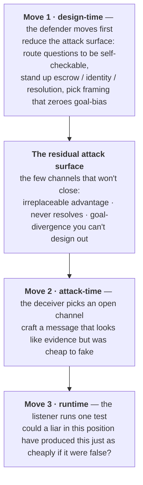

*Most consequential information comes from someone who wants something. Asking how much to trust the source is the wrong question, because most of the defense against being lied to happens before the source speaks. This chapter models strategic information as a security game in which the defender moves first: reduce the attack surface by design, accept that a few channels never close, and on those apply one test — a message is worth only what it would have cost a liar to fake.*

:::note
This chapter is the attack model for the rest of the notes — the source-side companion to the [decision-relative bias](/concepts/process-catalogue/#reading-the-table) of the Process Catalogue and the [routing program](/concepts/oversight-protocols/#narrowing-the-residue) of the oversight chapter.
:::

## The one idea

[Epistemic Impact Analysis](/proposals/epistemic-impact-analysis/) prices information as if it simply arrives. Most information that matters arrives from an interested party: an advocate before a judge, a company before a regulator, an AI before its overseer. The naive fix is a trust score for the source. The alternative argued here rests on [costly-signaling theory](https://ocw.mit.edu/courses/15-025-game-theory-for-strategic-advantage-spring-2015/c7de229ffadd7fb5dfe1d01b52f8ea48_MIT15_025S15_Lec_19.pdf): a message is credible when it is cheap to send if true and expensive to fake if false. As advice to a listener:

> **A message is worth only what it would have cost a liar to fake.** Don't ask whether an argument is convincing. Ask whether a liar could have made it *just as* convincing.

The defender's job is mostly done before any message exists, by arranging that the questions which matter cannot be cheaply faked. What survives is a small set of channels where faking is cheap and unavoidable; there the listener falls back on the test.

## Why anything survives distrust at all

The correct update on a message $m$ from an advocate of claim $C$ is the likelihood ratio **[exact]**

$$
\text{LR}(m) = \frac{P(m \mid C \text{ true})}{P(m \mid C \text{ false})}.
$$

For some forms it barely depends on the sender's intentions: a valid proof from a liar is still a valid proof. A form keeps its value under distrust when it is **hard to produce when wrong**, so the denominator stays small whoever is talking. That denominator is the cost-to-fake of the one idea. Value under distrust lives in checkability, not in source character.

Theory anchors the extremes. Unverifiable assertion is [cheap talk](https://www.jstor.org/stable/1913390): costless when wrong, so its content collapses under distrust. Verifiable evidence is the opposite pole: in disclosure games a skeptical receiver has bounded downside, because what *isn't* shown becomes informative ([unraveling](https://www.jstor.org/stable/3003562)). [Bayesian persuasion](https://www.aeaweb.org/articles?id=10.1257/aer.101.6.2590) characterizes the territory between. Evidence law reached the same core independently: [Friedman's route analysis](https://openyls.law.yale.edu/entities/publication/518633f2-8951-4055-b5e6-a9bb04a8c47a) (Yale L.J. 1987) grounds the value of testimony in this likelihood ratio, and analyses a stranger's offer to *bet* on a bizarre proposition as evidence for it, since a bluff costs money if called. <!-- TODO(verify): pinpoint page for Friedman's bet example; source PDF not reachable in Oct 2026 round. -->

## Deception is a game the defender moves first in

The naive picture is a listener filtering a message. The better picture is a sequential game in which **the defender moves first**: the structure of Stackelberg security games ([Conitzer & Sandholm 2006](https://doi.org/10.1145/1134707.1134717) on computing the optimal commitment; [Korzhyk et al. 2011](https://arxiv.org/abs/1401.3888) on the model behind the LAX and air-marshal deployments). The defender commits, the attacker observes the committed environment and best-responds, and the defender's craft is choosing the commitment that leaves the attacker the worst best response.

Call the set of routes a strategic sender could use to move you the **attack surface**, and each route a **channel**. Most of the defense is then design-time: nobody can lie past a proof checker, a neutral reproduction, or a resolving bet, and the runtime test works only on channels that survived Move 1. A running case: an AI advocate trying to nudge its overseer toward approving a plan.

## Move 1: reduce the attack surface

Deception is a live risk only when a conjunction of conditions holds, so breaking any one routes a question to safety. Read as the defender's first move, the conjunction is a list of channels to close. The last column is what makes it a design program: channels differ in who can close them and how cheaply.

| Channel (precondition) | Closed when… | The lever | What closing it costs the defender |
|---|---|---|---|
| **Verification gap** | you can check the claim cheaply yourself | [verifiability asymmetry](/concepts/hardening-verifiability/) — a runnable program, a checkable proof | *Often free:* route the question to a self-checkable form at decomposition time |
| **Reproduction gap** | a known-unbiased provider reproduces the answer's *quality* | finite [replacement cost](/concepts/core-model/#1-epistemic-weight-exact) | *Cheap for AI:* re-run, fork, poll many models — unless their errors correlate (below) |
| **Dependence** | output quality doesn't ride on the source's advantage | drop the source | *Free:* a routing decision |
| **Goal divergence** | the source's preferred decision ≈ the listener's on this $D$ | interest alignment: in [Crawford–Sobel](https://www.jstor.org/stable/1913390) cheap talk, information transmitted falls as the bias $b$ grows | *Sometimes free:* pick the venue or framing where the source has no lean |
| **Never-resolves** | the claim resolves in time to punish a lie | [deterrence](/concepts/hardening-deterrence/) — clawbacks destroy the stake retroactively | *Costs infrastructure:* escrow, bonds, a trusted resolver, identity |
| **Stakes** | the distortion isn't worth the source's trouble | shrink the corruption surplus | *Partly free:* don't concentrate decision weight on one elicitation |

Most of the advocate's sub-claims are checkable, reproducible, or will resolve, and leave the attack surface. A scalar trust score fails here: a strategic source whose goal happens to align with yours on $D$ is safe to listen to, while a generally trusted source can be adversarial on the one decision that matters. The decision-relevant object is **the listener's uncertainty over the source's goal-divergence on $D$**, the source-side reading of the [decision-relative bias](/concepts/process-catalogue/#reading-the-table) $b_\pi(D)$ that the label-swap test measures. ([Milgrom–Roberts 1986](https://ideas.repec.org/a/rje/randje/v17y1986ispringp18-32.html) is the literature's nearest statement of the conjunction: successful misreporting depends jointly on verifiability, receiver sophistication, and opposed interests.)

Two refinements. Closing the verification gap is not sufficient: [Bayesian persuasion](https://www.aeaweb.org/articles?id=10.1257/aer.101.6.2590) shows a receiver who verifies everything can still be moved by a sender who controls the *information structure*. And goal divergence has a lever the table omits: with several senders and a multidimensional state, full revelation is generically achievable even when each sender's bias is large ([Battaglini 2002](https://onlinelibrary.wiley.com/doi/10.1111/1468-0262.00336)), so consulting several differently biased sources can close a channel no single one would.

### The residual attack surface

Reproduction gap and dependence fuse into the channel that is hardest to close: a source with an **irreplaceable, output-relevant epistemic advantage**. In Blackwell's terms, no cheaper trusted experiment is a [garbling-sufficient substitute](https://doi.org/10.1214/aoms/1177729032) for the source's signal, so its replacement cost is unbounded even though its value stays finite (at most the expected value of perfect information). [Eliciting latent knowledge](https://www.alignment.org/blog/arcs-first-technical-report-eliciting-latent-knowledge/) (Christiano et al. 2021) is the formal core of this region. Ours is broader, since tacit intuition need not be a crisply represented latent fact, and Blackwell's order is partial, so many advantages are incomparable to the trusted frontier rather than dominant.

This residue is where the runtime test has to carry the load. Its size is a [design variable](/concepts/oversight-protocols/#narrowing-the-residue), the quantity the oversight program tries to drive down. Where hardening a specific question doesn't pay, the fallback is **trusted-frontier quality**: the best trusted experiment available.

### Why AI shrinks the surface, and the channel that reopens it

For humans, private knowledge is rarely reproducible, so the reproduction gap holds almost always. AI is more favorable: re-running, forking, and polling many models closes the reproduction gap for most questions, which is why the defender's first move is cheaper here.

The trap is correlated error. Polling many models closes the channel only if their errors are independent, and shared training erodes that: when two LLMs err they agree on the *same* wrong answer far above chance ([Kim et al. 2025](https://arxiv.org/abs/2506.07962)), and error similarity rises with capability ([Goel et al. 2025](https://arxiv.org/abs/2502.04313)). This is the N-version-programming problem in a new substrate. Programs written independently from one specification failed together far more often than independence predicts ([Knight & Leveson 1986](https://doi.org/10.1109/TSE.1986.6312924)), and reliability engineering prices such common-cause failure with models like the beta factor. The sibling Delegation Risk wiki applies that model to AI oversight stacks as the [entanglement tax](https://delegation-risk.quantifieduncertainty.org/entanglements/fundamentals/formal-definitions/#the-entanglement-tax). What is missing is an [AI-specific defense](/concepts/hardening-techniques/#what-each-family-defends--and-the-gaps) that restores independence rather than pricing its absence. So an AI's private intuition is most dangerous when it is genuinely idiosyncratic rather than a common-corpus artifact a neutral model would also produce. That case is the most valuable and the one aggregation cannot touch, though calibration, abstention, and tool or retrieval checks still apply.

## Move 2: the deceiver picks an open channel

Give the deceiver a question still on the residual surface: goals diverge, the source has irreplaceable leverage, nothing resolves in time. The conditions are necessary, not sufficient; the deceiver still has to act. To land a message pushing a false claim $C'$, a deceiver must:

1. **Choose the payload type**: outright lie, selective truth, pure framing, or the unfalsifiable. Sophisticated deceivers rarely lie outright; lies are what the listener's test catches.
2. **Pick a form that looks like strong evidence but was cheap to fake**: high perceived likelihood ratio, low true cost-to-fake. Every other step serves this one.
3. **Route around the listener's checks**: the unverifiable claim against a verifying listener, the idiosyncratic question against a reproducing one.
4. **Dress cheap talk as a costly form**, manufacturing the look of attestation (the Goodhart move, below).
5. **Manage punishment exposure**: decline bets, choose late-resolving claims, exploit ambiguous resolution criteria, stay Sybil-deniable.

Against a listener who verifies, bald falsehood loses. Three channels stay open anyway, each backed by a different result:

- **Selective truth**: say only true things, but choose which. [Unraveling](https://www.jstor.org/stable/3003562) closes it only if the listener knows a selection happened; the deceiver hides that there was a pool (the [p-hacking](http://www.stat.columbia.edu/~gelman/research/unpublished/p_hacking.pdf) attack).
- **Framing**: control the information structure, not the facts. [Bayesian persuasion](https://www.aeaweb.org/articles?id=10.1257/aer.101.6.2590) moves even a perfect Bayesian, which is why [The Core Model](/concepts/core-model/#4-corruption-standard-shape) says a rational judge is not a defense.
- **The unfalsifiable**: claims with no checkable content, likelihood ratio near 1 by construction. The only defense is to refuse to price them.

Our advocate, unable to lie, is forced here: a true-but-selective, favorably framed, hard-to-falsify presentation.

## Move 3: the test

The listener's runtime rule is the one idea as a procedure:

> **Use a message to the degree that a motivated liar in the source's position could not have produced it as cheaply if the claim were false.**

Call this the *counterfactual-deceiver test*. Verifying it yourself, routing to a neutral model, demanding a bet, opinion-fuzzing, and label-swapping are all ways of estimating that counterfactual. The listener tries them cheapest-first and stops at the first one a deceiver couldn't have beaten:

1. **Aligned?** If there is independent evidence that the source's preferred $D$ matches mine — it is paid on the same outcome, or a label-swap test shows its output does not move with which side benefits — there is nothing to deceive toward: **use it**. The source's own assurance does not count; alignment is the quantity in doubt.
2. **Verifiable?** If I can check the content, source identity is irrelevant: **use it on its merits**.
3. **Reproducible?** If a neutral provider reproduces the answer's quality, **use the routed answer** and ignore the source's framing.
4. **Deterred?** If the claim resolves in time and the source has a clawback-able stake, the lie is priced: **use it, lightly discounted**.
5. **Costly-to-fake form?** If the form is hard to produce when wrong (a bet, an escrowed process, a long track record), **use it, discounted by how cheaply it could still be faked**.
6. **Otherwise, refuse to process the content.** Keep only the *fact that* it was said, never its truth.

Rung 6 is the residual surface of Move 1 reached from the other end. It has its own failure mode: true but unverifiable warnings (a whistleblower's) are discarded along with the lies, and an adversary can push an honest source down to rung 6 by manufacturing doubt about it. Keeping the fact that it was said lets such a warning trigger a check rather than belief.

## The spectrum of forms

Run the test across kinds of argument and the forms sort by how cheaply a liar could fake them, which is how fast their value decays as trust falls.

| As trust falls, value… | Forms | Why |
|---|---|---|
| **Holds** | machine-checkable proofs, replicable computations, verifiable documents, the *fact that* a statement was made | you can check them yourself; source identity is irrelevant |
| **Degrades gracefully** | track records, bets, skin-in-the-game, attested processes | [costly to fake](https://www.jstor.org/stable/1882010); non-disclosure is observable |
| **Collapses** | curated argument lists, "ten reasons for X" | selected from an unseen pool; the [selection is invisible](http://www.stat.columbia.edu/~gelman/research/unpublished/p_hacking.pdf) |
| **Goes negative** | vivid anecdotes, unfalsifiable claims, unverified trust-extraction narratives | adversarial senders gain more from the form than honest ones; processing costs are real |

The top tier's last entry is hearsay law's distinction: a statement offered for its truth depends on every capacity of the declarant, but the same statement offered as the fact that it was said (notice, state of mind) depends on none of them ([Friedman 1987](https://openyls.law.yale.edu/entities/publication/518633f2-8951-4055-b5e6-a9bb04a8c47a)).

The negative tier is the practically important conjecture: for some forms the right low-trust policy is not discounting but refusal, because engagement itself is the channel. It connects to the [obfuscated arguments problem](https://www.alignmentforum.org/posts/PJLABqQ962hZEqhdB/debate-update-obfuscated-arguments-problem) in debate — arguments whose flaws cost too much to locate have negative value once verification cost is counted — and to [epistemic vigilance](https://doi.org/10.1111/j.1468-0017.2010.01394.x) (Sperber et al. 2010), the claim that humans evolved filtering keyed to both source and content.

## It's a game, not a lookup table

The deceiver reads the table too. Once a form's tier is public, persuaders converge on the cheapest way to *look* like a high-tier form. Only forms that are hard to fake structurally — verifiability, escrow, track records — survive an optimizing adversary. Style does not.

The sharpest instance is the **process narrative**, where our advocate ends up:

> "I asked a neutral query to an independent LLM and this is its full, unbiased output — which leans my way. Third-party forecasting services oversaw my process and confirmed I didn't cherry-pick or rerun."

Each clause closes a channel: neutral query (prompt framing), independent model (model shopping), single run (optional stopping), third-party oversight (self-report becomes attestation). This is pre-registration plus audit, ported to argument. The form is **bimodal**: attested, it sits near the top of the spectrum; as unverified self-report it sits in the negative tier, below a plain argument list, because every clause is cheap talk built to extract trust. So the unit of rating is **form × attestation status**.

Even a fully attested process leaves channels open:

| Residual channel | Mitigation |
|---|---|
| Query framing — a verified single run of a strategically phrased question | [Opinion fuzzing](https://forum.effectivealtruism.org/posts/zzeYeLLExFCfj2qAH/opinion-fuzzing-a-proposal-for-reducing-and-exploring): marginalize over models × phrasings × personas; instability under fuzzing is itself evidence |
| Rerunning until favorable | ensemble means concentrate, so rerunning a large fuzz barely moves it; plus run-counter attestation |
| Advocate selection — you only see runs that leaned their way | observable non-disclosure: if the listener knows the procedure ran, silence becomes evidence |
| Method shopping across many debates | pre-register the *choice* of method, not just its execution |
| Correlated model error | no AI-specific fix; price it with a measured common-cause correlation (see [above](#why-ai-shrinks-the-surface-and-the-channel-that-reopens-it)) |

Fuzzing converts "trust me" into "check me": a listener can verify a published variant set by re-running a sample. The composed high-tier form is roughly: escrowed question → neutral variant generation → opinion fuzz → published, replicable distribution → run-counter attestation.

## Measuring it

Define a form's **deception affordance** as the perceived likelihood ratio divided by the actual one **[heuristic]**: near 1, the form transmits information; far above 1, persuasion. With LLMs it is measurable: on questions with known answers, have advocate models argue each side restricted to one form, and measure the swing ratio across listener types.

Fragments exist under other names. Optimizing debaters for persuasiveness *increased* judge accuracy in [Khan et al. 2024](https://arxiv.org/abs/2402.06782). [Sycophancy evals](https://arxiv.org/abs/2310.13548) quantify how much agreement-seeking sways beliefs regardless of truth, and judge-bias studies document [position and verbosity biases](https://arxiv.org/abs/2306.05685): truth-independent swing from form alone. The [credibility-signal literature](https://arxiv.org/abs/2410.21360) (Srba et al.'s survey, which counts persuasion techniques among its signals) flags forms as bad; the step proposed here is to grade every form's measured swing ratio.

[EIA](/proposals/epistemic-impact-analysis/) prices *content*; this test rates *channels*, the strategic-sender discount on that price. The attestation mechanisms above — signed transcripts, run counters, query escrow, third-party process auditors — are the defender's Move-1 budget.

## Prior art

Institutions have rated information for a long time, almost always by **source**, **claim**, or **method** rather than by argument form. The NATO/Admiralty code rates source and item by analyst judgment, and its labels [collapse toward a defensible band](https://doi.org/10.1080/02684527.2019.1569343) (A1 and B2 were 80% of ratings in one Army exercise). [GRADE](https://www.bmj.com/content/336/7650/924) and [Daubert](https://www.law.cornell.edu/wex/daubert_standard) rate methods against non-strategic error, and [industry sponsorship](https://doi.org/10.1002/14651858.MR000033.pub3) skews conclusions despite design hierarchies ([The Funding Effect](/case-studies/the-funding-effect/)). Reputation systems ([EigenTrust](https://dl.acm.org/doi/10.1145/775152.775242), [PageRank](https://www.researchgate.net/publication/200110773_Manipulability_of_PageRank_under_Sybil_Strategies)) fall to Sybils and collusion. [Proper scoring rules](https://doi.org/10.1198/016214506000001437) cover only resolvable claims. Argument forms appear only negatively, as anti-credibility signals. The sibling Evaluation Engineering wiki catalogues these systems and their failures at length ([in the wild](https://evaluation-engineering.quantifieduncertainty.org/concepts/evaluation-systems-in-the-wild/); [patterns and failure modes](https://evaluation-engineering.quantifieduncertainty.org/concepts/patterns-and-failure-modes/)).

Three lessons carry over, each a corollary of the one idea:

1. **Ratings grounded in sender-controlled features are gameable.** Professional fact-checkers judging unfamiliar sites *read laterally*, leaving the page to check outside sources, while PhD historians and Stanford undergraduates read the page itself and were fooled by surface features ([Wineburg & McGrew 2019](https://journals.sagepub.com/doi/10.1177/016146811912101102)). The lateral reader is running the counterfactual-deceiver test.
2. **Raters game ratings too.** The Admiralty collapse shows a rating vocabulary without calibration incentives transmits less than it claims; a deployed spectrum needs scoring of the scorers.
3. **Structured techniques must themselves be validated.** Analysis of Competing Hypotheses was the intelligence community's flagship method for decades; when tested, it showed [little-to-no benefit and possible harm](https://doi.org/10.1080/02684527.2024.2304934).

Philosophical antecedents include [Goldman's veritistic social epistemology](https://doi.org/10.1093/0198238207.001.0001) (1999), which has no strategic sender, and the [epistemology of testimony](https://plato.stanford.edu/entries/testimony-episprob/). [Walton's argument schemes](https://doi.org/10.1017/CBO9780511802034), each paired with critical questions that enumerate its attack surface, are a ready-made starting taxonomy for the forms column.

## Open questions

- Is the conjunction complete, and are the channels independent levers, or do some collapse together (does "never-resolves" subsume part of the verification gap)?
- How idiosyncratic must an AI's advantage be before reproduction fails to close the channel — where does correlated error make apparent independence illusory, and can the residual surface be measured rather than asserted?
- Is deception affordance (perceived ÷ actual likelihood ratio) the right central measure, or do richer adversary models (partially aligned, budget-limited, capability-gapped) reorder the forms?
- Does form-level robustness generalize across domains and listeners?
- How should composed arguments be rated, where a hard-to-fake shell (a certified process) wraps a cheap-to-fake core (a strategically chosen question)?
- How fast do persuaders adapt once the spectrum is public, and which structural properties resist mimicry?
- Can listeners, human or fine-tuned AI, actually run the counterfactual-deceiver test, and does it measurably reduce successful manipulation?
- When the defender cannot credibly commit (no escrow, no identity), how much of the design-time advantage survives?
