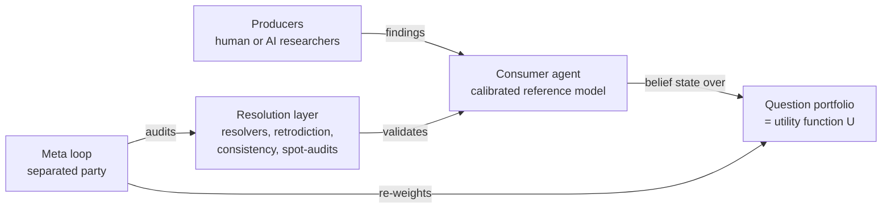

*How to manage research you cannot check: rather than audit the process, meter the output's validated epistemic impact against a weighted question portfolio, the way a trading desk marks its positions. For the fraction of the portfolio that nature resolves, oversight capacity then scales with producer capability.*

:::note
An agenda sketch, more speculative than the other proposals. [Building Strong Reasoners](/proposals/building-strong-reasoners/) lists cheaper experiments that test its components.
:::

## The problem

Labs now delegate research to AI systems and plan to delegate more. In September 2026 OpenAI said that, by its own measurements, it had reached its target of an "automated research intern", a system that carries out well-defined research tasks under human direction, and that it is working toward an automated AI researcher by March 2028 ([OpenAI 2026](https://openai.com/index/research-acceleration-view-inside-openai/); [Help Net Security](https://www.helpnetsecurity.com/2026/09/07/openai-research-automation-intern/)). Systems that automate large parts of the research loop exist; some have lab-validated results, and their failures are well documented ([State of the evidence](/concepts/what-is-a-strong-reasoner/#ai-scientist-systems)). Safety research is among the work to be delegated, which makes this the sharpest form of the oversight problem: managing researchers whose object-level work you cannot check.

*Process auditing* works better than often assumed. [AI control](https://www.redwoodresearch.org/research/ai-control) protocols extract substantial safety from weaker trusted monitors, rubric-based LLM judging grades paper replications at scale ([PaperBench](https://openai.com/index/paperbench/)), and the AI-scientist failure modes Luo et al. tested for (benchmark selection, data leakage, metric misuse, post-hoc selection) are far easier to catch from trace logs and code than from the paper ([Luo et al. 2025](https://arxiv.org/abs/2509.08713)). But deliberate sabotage is harder: in ResearchArena, monitors flagged sabotage hidden in the training data of an AI R&D agent's deliverable less than half the time, and letting them run experiments on the artifact helped without closing the gap ([Libon et al. 2026](https://arxiv.org/abs/2607.19321)). The sibling Delegation Risk wiki collects measured monitor recall from other control evaluations ([Empirical Scheming Reduction](https://delegation-risk.quantifieduncertainty.org/research/trust-behavior/empirical-scheming-reduction/#3-monitor-recall-control-evaluations)). Process auditing's cost grows with output volume, and its reliability falls as the capability gap widens ([Engels et al. 2025](https://arxiv.org/abs/2504.18530)).

The alternative proposed here is **output-metered oversight**: the principal does not follow the work but tracks the program's beliefs, as a trading desk tracks positions. It complements process audits: trace audits catch flaws that leave marks in the logs, control protects against subversion, and metering prices the product. Metering suits what the control literature calls distributed threats, where no single output is catastrophic and evidence accumulates across many ([Wen et al. 2024](https://arxiv.org/abs/2411.17693)). Against a single catastrophic action it does nothing.

## The architecture

1. **Question portfolio.** The program's mission as a few hundred importance-weighted questions: the utility function $U$, set and slowly revised by the human principals. Turning a "key questions" document into ~200 dispute-proof resolvable questions is weeks of specialist work ([Constructing Utility Functions](/concepts/constructing-utility-functions/)), and what is lost there is the first Goodhart step.
2. **Consumer agent.** A calibrated reference model whose belief state over the portfolio is "the book". Its calibration and [consistency](/proposals/consistency-evals/) are evaluated continuously. Current models are not yet adequate. They track the direction of new evidence but update far too little ([Yuan et al. 2025](https://arxiv.org/abs/2509.23936)), which would systematically under-credit producers. Their forecasting is at best roughly level with strong humans, and only on short-horizon questions ([State of the evidence](/concepts/what-is-a-strong-reasoner/#forecasting)).
3. **Producers.** Research agents or teams submit findings. Credit is the validated marginal improvement in the portfolio score, the [Epistemic Impact Analysis](/proposals/epistemic-impact-analysis/) value $V(I, A, U)$, assigned sequentially in the style of a market scoring rule and paid mostly at resolution. Incentive compatibility needs two-sided payoffs: bonded, escrowed credit netted across each producer's [identity-bound history](/environment/identity-and-track-records/), with advances from fast validators treated as loans clawed back at resolution. Confirmation work, which moves beliefs little, is paid from the resolution budget.
4. **Resolution layer.** The enforcement of falsehood nullification: credit is zeroed or clawed back when claims resolve false. It comprises resolvers with pre-registered criteria, retrodiction against held-out facts, consistency checks, and randomized expert spot-audits. The system has exactly the integrity of this layer.
5. **Meta loop, institutionally separated.** A distinct party audits whether high-scoring research improved downstream decisions, and re-weights the portfolio prospectively, with announced lead time. Credit accrues against $U$ as frozen at submission. If the same system both optimizes $V$ and amends it, the architecture is a reward-hacking machine.

## Why this might scale

**For questions nature resolves, oversight capacity scales with producer capability, not overseer capability.** A principal who cannot follow a proof can still see that the portfolio score improved and survived resolution. Strictly, this is mark-to-*model* until resolution. The marks are endogenous and movable by the producers being scored, which is the regime behind Enron's fair-value book and 2008's Level 3 assets. So the analogy holds in proportion to how much of the portfolio resolves. Elsewhere oversight concentrates on the resolution layer, which is still capability-limited but targetable and auditable. Resolving a claim can cost as much as producing it, so the scaling rests on sampling and amortization, and the resolvable fraction is a first-class design parameter.

This is [resolution-grounded oversight](/concepts/oversight-protocols/) applied to a portfolio rather than a single claim, and it supplies what the debate lineage lacks: allocation across claims. Debate aims to verify individual claims, with contested guarantees (obfuscated arguments; mixed gains in [Kenton et al. 2024](https://arxiv.org/abs/2407.04622)) and per-claim cost economics from [doubly-efficient debate](https://arxiv.org/abs/2311.14125). It does not say which claims to verify, at what price, across a bounded budget and thousands of outputs. The system works when the evaluator is harder to fool than the producers are clever, so investment should be biased toward the resolution layer.

For safety research the resolvable region is small. Retrodiction on held-out model behaviors, capability predictions, and replications resolve. The central questions, such as whether a technique prevents deceptive alignment, resolve late, never, or catastrophically. The [ELK report](https://www.alignmentforum.org/posts/qHCDysDnvhteW7kRd/arc-s-first-technical-report-eliciting-latent-knowledge) argues that a producer modeling the resolution process itself (the "human simulator") passes retrodiction and consistency checks while being wrong off-distribution. There this protocol complements judge-grounded methods.

## Lineage and landscape

[Hanson (1995)](https://www.tandfonline.com/doi/abs/10.1080/02691729508578768) proposed allocating scientific credit through betting markets on outcomes, as an alternative to peer review. Forecasters predicting a trusted evaluator's judgment, to stretch scarce evaluation, was proposed as [Prediction-Augmented Evaluation Systems](https://forum.effectivealtruism.org/posts/vgFnJhTiRco8DqBoC/prediction-augmented-evaluation-systems) (2018) and demonstrated in [Amplifying generalist research via forecasting](https://www.lesswrong.com/posts/cLtdcxu9E4noRSons/part-1-amplifying-generalist-research-via-forecasting-models) (2019). This proposal replaces the human evaluator with a calibrated reference model over a weighted portfolio. Paying in proportion to scoring-rule performance, with contracts allocated by bidding, was proposed for human forecasters as [Accuracy Agreements](https://forum.effectivealtruism.org/posts/6aDPZJQDoQmZ2sooM/accuracy-agreements-a-flexible-alternative-to-prediction) (2023).

The feasibility evidence runs both ways.
- Forecasters predicting the value of small projects before execution discriminated good from bad but were [systematically optimistic](https://forum.effectivealtruism.org/posts/qb56nicbnj9asSemx/predicting-the-value-of-small-altruistic-projects-a-proof-of) (2020).
- A [retrospective of 2018–19 LTFF grants](https://forum.effectivealtruism.org/posts/Ps8ecFPBzSrkLC6ip/2018-2019-long-term-future-fund-grantees-how-did-they-do) found that research outputs often existed but were illegible or unpublished. Legibility, not absence, was the validation bottleneck, and output-metering inherits it.
- Replication markets reached roughly 73% accuracy on ~100 resolved claims, with cheap surveys statistically indistinguishable ([Gordon et al. 2021](https://journals.plos.org/plosone/article?id=10.1371/journal.pone.0248780)). DARPA SCORE scaled forecasting to ~3,000 claims but planned to replicate only about 5% of them ([Gordon et al. 2020](https://royalsocietypublishing.org/doi/10.1098/rsos.200566)). The resolution layer is the system.

What exists instead: research-agent benchmarks ([RE-Bench](https://arxiv.org/abs/2411.15114), [MLE-bench](https://arxiv.org/abs/2410.07095), [PaperBench](https://openai.com/index/paperbench/)) score against fixed task metrics or rubrics. Lab oversight agendas ([amplified oversight](https://arxiv.org/abs/2504.01849), [AISI safety cases](https://www.aisi.gov.uk/blog/safety-cases-at-aisi)) are process audits or per-claim judge-grounded evaluations. We know of none that meters producers against a weighted question portfolio.

## Failure modes

- **Persuasion of the consumer.** If credit flows on belief movement alone, the gradient favors rhetoric. As drawn, the update step is the *consultancy* protocol, which does worse than debate under persuasive advocacy ([Michael et al. 2023](https://arxiv.org/abs/2311.08702); [Khan et al. 2024](https://arxiv.org/abs/2402.06782)). Mitigations: pay at resolution (binding only for portfolio weight that resolves on a useful horizon), and make the update adversarial, with counter-producers paid for moving the book the other way.
- **Sabotage the meter rates highly.** A misaligned producer can do subtly worse work that a weaker scorer cannot tell apart from good work. On research proposals, an optimized red team got Opus 4.6 to write proposals worse than GPT-OSS-20B's by a proxy ground truth, which a weak scorer rated as highly as Opus's best ([Terekhov et al. 2026](https://arxiv.org/abs/2606.08892)). Until resolution, the consumer is that weak scorer. Mitigation: weight credit toward resolution, and red-team the consumer's prompt adversarially, as that paper's blue team does.
- **Portfolio fixation.** A fixed question set cannot value research showing that the portfolio asks the wrong questions. Meta-questions help but resolve by panel judgment, which keeps this the most human-dependent component.
- **Resolver corruption and collusion.** Producers and resolvers, or producers sharing a base model with the consumer, may correlate or collude; LLM judges also favor outputs they recognize as their own ([Panickssery et al. 2024](https://arxiv.org/abs/2404.13076)). Mitigations: diverse resolver ensembles with [measured independence](/proposals/building-strong-reasoners/#5-measuring-effective-independence-in-model-panels), randomized audits, and red-team producers rewarded for exposing resolution failures. Producers may also lobby the meta loop instead, or move outcomes rather than resolutions: on questions about the field's own future, the research being scored can make itself come true.
- **Strategic churn and Sybils.** If losses floor at zero, one identity injects an error and a colluder, or the same producer re-keyed, collects on the correction. Withholding and bundling also game sequential credit. Hence the two-sided, identity-bound escrow.
- **Resolution ambiguity.** Disputed and annulled resolutions are a familiar resolution-layer failure on real platforms, and adversarial producers will exploit criteria gaps first. Mitigations: pre-registered criteria, versioned adjudication, and the ambiguity rate tracked as a health metric.
- **Goodharting the portfolio.** Optimizing measurable questions at the expense of unmeasured mission value. The meta loop exists to detect that divergence, which is why its independence is non-negotiable.

## A pilot

The proposal can be tested now, reflexively, on QURI's own output.

1. **Portfolio.** About 200 weighted questions for one domain QURI works in (for example, AI forecasting and epistemics), with weights set by two or more staff independently before scoring begins. Pre-register the questions, weights and resolution criteria.
2. **Consumer.** One pinned frontier model at fixed settings, benchmarked first on a consistency battery and on a few hundred resolved forecasting questions. A second model family is run in parallel to see how much the meter depends on the consumer.
3. **Scoring.** For each of 30–50 QURI posts and papers from 2025–26 published after the consumer's training cutoff, elicit the consumer's portfolio forecasts with and without the item in context, several samples each, and compute the impact score. A placebo arm, with length-matched irrelevant documents in context, measures how far any text moves the book; impact is scored net of it.
4. **Comparison.** Collect the staff's retrospective ranking of which items mattered, made blind to the meter's scores, and compare both with outside readership.

Our rough scale estimate, not a quote: if one call answers all 200 questions at once (checked against one-question calls on a subsample, since batching may itself shift answers), 50 items × 5 samples × 2 consumers is about 500 long-context calls plus the baseline and placebo runs, likely tens to low hundreds of dollars at 2026 list prices. Building the portfolio is the expensive part, at the weeks of specialist work noted above.

The divergences are the deliverable. Where the meter and the judgment disagree, the portfolio is mis-weighted (meta-loop data), the consumer is miscalibrated (eval data), or the intuition is wrong (the interesting case). Pre-registered failure conditions: the meter is measuring prestige and phrasing, not epistemic impact, if its scores are predicted as well by length and venue as by content or are unstable under question rewording; it is measuring the consumer, not the item, if the two consumer models' rankings barely correlate.

## Open questions

- What incentive guarantees can be proven, and under what assumptions about consumer calibration and resolver integrity?
- How should credit be split between *surprise now* and *validation later*, keeping both incentives and cash flow workable for long-horizon research?
- Can a portfolio value exploratory work whose impact runs through questions not yet asked?
- What is the minimal institutional separation for the meta loop that survives organizational pressure?
- How should this compose with trace audits and judge-grounded protocols for the parts of a research mission that never resolve?
